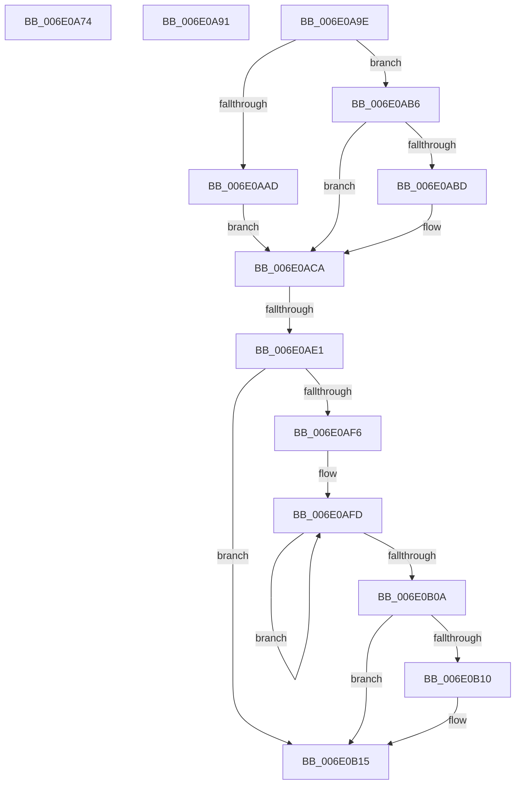

# sub_006E0A74

- RVA: `0x006E0A74`–`0x006E0B25` (길이 `177` bytes)
- VA: `0x00000001406E0A74`
- 실행 섹션: `.text`
- PDB 이름 있음: `아니요`; PDB Function 태그: `아니요`
- unwind 정보 RVA: `0x00073954`
- 디코드: `39`개 명령, `177/177` bytes 표시
- 미해석 바이트: `0` (있으면 어셈블리에 `.byte`로 보존)

> 이 문서는 커널 이미지의 기계어와 PDB 기호를 분석해 생성했습니다. 4번과 5번은 함수 원형과 자료형을 바이너리 사용 방식에서 추정한 C 해석이며 원본 소스 복구 결과는 아닙니다.

## 1. Dependencies

- 직접 호출 지점: **1**; 고유 호출 대상: **1**
- 직접 호출자로 확인된 함수: **0**
- RIP 상대 이미지 참조: **0**

### Outgoing calls
- `0x006E0B10` → [KiRemoveSystemWorkPriorityKick](../26/KiRemoveSystemWorkPriorityKick_function_002631D0.md) (function, `0x002631D0`)

### Direct callers
- 이 함수 시작 RVA로 연결되는 직접 call은 확인되지 않았습니다. 간접 호출은 완전히 역산할 수 없습니다.

### Static image references
- 디코드된 RIP-relative 메모리 참조가 없습니다.

## 2. Other-region calls and transfers

- 다른 실행 섹션으로 향하는 call: **0**
- call이 아닌 외부 분기/꼬리 이동: **4**
  - `0x006E0A8C` → [HvlDmaMapDeviceLogicalRange + 0x289](../30/HvlDmaMapDeviceLogicalRange_function_003077D0.md) (`tail-transfer`)
  - `0x006E0A99` → [HvlDmaMapDeviceLogicalRange + 0x1B4](../30/HvlDmaMapDeviceLogicalRange_function_003077D0.md) (`tail-transfer`)
  - `0x006E0ADB` → [HvlDmaMapDeviceLogicalRange + 0x1B4](../30/HvlDmaMapDeviceLogicalRange_function_003077D0.md) (`tail-transfer`)
  - `0x006E0B20` → [HvlDmaMapDeviceLogicalRange + 0x1B4](../30/HvlDmaMapDeviceLogicalRange_function_003077D0.md) (`tail-transfer`)

## 3. Assembly (complete function range)

```asm
006E0A74  88 44 24 48                     mov byte ptr [rsp + 0x48], al
006E0A78  65 48 8B 04 25 20 00 00 00      mov rax, qword ptr gs:[0x20]
006E0A81  48 8B 88 00 8C 00 00            mov rcx, qword ptr [rax + 0x8c00]
006E0A88  48 8B 79 10                     mov rdi, qword ptr [rcx + 0x10]
006E0A8C  E9 C8 6F C2 FF                  jmp 0x140307a59
006E0A91  40 0F B6 C6                     movzx eax, sil
006E0A95  44 0F 22 C0                     mov cr8, rax
006E0A99  E9 E6 6E C2 FF                  jmp 0x140307984
006E0A9E  65 48 8B 0C 25 20 00 00 00      mov rcx, qword ptr gs:[0x20]
006E0AA7  84 54 24 4C                     test byte ptr [rsp + 0x4c], dl
006E0AAB  74 09                           je 0x1406e0ab6
006E0AAD  48 8B 81 00 8C 00 00            mov rax, qword ptr [rcx + 0x8c00]
006E0AB4  EB 14                           jmp 0x1406e0aca
006E0AB6  F6 44 24 4C 02                  test byte ptr [rsp + 0x4c], 2
006E0ABB  74 0D                           je 0x1406e0aca
006E0ABD  48 8B 81 00 8C 00 00            mov rax, qword ptr [rcx + 0x8c00]
006E0AC4  48 05 00 10 00 00               add rax, 0x1000
006E0ACA  40 8A 74 24 48                  mov sil, byte ptr [rsp + 0x48]
006E0ACF  48 8B 7C 24 58                  mov rdi, qword ptr [rsp + 0x58]
006E0AD4  48 89 78 10                     mov qword ptr [rax + 0x10], rdi
006E0AD8  40 84 F6                        test sil, sil
006E0ADB  0F 84 A3 6E C2 FF               je 0x140307984
006E0AE1  65 48 8B 0C 25 20 00 00 00      mov rcx, qword ptr gs:[0x20]
006E0AEA  4C 8B 81 B8 8E 00 00            mov r8, qword ptr [rcx + 0x8eb8]
006E0AF1  4D 85 C0                        test r8, r8
006E0AF4  74 1F                           je 0x1406e0b15
006E0AF6  41 0F 0D 08                     prefetchw byte ptr [r8]
006E0AFA  41 8B 00                        mov eax, dword ptr [r8]
006E0AFD  8B D0                           mov edx, eax
006E0AFF  0F BA F2 15                     btr edx, 0x15
006E0B03  F0 41 0F B1 10                  lock cmpxchg dword ptr [r8], edx
006E0B08  75 F3                           jne 0x1406e0afd
006E0B0A  0F BA E0 15                     bt eax, 0x15
006E0B0E  73 05                           jae 0x1406e0b15
006E0B10  E8 BB 26 B8 FF                  call 0x1402631d0
006E0B15  FB                              sti
006E0B16  48 8B 7C 24 58                  mov rdi, qword ptr [rsp + 0x58]
006E0B1B  40 8A 74 24 48                  mov sil, byte ptr [rsp + 0x48]
006E0B20  E9 5F 6E C2 FF                  jmp 0x140307984
```

## 4. C-style interpretation (structured pseudocode)

```c
__int64 __fastcall sub_006E0A74(void)
{
    unsigned __int8 v_stack_p48;
    unsigned __int8 v_stack_p4C;
    unsigned __int64 v_stack_p58;

    v_stack_p48 = (unsigned __int8)(result);
}
```

## 5. (Beta) C Style

```c
void sub_006E0A74(void)
{
    uint8_t v_stack_p48;
    uint8_t v_stack_p4C;
    uint64_t v_stack_p58;

    v_stack_p48 = (uint8_t)(result);
}
```

## 6. Execution-region graph

[열기: 2D/3D 그래프와 함수 탐색 컨트롤 패널](../../../control-panel.html?section=text&rva=0x006E0A74&view=graph)

- 2D 그래프는 위에서 아래로 흐르고, 3D 그래프는 빈 공간을 드래그해 회전합니다. Shift+드래그는 이동, 휠은 확대·축소, 함수 노드 선택은 대상 보고서 이동입니다.

### Static fallback


