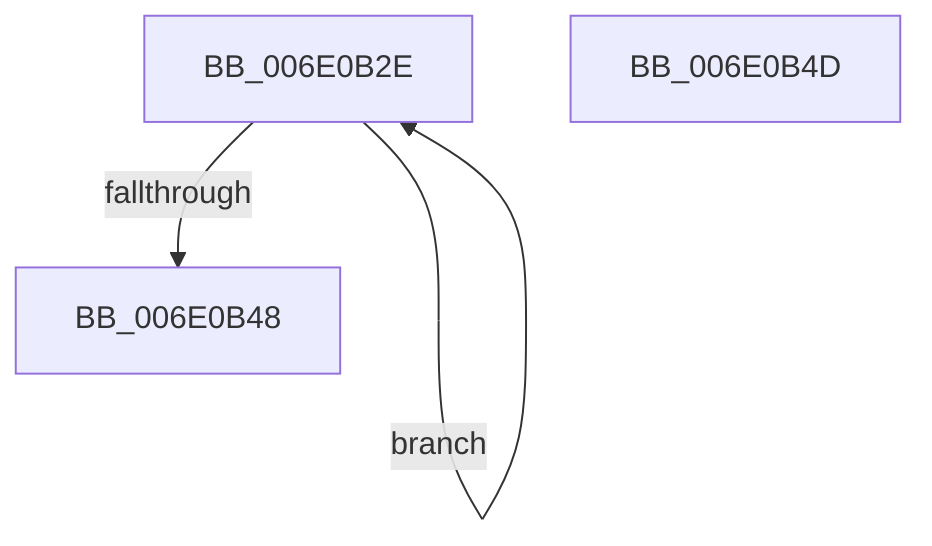

# sub_006E0B2E

- RVA: `0x006E0B2E`–`0x006E0B5F` (길이 `49` bytes)
- VA: `0x00000001406E0B2E`
- 실행 섹션: `.text`
- PDB 이름 있음: `아니요`; PDB Function 태그: `아니요`
- unwind 정보 RVA: `0x00073980`
- 디코드: `13`개 명령, `49/49` bytes 표시
- 미해석 바이트: `0` (있으면 어셈블리에 `.byte`로 보존)

> 이 문서는 커널 이미지의 기계어와 PDB 기호를 분석해 생성했습니다. 4번과 5번은 함수 원형과 자료형을 바이너리 사용 방식에서 추정한 C 해석이며 원본 소스 복구 결과는 아닙니다.

## 1. Dependencies

- 직접 호출 지점: **2**; 고유 호출 대상: **1**
- 직접 호출자로 확인된 함수: **0**
- RIP 상대 이미지 참조: **0**

### Outgoing calls
- `0x006E0B3D` → [HalpIommuDomainFreeLogicalAddressRange](../30/HalpIommuDomainFreeLogicalAddressRange_function_003070EC.md) (function, `0x003070EC`)
- `0x006E0B54` → [HalpIommuDomainFreeLogicalAddressRange](../30/HalpIommuDomainFreeLogicalAddressRange_function_003070EC.md) (function, `0x003070EC`)

### Direct callers
- 이 함수 시작 RVA로 연결되는 직접 call은 확인되지 않았습니다. 간접 호출은 완전히 역산할 수 없습니다.

### Static image references
- 디코드된 RIP-relative 메모리 참조가 없습니다.

## 2. Other-region calls and transfers

- 다른 실행 섹션으로 향하는 call: **0**
- call이 아닌 외부 분기/꼬리 이동: **2**
  - `0x006E0B48` → [IommuMapIdentityRangeEx + 0x128](../30/IommuMapIdentityRangeEx_function_00307C10.md) (`tail-transfer`)
  - `0x006E0B5A` → [IommuMapIdentityRangeEx + 0x128](../30/IommuMapIdentityRangeEx_function_00307C10.md) (`tail-transfer`)

## 3. Assembly (complete function range)

```asm
006E0B2E  49 8B 14 DC                     mov rdx, qword ptr [r12 + rbx*8]
006E0B32  49 8B CE                        mov rcx, r14
006E0B35  48 C1 E2 0C                     shl rdx, 0xc
006E0B39  48 89 55 58                     mov qword ptr [rbp + 0x58], rdx
006E0B3D  E8 AA 65 C2 FF                  call 0x1403070ec
006E0B42  48 83 EB 01                     sub rbx, 1
006E0B46  79 E6                           jns 0x1406e0b2e
006E0B48  E9 EB 71 C2 FF                  jmp 0x140307d38
006E0B4D  48 8B 55 58                     mov rdx, qword ptr [rbp + 0x58]
006E0B51  49 8B CE                        mov rcx, r14
006E0B54  E8 93 65 C2 FF                  call 0x1403070ec
006E0B59  90                              nop
006E0B5A  E9 D9 71 C2 FF                  jmp 0x140307d38
```

## 4. C-style interpretation (structured pseudocode)

```c
__int64 __fastcall sub_006E0B2E(void)
{
    __int64 result;
    __int64 v_rbx;

    a2 = (*(unsigned __int64 *)(v_r12 + v_rbx * 8)) << (12);
    *(unsigned __int64 *)(v_rbp + 88) = a2;
    result = HalpIommuDomainFreeLogicalAddressRange(v_r14, a2, a3, a4);
    v_rbx = (v_rbx) - (1);
    if (!sign_flag) goto loc_006E0B2E;
}
```

## 5. (Beta) C Style

```c
void sub_006E0B2E(void)
{
    int64_t result;
    int64_t local_rbx;

    a2 = (*(uint64_t *)(local_r12 + local_rbx * 8)) << (12);
    *(uint64_t *)(local_rbp + 0x58) = a2;
    result = HalpIommuDomainFreeLogicalAddressRange(local_r14, a2, a3, a4);
    local_rbx = (local_rbx) - (1);
    if (!sign_flag) goto loc_006E0B2E;
}
```

## 6. Execution-region graph

[열기: 2D/3D 그래프와 함수 탐색 컨트롤 패널](../../../control-panel.html?section=text&rva=0x006E0B2E&view=graph)

- 2D 그래프는 위에서 아래로 흐르고, 3D 그래프는 빈 공간을 드래그해 회전합니다. Shift+드래그는 이동, 휠은 확대·축소, 함수 노드 선택은 대상 보고서 이동입니다.

### Static fallback


