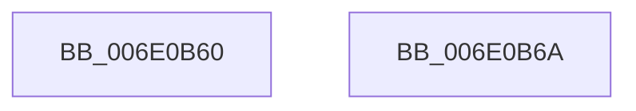

# sub_006E0B60

- RVA: `0x006E0B60`–`0x006E0B80` (길이 `32` bytes)
- VA: `0x00000001406E0B60`
- 실행 섹션: `.text`
- PDB 이름 있음: `아니요`; PDB Function 태그: `아니요`
- unwind 정보 RVA: `0x00073A44`
- 디코드: `8`개 명령, `32/32` bytes 표시
- 미해석 바이트: `0` (있으면 어셈블리에 `.byte`로 보존)

> 이 문서는 커널 이미지의 기계어와 PDB 기호를 분석해 생성했습니다. 4번과 5번은 함수 원형과 자료형을 바이너리 사용 방식에서 추정한 C 해석이며 원본 소스 복구 결과는 아닙니다.

## 1. Dependencies

- 직접 호출 지점: **0**; 고유 호출 대상: **0**
- 직접 호출자로 확인된 함수: **0**
- RIP 상대 이미지 참조: **0**

### Outgoing calls
- 직접 디코드된 call 명령이 없습니다.

### Direct callers
- 이 함수 시작 RVA로 연결되는 직접 call은 확인되지 않았습니다. 간접 호출은 완전히 역산할 수 없습니다.

### Static image references
- 디코드된 RIP-relative 메모리 참조가 없습니다.

## 2. Other-region calls and transfers

- 다른 실행 섹션으로 향하는 call: **0**
- call이 아닌 외부 분기/꼬리 이동: **2**
  - `0x006E0B65` → [MiFlushCacheForAttributeChange + 0x55](../30/MiFlushCacheForAttributeChange_function_00308944.md) (`tail-transfer`)
  - `0x006E0B7B` → [MiFlushCacheForAttributeChange + 0x6F](../30/MiFlushCacheForAttributeChange_function_00308944.md) (`tail-transfer`)

## 3. Assembly (complete function range)

```asm
006E0B60  F0 44 09 2C 24                  lock or dword ptr [rsp], r13d
006E0B65  E9 2F 7E C2 FF                  jmp 0x140308999
006E0B6A  48 3B C7                        cmp rax, rdi
006E0B6D  48 8B CF                        mov rcx, rdi
006E0B70  48 0F 43 C8                     cmovae rcx, rax
006E0B74  48 2B CF                        sub rcx, rdi
006E0B77  48 01 4D 00                     add qword ptr [rbp], rcx
006E0B7B  E9 33 7E C2 FF                  jmp 0x1403089b3
```

## 4. C-style interpretation (structured pseudocode)

```c
void __fastcall sub_006E0B60(void)
{
    unsigned int v_stack_p0;
}
```

## 5. (Beta) C Style

```c
void sub_006E0B60(void)
{
    uint32_t v_stack_p0;
}
```

## 6. Execution-region graph

[열기: 2D/3D 그래프와 함수 탐색 컨트롤 패널](../../../control-panel.html?section=text&rva=0x006E0B60&view=graph)

- 2D 그래프는 위에서 아래로 흐르고, 3D 그래프는 빈 공간을 드래그해 회전합니다. Shift+드래그는 이동, 휠은 확대·축소, 함수 노드 선택은 대상 보고서 이동입니다.

### Static fallback


