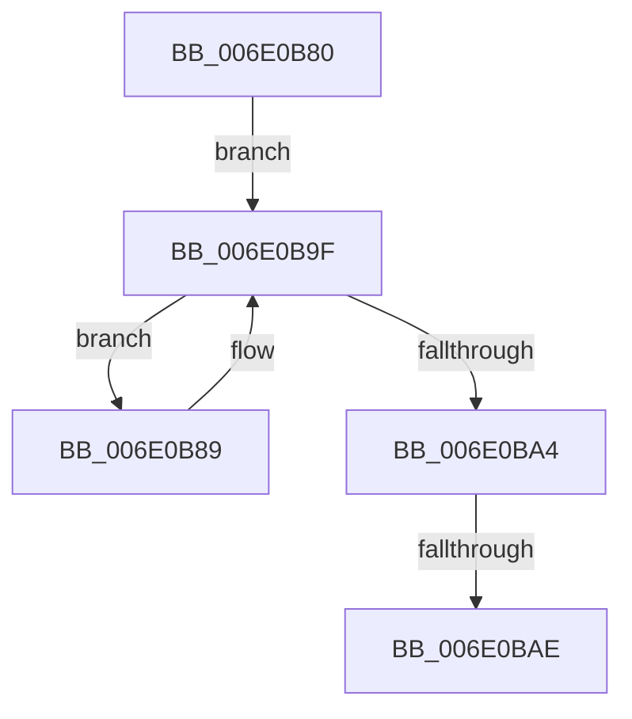

# sub_006E0B80

- RVA: `0x006E0B80`–`0x006E0BC0` (길이 `64` bytes)
- VA: `0x00000001406E0B80`
- 실행 섹션: `.text`
- PDB 이름 있음: `아니요`; PDB Function 태그: `아니요`
- unwind 정보 RVA: `0x00073B64`
- 디코드: `17`개 명령, `64/64` bytes 표시
- 미해석 바이트: `0` (있으면 어셈블리에 `.byte`로 보존)

> 이 문서는 커널 이미지의 기계어와 PDB 기호를 분석해 생성했습니다. 4번과 5번은 함수 원형과 자료형을 바이너리 사용 방식에서 추정한 C 해석이며 원본 소스 복구 결과는 아닙니다.

## 1. Dependencies

- 직접 호출 지점: **2**; 고유 호출 대상: **2**
- 직접 호출자로 확인된 함수: **0**
- RIP 상대 이미지 참조: **0**

### Outgoing calls
- `0x006E0B97` → [IommuFlushTb](../56/IommuFlushTb_function_005656B0.md) (function, `0x005656B0`)
- `0x006E0BB5` → [ExReleaseSpinLockShared](../2F/ExReleaseSpinLockShared_function_002F0EF0.md) (function, `0x002F0EF0`)

### Direct callers
- 이 함수 시작 RVA로 연결되는 직접 call은 확인되지 않았습니다. 간접 호출은 완전히 역산할 수 없습니다.

### Static image references
- 디코드된 RIP-relative 메모리 참조가 없습니다.

## 2. Other-region calls and transfers

- 다른 실행 섹션으로 향하는 call: **0**
- call이 아닌 외부 분기/꼬리 이동: **2**
  - `0x006E0BA8` → [HalpIommuFlushDmaDomain + 0x75](../30/HalpIommuFlushDmaDomain_function_003093B4.md) (`tail-transfer`)
  - `0x006E0BBB` → [HalpIommuFlushDmaDomain + 0x75](../30/HalpIommuFlushDmaDomain_function_003093B4.md) (`tail-transfer`)

## 3. Assembly (complete function range)

```asm
006E0B80  4C 8D 73 48                     lea r14, [rbx + 0x48]
006E0B84  49 8B 36                        mov rsi, qword ptr [r14]
006E0B87  EB 16                           jmp 0x1406e0b9f
006E0B89  48 8B 4E 18                     mov rcx, qword ptr [rsi + 0x18]
006E0B8D  4C 8D 44 24 58                  lea r8, [rsp + 0x58]
006E0B92  BA 01 00 00 00                  mov edx, 1
006E0B97  E8 14 4B E8 FF                  call 0x1405656b0
006E0B9C  48 8B 36                        mov rsi, qword ptr [rsi]
006E0B9F  49 3B F6                        cmp rsi, r14
006E0BA2  75 E5                           jne 0x1406e0b89
006E0BA4  40 80 FD 0F                     cmp bpl, 0xf
006E0BA8  0F 84 7B 88 C2 FF               je 0x140309429
006E0BAE  48 8D 4B 58                     lea rcx, [rbx + 0x58]
006E0BB2  40 8A D7                        mov dl, dil
006E0BB5  E8 36 03 C1 FF                  call 0x1402f0ef0
006E0BBA  90                              nop
006E0BBB  E9 69 88 C2 FF                  jmp 0x140309429
```

## 4. C-style interpretation (structured pseudocode)

```c
__int64 __fastcall sub_006E0B80(__int64 a1, __int64 a2, __int64 a3, __int64 a4, __int64 a5, __int64 a6, __int64 a7, __int64 a8, __int64 a9, __int64 a10, __int64 a11)
{
    __int64 result;

    goto loc_006E0B9F;
loc_006E0B89:
    result = IommuFlushTb(*(unsigned __int64 *)(*(unsigned __int64 *)(v_rbx + 72) + 24), 1, a11, a4);
loc_006E0B9F:
    if ((*(unsigned __int64 *)(*(unsigned __int64 *)(v_rbx + 72))) != (v_rbx + 72)) goto loc_006E0B89;
    result = ExReleaseSpinLockShared(v_rbx + 88, (unsigned __int8)(v_rdi), a11, a4);
}
```

## 5. (Beta) C Style

```c
int64_t sub_006E0B80(int64_t Arg1, int64_t Arg2, int64_t Arg3, int64_t Arg4, uint64_t Arg5, uint64_t Arg6, uint64_t Arg7, uint64_t Arg8, uint64_t Arg9, uint64_t Arg10, int64_t Arg11)
{
    int64_t result;

    goto loc_006E0B9F;
loc_006E0B89:
    result = IommuFlushTb(*(uint64_t *)(*(uint64_t *)(local_rbx + 0x48) + 0x18), 1, Arg11, Arg4);
loc_006E0B9F:
    if ((*(uint64_t *)(*(uint64_t *)(local_rbx + 0x48))) != (local_rbx + 72)) goto loc_006E0B89;
    result = ExReleaseSpinLockShared(local_rbx + 88, (uint8_t)(local_rdi), Arg11, Arg4);
}
```

## 6. Execution-region graph

[열기: 2D/3D 그래프와 함수 탐색 컨트롤 패널](../../../control-panel.html?section=text&rva=0x006E0B80&view=graph)

- 2D 그래프는 위에서 아래로 흐르고, 3D 그래프는 빈 공간을 드래그해 회전합니다. Shift+드래그는 이동, 휠은 확대·축소, 함수 노드 선택은 대상 보고서 이동입니다.

### Static fallback


