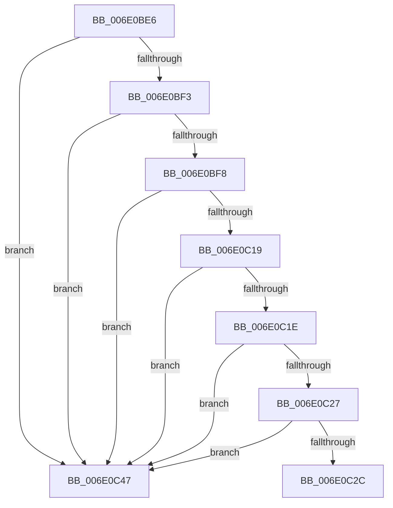

# sub_006E0BE6

- RVA: `0x006E0BE6`–`0x006E0C4E` (길이 `104` bytes)
- VA: `0x00000001406E0BE6`
- 실행 섹션: `.text`
- PDB 이름 있음: `아니요`; PDB Function 태그: `아니요`
- unwind 정보 RVA: `0x00073BBC`
- 디코드: `31`개 명령, `104/104` bytes 표시
- 미해석 바이트: `0` (있으면 어셈블리에 `.byte`로 보존)

> 이 문서는 커널 이미지의 기계어와 PDB 기호를 분석해 생성했습니다. 4번과 5번은 함수 원형과 자료형을 바이너리 사용 방식에서 추정한 C 해석이며 원본 소스 복구 결과는 아닙니다.

## 1. Dependencies

- 직접 호출 지점: **0**; 고유 호출 대상: **0**
- 직접 호출자로 확인된 함수: **0**
- RIP 상대 이미지 참조: **0**

### Outgoing calls
- 직접 디코드된 call 명령이 없습니다.

### Direct callers
- 이 함수 시작 RVA로 연결되는 직접 call은 확인되지 않았습니다. 간접 호출은 완전히 역산할 수 없습니다.

### Static image references
- 디코드된 RIP-relative 메모리 참조가 없습니다.

## 2. Other-region calls and transfers

- 다른 실행 섹션으로 향하는 call: **0**
- call이 아닌 외부 분기/꼬리 이동: **1**
  - `0x006E0C42` → [KiMoveScbThreadsToNewReadylist + 0x101](../30/KiMoveScbThreadsToNewReadylist_function_003099AC.md) (`tail-transfer`)

## 3. Assembly (complete function range)

```asm
006E0BE6  48 8B 0B                        mov rcx, qword ptr [rbx]
006E0BE9  4C 8B 43 08                     mov r8, qword ptr [rbx + 8]
006E0BED  48 39 59 08                     cmp qword ptr [rcx + 8], rbx
006E0BF1  75 54                           jne 0x1406e0c47
006E0BF3  49 39 18                        cmp qword ptr [r8], rbx
006E0BF6  75 4F                           jne 0x1406e0c47
006E0BF8  8B 54 24 30                     mov edx, dword ptr [rsp + 0x30]
006E0BFC  49 89 08                        mov qword ptr [r8], rcx
006E0BFF  4C 89 41 08                     mov qword ptr [rcx + 8], r8
006E0C03  48 C1 E2 04                     shl rdx, 4
006E0C07  48 03 54 24 38                  add rdx, qword ptr [rsp + 0x38]
006E0C0C  48 8B 02                        mov rax, qword ptr [rdx]
006E0C0F  4C 8B 4A 08                     mov r9, qword ptr [rdx + 8]
006E0C13  48 39 50 08                     cmp qword ptr [rax + 8], rdx
006E0C17  75 2E                           jne 0x1406e0c47
006E0C19  49 39 11                        cmp qword ptr [r9], rdx
006E0C1C  75 29                           jne 0x1406e0c47
006E0C1E  48 8B 01                        mov rax, qword ptr [rcx]
006E0C21  48 39 48 08                     cmp qword ptr [rax + 8], rcx
006E0C25  75 20                           jne 0x1406e0c47
006E0C27  49 39 08                        cmp qword ptr [r8], rcx
006E0C2A  75 1B                           jne 0x1406e0c47
006E0C2C  49 89 09                        mov qword ptr [r9], rcx
006E0C2F  48 8B 41 08                     mov rax, qword ptr [rcx + 8]
006E0C33  48 89 42 08                     mov qword ptr [rdx + 8], rax
006E0C37  48 8B 41 08                     mov rax, qword ptr [rcx + 8]
006E0C3B  48 89 10                        mov qword ptr [rax], rdx
006E0C3E  4C 89 49 08                     mov qword ptr [rcx + 8], r9
006E0C42  E9 66 8E C2 FF                  jmp 0x140309aad
006E0C47  B9 03 00 00 00                  mov ecx, 3
006E0C4C  CD 29                           int 0x29
```

## 4. C-style interpretation (structured pseudocode)

```c
__int64 __fastcall sub_006E0BE6(__int64 a1, __int64 a2, __int64 a3, __int64 a4, __int64 a5, unsigned int a6, __int64 a7)
{
    if ((*(unsigned __int64 *)(*(unsigned __int64 *)(v_rbx) + 8)) != v_rbx) goto loc_006E0C47;
    if ((*(unsigned __int64 *)(*(unsigned __int64 *)(v_rbx + 8))) != v_rbx) goto loc_006E0C47;
    *(unsigned __int64 *)(*(unsigned __int64 *)(v_rbx + 8)) = *(unsigned __int64 *)(v_rbx);
    *(unsigned __int64 *)(*(unsigned __int64 *)(v_rbx) + 8) = *(unsigned __int64 *)(v_rbx + 8);
    a2 = ((unsigned int)(a6)) << (4);
    a2 = (a2) + (a7);
    if ((*(unsigned __int64 *)(*(unsigned __int64 *)(a2) + 8)) != a2) goto loc_006E0C47;
    if ((*(unsigned __int64 *)(*(unsigned __int64 *)(a2 + 8))) != a2) goto loc_006E0C47;
    if ((*(unsigned __int64 *)(*(unsigned __int64 *)(*(unsigned __int64 *)(v_rbx)) + 8)) != (*(unsigned __int64 *)(v_rbx))) goto loc_006E0C47;
    if ((*(unsigned __int64 *)(*(unsigned __int64 *)(v_rbx + 8))) != (*(unsigned __int64 *)(v_rbx))) goto loc_006E0C47;
    *(unsigned __int64 *)(*(unsigned __int64 *)(a2 + 8)) = *(unsigned __int64 *)(v_rbx);
    *(unsigned __int64 *)(a2 + 8) = *(unsigned __int64 *)(*(unsigned __int64 *)(v_rbx) + 8);
    *(unsigned __int64 *)(*(unsigned __int64 *)(*(unsigned __int64 *)(v_rbx) + 8)) = a2;
    *(unsigned __int64 *)(*(unsigned __int64 *)(v_rbx) + 8) = *(unsigned __int64 *)(a2 + 8);
loc_006E0C47:
    return *(unsigned __int64 *)(*(unsigned __int64 *)(v_rbx) + 8);
}
```

## 5. (Beta) C Style

```c
int64_t sub_006E0BE6(int64_t Arg1, int64_t Arg2, int64_t Arg3, int64_t Arg4, uint64_t Arg5, uint32_t Arg6, int64_t Arg7)
{
    if ((*(uint64_t *)(*(uint64_t *)(local_rbx) + 0x8)) != local_rbx) goto loc_006E0C47;
    if ((*(uint64_t *)(*(uint64_t *)(local_rbx + 0x8))) != local_rbx) goto loc_006E0C47;
    *(uint64_t *)(*(uint64_t *)(local_rbx + 0x8)) = *(uint64_t *)(local_rbx);
    *(uint64_t *)(*(uint64_t *)(local_rbx) + 0x8) = *(uint64_t *)(local_rbx + 0x8);
    Arg2 = ((uint32_t)(Arg6)) << (4);
    Arg2 = (Arg2) + (Arg7);
    if ((*(uint64_t *)(*(uint64_t *)(Arg2) + 0x8)) != Arg2) goto loc_006E0C47;
    if ((*(uint64_t *)(*(uint64_t *)(Arg2 + 0x8))) != Arg2) goto loc_006E0C47;
    if ((*(uint64_t *)(*(uint64_t *)(*(uint64_t *)(local_rbx)) + 0x8)) != (*(uint64_t *)(local_rbx))) goto loc_006E0C47;
    if ((*(uint64_t *)(*(uint64_t *)(local_rbx + 0x8))) != (*(uint64_t *)(local_rbx))) goto loc_006E0C47;
    *(uint64_t *)(*(uint64_t *)(Arg2 + 0x8)) = *(uint64_t *)(local_rbx);
    *(uint64_t *)(Arg2 + 0x8) = *(uint64_t *)(*(uint64_t *)(local_rbx) + 0x8);
    *(uint64_t *)(*(uint64_t *)(*(uint64_t *)(local_rbx) + 0x8)) = Arg2;
    *(uint64_t *)(*(uint64_t *)(local_rbx) + 0x8) = *(uint64_t *)(Arg2 + 0x8);
loc_006E0C47:
    return *(uint64_t *)(*(uint64_t *)(local_rbx) + 0x8);
}
```

## 6. Execution-region graph

[열기: 2D/3D 그래프와 함수 탐색 컨트롤 패널](../../../control-panel.html?section=text&rva=0x006E0BE6&view=graph)

- 2D 그래프는 위에서 아래로 흐르고, 3D 그래프는 빈 공간을 드래그해 회전합니다. Shift+드래그는 이동, 휠은 확대·축소, 함수 노드 선택은 대상 보고서 이동입니다.

### Static fallback


