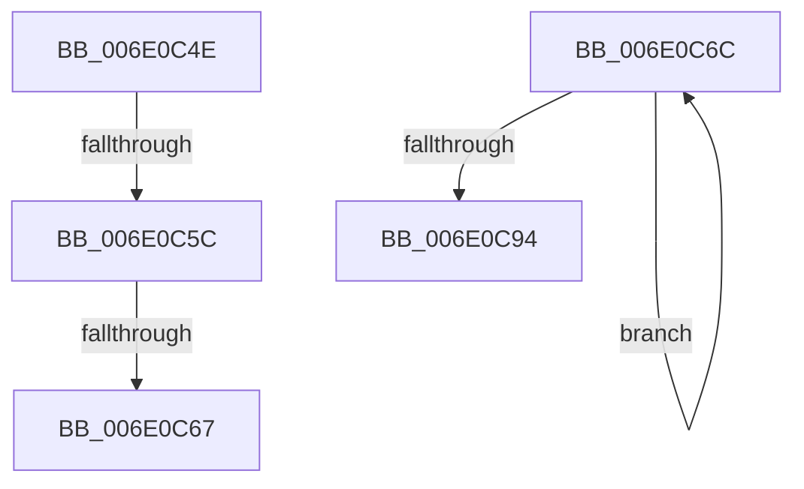

# sub_006E0C4E

- RVA: `0x006E0C4E`–`0x006E0CAE` (길이 `96` bytes)
- VA: `0x00000001406E0C4E`
- 실행 섹션: `.text`
- PDB 이름 있음: `아니요`; PDB Function 태그: `아니요`
- unwind 정보 RVA: `0x00073CA8`
- 디코드: `23`개 명령, `96/96` bytes 표시
- 미해석 바이트: `0` (있으면 어셈블리에 `.byte`로 보존)

> 이 문서는 커널 이미지의 기계어와 PDB 기호를 분석해 생성했습니다. 4번과 5번은 함수 원형과 자료형을 바이너리 사용 방식에서 추정한 C 해석이며 원본 소스 복구 결과는 아닙니다.

## 1. Dependencies

- 직접 호출 지점: **2**; 고유 호출 대상: **2**
- 직접 호출자로 확인된 함수: **0**
- RIP 상대 이미지 참조: **0**

### Outgoing calls
- `0x006E0C84` → [KiCompleteRescheduleContextEntry](../35/KiCompleteRescheduleContextEntry_function_00356330.md) (function, `0x00356330`)
- `0x006E0CA3` → [KiFlushSoftwareInterruptBatch](../25/KiFlushSoftwareInterruptBatch_function_00252200.md) (function, `0x00252200`)

### Direct callers
- 이 함수 시작 RVA로 연결되는 직접 call은 확인되지 않았습니다. 간접 호출은 완전히 역산할 수 없습니다.

### Static image references
- 디코드된 RIP-relative 메모리 참조가 없습니다.

## 2. Other-region calls and transfers

- 다른 실행 섹션으로 향하는 call: **0**
- call이 아닌 외부 분기/꼬리 이동: **4**
  - `0x006E0C56` → [KiGroupSchedulingQuantumEnd + 0x3A6](../30/KiGroupSchedulingQuantumEnd_function_0030B220.md) (`tail-transfer`)
  - `0x006E0C61` → [KiGroupSchedulingQuantumEnd + 0x185](../30/KiGroupSchedulingQuantumEnd_function_0030B220.md) (`tail-transfer`)
  - `0x006E0C67` → [KiGroupSchedulingQuantumEnd + 0x3A6](../30/KiGroupSchedulingQuantumEnd_function_0030B220.md) (`tail-transfer`)
  - `0x006E0CA9` → [KiGroupSchedulingQuantumEnd + 0x1E4](../30/KiGroupSchedulingQuantumEnd_function_0030B220.md) (`tail-transfer`)

## 3. Assembly (complete function range)

```asm
006E0C4E  49 3B DE                        cmp rbx, r14
006E0C51  BB 01 00 00 00                  mov ebx, 1
006E0C56  0F 84 6A A9 C2 FF               je 0x14030b5c6
006E0C5C  40 38 7C 24 20                  cmp byte ptr [rsp + 0x20], dil
006E0C61  0F 84 3E A7 C2 FF               je 0x14030b3a5
006E0C67  E9 5A A9 C2 FF                  jmp 0x14030b5c6
006E0C6C  41 8B CF                        mov ecx, r15d
006E0C6F  45 33 C9                        xor r9d, r9d
006E0C72  48 83 C1 02                     add rcx, 2
006E0C76  45 33 C0                        xor r8d, r8d
006E0C79  48 8B D5                        mov rdx, rbp
006E0C7C  4A 8D 0C B9                     lea rcx, [rcx + r15*4]
006E0C80  48 8D 0C CE                     lea rcx, [rsi + rcx*8]
006E0C84  E8 A7 56 C7 FF                  call 0x140356330
006E0C89  0F B6 06                        movzx eax, byte ptr [rsi]
006E0C8C  45 03 FD                        add r15d, r13d
006E0C8F  44 3B F8                        cmp r15d, eax
006E0C92  72 D8                           jb 0x1406e0c6c
006E0C94  4C 8B AC 24 A0 00 00 00         mov r13, qword ptr [rsp + 0xa0]
006E0C9C  48 8D 8D D8 35 00 00            lea rcx, [rbp + 0x35d8]
006E0CA3  E8 58 15 B7 FF                  call 0x140252200
006E0CA8  90                              nop
006E0CA9  E9 56 A7 C2 FF                  jmp 0x14030b404
```

## 4. C-style interpretation (structured pseudocode)

```c
__int64 __fastcall sub_006E0C4E(__int64 a1, __int64 a2, int a3, int a4)
{
    unsigned __int8 v_stack_p20;
    unsigned __int64 v_stack_pA0;
}
```

## 5. (Beta) C Style

```c
int64_t sub_006E0C4E(int64_t Arg1, int64_t Arg2, int32_t Arg3, int32_t Arg4)
{
    uint8_t v_stack_p20;
    uint64_t v_stack_pA0;
}
```

## 6. Execution-region graph

[열기: 2D/3D 그래프와 함수 탐색 컨트롤 패널](../../../control-panel.html?section=text&rva=0x006E0C4E&view=graph)

- 2D 그래프는 위에서 아래로 흐르고, 3D 그래프는 빈 공간을 드래그해 회전합니다. Shift+드래그는 이동, 휠은 확대·축소, 함수 노드 선택은 대상 보고서 이동입니다.

### Static fallback


