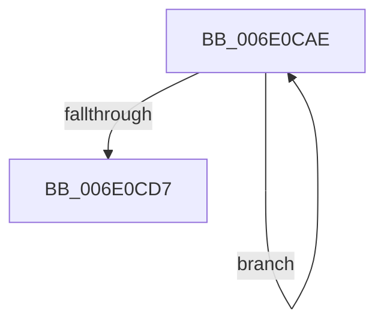

# sub_006E0CAE

- RVA: `0x006E0CAE`–`0x006E0CE9` (길이 `59` bytes)
- VA: `0x00000001406E0CAE`
- 실행 섹션: `.text`
- PDB 이름 있음: `아니요`; PDB Function 태그: `아니요`
- unwind 정보 RVA: `0x00073D14`
- 디코드: `16`개 명령, `59/59` bytes 표시
- 미해석 바이트: `0` (있으면 어셈블리에 `.byte`로 보존)

> 이 문서는 커널 이미지의 기계어와 PDB 기호를 분석해 생성했습니다. 4번과 5번은 함수 원형과 자료형을 바이너리 사용 방식에서 추정한 C 해석이며 원본 소스 복구 결과는 아닙니다.

## 1. Dependencies

- 직접 호출 지점: **2**; 고유 호출 대상: **2**
- 직접 호출자로 확인된 함수: **0**
- RIP 상대 이미지 참조: **0**

### Outgoing calls
- `0x006E0CC6` → [KiCompleteRescheduleContextEntry](../35/KiCompleteRescheduleContextEntry_function_00356330.md) (function, `0x00356330`)
- `0x006E0CDE` → [KiFlushSoftwareInterruptBatch](../25/KiFlushSoftwareInterruptBatch_function_00252200.md) (function, `0x00252200`)

### Direct callers
- 이 함수 시작 RVA로 연결되는 직접 call은 확인되지 않았습니다. 간접 호출은 완전히 역산할 수 없습니다.

### Static image references
- 디코드된 RIP-relative 메모리 참조가 없습니다.

## 2. Other-region calls and transfers

- 다른 실행 섹션으로 향하는 call: **0**
- call이 아닌 외부 분기/꼬리 이동: **1**
  - `0x006E0CE4` → [KiEnterLongDpcProcessing + 0x26C](../30/KiEnterLongDpcProcessing_function_0030BE54.md) (`tail-transfer`)

## 3. Assembly (complete function range)

```asm
006E0CAE  41 8B CF                        mov ecx, r15d
006E0CB1  45 33 C9                        xor r9d, r9d
006E0CB4  48 83 C1 02                     add rcx, 2
006E0CB8  45 33 C0                        xor r8d, r8d
006E0CBB  48 8B D6                        mov rdx, rsi
006E0CBE  4A 8D 0C B9                     lea rcx, [rcx + r15*4]
006E0CC2  49 8D 0C CE                     lea rcx, [r14 + rcx*8]
006E0CC6  E8 65 56 C7 FF                  call 0x140356330
006E0CCB  41 0F B6 06                     movzx eax, byte ptr [r14]
006E0CCF  41 FF C7                        inc r15d
006E0CD2  44 3B F8                        cmp r15d, eax
006E0CD5  72 D7                           jb 0x1406e0cae
006E0CD7  48 8D 8E D8 35 00 00            lea rcx, [rsi + 0x35d8]
006E0CDE  E8 1D 15 B7 FF                  call 0x140252200
006E0CE3  90                              nop
006E0CE4  E9 D7 B3 C2 FF                  jmp 0x14030c0c0
```

## 4. C-style interpretation (structured pseudocode)

```c
__int64 __fastcall sub_006E0CAE(__int64 a1, __int64 a2, int a3, int a4)
{
    __int64 result;
    __int64 v_r15;

    a4 = 0;
    a1 = ((unsigned int)((unsigned int)(v_r15))) + (2);
    a3 = 0;
    result = KiCompleteRescheduleContextEntry(v_r14 + a1 + v_r15 * 4 * 8, v_rsi, a3, a4);
    v_r15 = (unsigned int)((v_r15) + 1);
    if (((unsigned int)(v_r15)) < ((unsigned int)(*(unsigned __int8 *)(v_r14)))) goto loc_006E0CAE;
    result = KiFlushSoftwareInterruptBatch(v_rsi + 13784, v_rsi, a3, a4);
}
```

## 5. (Beta) C Style

```c
int64_t sub_006E0CAE(int64_t Arg1, int64_t Arg2, int32_t Arg3, int32_t Arg4)
{
    int64_t result;
    int64_t local_r15;

    Arg4 = 0;
    Arg1 = ((uint32_t)((uint32_t)(local_r15))) + (2);
    Arg3 = 0;
    result = KiCompleteRescheduleContextEntry(local_r14 + Arg1 + local_r15 * 4 * 8, local_rsi, Arg3, Arg4);
    local_r15 = (uint32_t)((local_r15) + 1);
    if (((uint32_t)(local_r15)) < ((uint32_t)(*(uint8_t *)(local_r14)))) goto loc_006E0CAE;
    result = KiFlushSoftwareInterruptBatch(local_rsi + 13784, local_rsi, Arg3, Arg4);
}
```

## 6. Execution-region graph

[열기: 2D/3D 그래프와 함수 탐색 컨트롤 패널](../../../control-panel.html?section=text&rva=0x006E0CAE&view=graph)

- 2D 그래프는 위에서 아래로 흐르고, 3D 그래프는 빈 공간을 드래그해 회전합니다. Shift+드래그는 이동, 휠은 확대·축소, 함수 노드 선택은 대상 보고서 이동입니다.

### Static fallback


