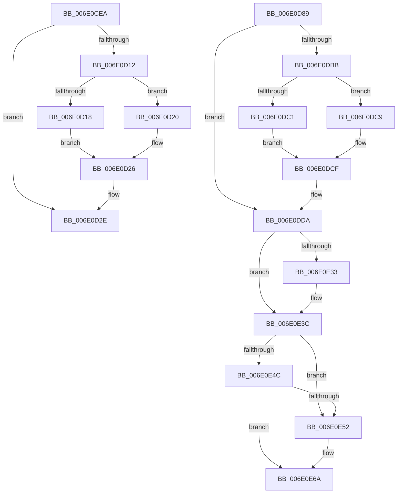

# sub_006E0CEA

- RVA: `0x006E0CEA`–`0x006E0E76` (길이 `396` bytes)
- VA: `0x00000001406E0CEA`
- 실행 섹션: `.text`
- PDB 이름 있음: `아니요`; PDB Function 태그: `아니요`
- unwind 정보 RVA: `0x00073E84`
- 디코드: `114`개 명령, `396/396` bytes 표시
- 미해석 바이트: `0` (있으면 어셈블리에 `.byte`로 보존)

> 이 문서는 커널 이미지의 기계어와 PDB 기호를 분석해 생성했습니다. 4번과 5번은 함수 원형과 자료형을 바이너리 사용 방식에서 추정한 C 해석이며 원본 소스 복구 결과는 아닙니다.

## 1. Dependencies

- 직접 호출 지점: **6**; 고유 호출 대상: **4**
- 직접 호출자로 확인된 함수: **0**
- RIP 상대 이미지 참조: **2**

### Outgoing calls
- `0x006E0CF0` → [KiQueryEffectivePriorityThread](../25/KiQueryEffectivePriorityThread_function_00257BA0.md) (function, `0x00257BA0`)
- `0x006E0D29` → [KiSetSchedulerAssistPriority](../46/KiSetSchedulerAssistPriority_function_0046E740.md) (function, `0x0046E740`)
- `0x006E0D76` → [KiUpdateThreadQosGroupingSummaries](../25/KiUpdateThreadQosGroupingSummaries_function_00257AEC.md) (function, `0x00257AEC`)
- `0x006E0D7E` → [KiUpdateStandbyStealSummaryForStandbyChange](../25/KiUpdateStandbyStealSummaryForStandbyChange_function_00257A80.md) (function, `0x00257A80`)
- `0x006E0D8F` → [KiQueryEffectivePriorityThread](../25/KiQueryEffectivePriorityThread_function_00257BA0.md) (function, `0x00257BA0`)
- `0x006E0DD5` → [KiSetSchedulerAssistPriority](../46/KiSetSchedulerAssistPriority_function_0046E740.md) (function, `0x0046E740`)

### Direct callers
- 이 함수 시작 RVA로 연결되는 직접 call은 확인되지 않았습니다. 간접 호출은 완전히 역산할 수 없습니다.

### Static image references
- `0x006E0D18` → RVA `0x00FC504C` (`ALMOSTRO`; read)
- `0x006E0D61` → RVA `0x00FC537C` (`ALMOSTRO`; read)

## 2. Other-region calls and transfers

- 다른 실행 섹션으로 향하는 call: **0**
- call이 아닌 외부 분기/꼬리 이동: **2**
  - `0x006E0D84` → [KiCommitRescheduleContextEntry + 0x2DE](../30/KiCommitRescheduleContextEntry_function_0030CFD0.md) (`tail-transfer`)
  - `0x006E0E71` → [KiCommitRescheduleContextEntry + 0x180](../30/KiCommitRescheduleContextEntry_function_0030CFD0.md) (`tail-transfer`)

## 3. Assembly (complete function range)

```asm
006E0CEA  48 8B D3                        mov rdx, rbx
006E0CED  48 8B CE                        mov rcx, rsi
006E0CF0  E8 AB 6E B7 FF                  call 0x140257ba0
006E0CF5  8B C8                           mov ecx, eax
006E0CF7  8B 46 78                        mov eax, dword ptr [rsi + 0x78]
006E0CFA  80 E1 7F                        and cl, 0x7f
006E0CFD  D1 E8                           shr eax, 1
006E0CFF  C0 E0 07                        shl al, 7
006E0D02  0A C1                           or al, cl
006E0D04  88 07                           mov byte ptr [rdi], al
006E0D06  48 8B 8B B8 8E 00 00            mov rcx, qword ptr [rbx + 0x8eb8]
006E0D0D  48 85 C9                        test rcx, rcx
006E0D10  74 1C                           je 0x1406e0d2e
006E0D12  48 3B 73 18                     cmp rsi, qword ptr [rbx + 0x18]
006E0D16  75 08                           jne 0x1406e0d20
006E0D18  8B 15 2E 43 8E 00               mov edx, dword ptr [rip + 0x8e432e]
006E0D1E  EB 06                           jmp 0x1406e0d26
006E0D20  0F B6 D0                        movzx edx, al
006E0D23  83 E2 7F                        and edx, 0x7f
006E0D26  45 33 C0                        xor r8d, r8d
006E0D29  E8 12 DA D8 FF                  call 0x14046e740
006E0D2E  8B 56 50                        mov edx, dword ptr [rsi + 0x50]
006E0D31  4C 8B 43 38                     mov r8, qword ptr [rbx + 0x38]
006E0D35  41 8A 40 40                     mov al, byte ptr [r8 + 0x40]
006E0D39  8A C8                           mov cl, al
006E0D3B  32 8E 04 02 00 00               xor cl, byte ptr [rsi + 0x204]
006E0D41  80 E1 07                        and cl, 7
006E0D44  32 C1                           xor al, cl
006E0D46  8A 8E 05 02 00 00               mov cl, byte ptr [rsi + 0x205]
006E0D4C  C0 E1 03                        shl cl, 3
006E0D4F  32 C8                           xor cl, al
006E0D51  80 E1 38                        and cl, 0x38
006E0D54  32 C1                           xor al, cl
006E0D56  8B 4E 54                        mov ecx, dword ptr [rsi + 0x54]
006E0D59  3B D1                           cmp edx, ecx
006E0D5B  0F 46 D1                        cmovbe edx, ecx
006E0D5E  48 8B CB                        mov rcx, rbx
006E0D61  3B 15 15 46 8E 00               cmp edx, dword ptr [rip + 0x8e4615]
006E0D67  1A D2                           sbb dl, dl
006E0D69  24 BF                           and al, 0xbf
006E0D6B  F6 D2                           not dl
006E0D6D  80 E2 40                        and dl, 0x40
006E0D70  0A C2                           or al, dl
006E0D72  41 88 40 40                     mov byte ptr [r8 + 0x40], al
006E0D76  E8 71 6D B7 FF                  call 0x140257aec
006E0D7B  48 8B CB                        mov rcx, rbx
006E0D7E  E8 FD 6C B7 FF                  call 0x140257a80
006E0D83  90                              nop
006E0D84  E9 25 C5 C2 FF                  jmp 0x14030d2ae
006E0D89  48 8B D3                        mov rdx, rbx
006E0D8C  48 8B CE                        mov rcx, rsi
006E0D8F  E8 0C 6E B7 FF                  call 0x140257ba0
006E0D94  44 8B 94 24 80 00 00 00         mov r10d, dword ptr [rsp + 0x80]
006E0D9C  45 33 DB                        xor r11d, r11d
006E0D9F  8B 4E 78                        mov ecx, dword ptr [rsi + 0x78]
006E0DA2  24 7F                           and al, 0x7f
006E0DA4  D1 E9                           shr ecx, 1
006E0DA6  C0 E1 07                        shl cl, 7
006E0DA9  0A C8                           or cl, al
006E0DAB  41 88 4D 00                     mov byte ptr [r13], cl
006E0DAF  48 8B 83 B8 8E 00 00            mov rax, qword ptr [rbx + 0x8eb8]
006E0DB6  48 85 C0                        test rax, rax
006E0DB9  74 1F                           je 0x1406e0dda
006E0DBB  48 3B 73 18                     cmp rsi, qword ptr [rbx + 0x18]
006E0DBF  75 08                           jne 0x1406e0dc9
006E0DC1  8B 15 85 42 8E 00               mov edx, dword ptr [rip + 0x8e4285]
006E0DC7  EB 06                           jmp 0x1406e0dcf
006E0DC9  0F B6 D1                        movzx edx, cl
006E0DCC  83 E2 7F                        and edx, 0x7f
006E0DCF  45 33 C0                        xor r8d, r8d
006E0DD2  48 8B C8                        mov rcx, rax
006E0DD5  E8 66 D9 D8 FF                  call 0x14046e740
006E0DDA  8B 56 50                        mov edx, dword ptr [rsi + 0x50]
006E0DDD  4C 8B 43 38                     mov r8, qword ptr [rbx + 0x38]
006E0DE1  41 8A 40 40                     mov al, byte ptr [r8 + 0x40]
006E0DE5  8A C8                           mov cl, al
006E0DE7  32 8E 04 02 00 00               xor cl, byte ptr [rsi + 0x204]
006E0DED  80 E1 07                        and cl, 7
006E0DF0  32 C1                           xor al, cl
006E0DF2  8A 8E 05 02 00 00               mov cl, byte ptr [rsi + 0x205]
006E0DF8  C0 E1 03                        shl cl, 3
006E0DFB  32 C8                           xor cl, al
006E0DFD  80 E1 38                        and cl, 0x38
006E0E00  32 C1                           xor al, cl
006E0E02  8B 4E 54                        mov ecx, dword ptr [rsi + 0x54]
006E0E05  3B D1                           cmp edx, ecx
006E0E07  0F 46 D1                        cmovbe edx, ecx
006E0E0A  3B 15 6C 45 8E 00               cmp edx, dword ptr [rip + 0x8e456c]
006E0E10  1A C9                           sbb cl, cl
006E0E12  24 BF                           and al, 0xbf
006E0E14  F6 D1                           not cl
006E0E16  80 E1 40                        and cl, 0x40
006E0E19  0A C1                           or al, cl
006E0E1B  41 88 40 40                     mov byte ptr [r8 + 0x40], al
006E0E1F  48 8B 8B B8 8E 00 00            mov rcx, qword ptr [rbx + 0x8eb8]
006E0E26  48 8B 43 18                     mov rax, qword ptr [rbx + 0x18]
006E0E2A  48 89 6B 10                     mov qword ptr [rbx + 0x10], rbp
006E0E2E  48 85 C9                        test rcx, rcx
006E0E31  74 09                           je 0x1406e0e3c
006E0E33  48 3B E8                        cmp rbp, rax
006E0E36  0F 94 C0                        sete al
006E0E39  88 41 10                        mov byte ptr [rcx + 0x10], al
006E0E3C  8A 85 84 01 00 00               mov al, byte ptr [rbp + 0x184]
006E0E42  BE 01 00 00 00                  mov esi, 1
006E0E47  40 3A C6                        cmp al, sil
006E0E4A  74 06                           je 0x1406e0e52
006E0E4C  41 F6 C4 02                     test r12b, 2
006E0E50  74 18                           je 0x1406e0e6a
006E0E52  48 B8 20 03 00 00 80 F7 FF FF   movabs rax, 0xfffff78000000320
006E0E5C  8B 00                           mov eax, dword ptr [rax]
006E0E5E  2B 85 B4 01 00 00               sub eax, dword ptr [rbp + 0x1b4]
006E0E64  01 85 84 00 00 00               add dword ptr [rbp + 0x84], eax
006E0E6A  C6 85 84 01 00 00 03            mov byte ptr [rbp + 0x184], 3
006E0E71  E9 DA C2 C2 FF                  jmp 0x14030d150
```

## 4. C-style interpretation (structured pseudocode)

```c
__int64 __fastcall sub_006E0CEA(__int64 a1, __int64 a2, int a3)
{
    __int64 result;
    unsigned int v_stack_p80;

    result = KiQueryEffectivePriorityThread(v_rsi, v_rbx, a3, a4);
    a1 = (unsigned __int8)(((unsigned int)((unsigned int)(result))) & (127));
    result = (unsigned int)(((unsigned int)(*(unsigned int *)(v_rsi + 120))) >> (1));
    result = (unsigned __int8)((result) << (7));
    result = (unsigned __int8)((result) | ((unsigned __int8)(a1)));
    *(unsigned __int8 *)(v_rdi) = (unsigned __int8)(result);
    if (*(unsigned __int64 *)(v_rbx + 36536) == 0) goto loc_006E0D2E;
    if (v_rsi != (*(unsigned __int64 *)(v_rbx + 24))) goto loc_006E0D20;
    goto loc_006E0D26;
loc_006E0D20:
    a2 = (unsigned int)(((unsigned __int8)(result)) & (127));
loc_006E0D26:
    a3 = 0;
    result = KiSetSchedulerAssistPriority(*(unsigned __int64 *)(v_rbx + 36536), a2, a3, a4);
loc_006E0D2E:
    a1 = (unsigned __int8)(((unsigned __int8)(*(unsigned __int8 *)(*(unsigned __int64 *)(v_rbx + 56) + 64))) ^ (*(unsigned __int8 *)(v_rsi + 516)));
    a1 = (unsigned __int8)((a1) & (7));
    result = (unsigned __int8)((*(unsigned __int8 *)(*(unsigned __int64 *)(v_rbx + 56) + 64)) ^ ((unsigned __int8)(a1)));
    a1 = (unsigned __int8)((*(unsigned __int8 *)(v_rsi + 517)) << (3));
    a1 = (unsigned __int8)((a1) ^ ((unsigned __int8)(result)));
    a1 = (unsigned __int8)((a1) & (56));
    result = (unsigned __int8)((result) ^ ((unsigned __int8)(a1)));
    a2 = (unsigned int)(*(unsigned int *)(v_rsi + 80));
    if (((unsigned int)((unsigned int)(*(unsigned int *)(v_rsi + 80)))) <= ((unsigned int)((unsigned int)(*(unsigned int *)(v_rsi + 84))))) { a2 = (unsigned int)((unsigned int)(*(unsigned int *)(v_rsi + 84))); }
    result = (unsigned __int8)((result) & (191));
    a2 = (unsigned __int8)(~(a2));
    a2 = (unsigned __int8)((a2) & (64));
    result = (unsigned __int8)((result) | ((unsigned __int8)(a2)));
    *(unsigned __int8 *)(*(unsigned __int64 *)(v_rbx + 56) + 64) = (unsigned __int8)(result);
    result = KiUpdateThreadQosGroupingSummaries(v_rbx, a2, *(unsigned __int64 *)(v_rbx + 56), a4);
    result = KiUpdateStandbyStealSummaryForStandbyChange(v_rbx, a2, *(unsigned __int64 *)(v_rbx + 56), a4);
}
```

## 5. (Beta) C Style

```c
int64_t sub_006E0CEA(int64_t Arg1, int64_t Arg2, int32_t Arg3)
{
    int64_t result;
    uint32_t v_stack_p80;

    result = KiQueryEffectivePriorityThread(local_rsi, local_rbx, Arg3, a4);
    Arg1 = (uint8_t)(((uint32_t)((uint32_t)(result))) & (127));
    result = (uint32_t)(((uint32_t)(*(uint32_t *)(local_rsi + 0x78))) >> (1));
    result = (uint8_t)((result) << (7));
    result = (uint8_t)((result) | ((uint8_t)(Arg1)));
    *(uint8_t *)(local_rdi) = (uint8_t)(result);
    if (*(uint64_t *)(local_rbx + 0x8EB8) == 0) goto loc_006E0D2E;
    if (local_rsi != (*(uint64_t *)(local_rbx + 0x18))) goto loc_006E0D20;
    goto loc_006E0D26;
loc_006E0D20:
    Arg2 = (uint32_t)(((uint8_t)(result)) & (127));
loc_006E0D26:
    Arg3 = 0;
    result = KiSetSchedulerAssistPriority(*(uint64_t *)(local_rbx + 0x8EB8), Arg2, Arg3, a4);
loc_006E0D2E:
    Arg1 = (uint8_t)(((uint8_t)(*(uint8_t *)(*(uint64_t *)(local_rbx + 0x38) + 0x40))) ^ (*(uint8_t *)(local_rsi + 0x204)));
    Arg1 = (uint8_t)((Arg1) & (7));
    result = (uint8_t)((*(uint8_t *)(*(uint64_t *)(local_rbx + 0x38) + 0x40)) ^ ((uint8_t)(Arg1)));
    Arg1 = (uint8_t)((*(uint8_t *)(local_rsi + 0x205)) << (3));
    Arg1 = (uint8_t)((Arg1) ^ ((uint8_t)(result)));
    Arg1 = (uint8_t)((Arg1) & (56));
    result = (uint8_t)((result) ^ ((uint8_t)(Arg1)));
    Arg2 = (uint32_t)(*(uint32_t *)(local_rsi + 0x50));
    if (((uint32_t)((uint32_t)(*(uint32_t *)(local_rsi + 0x50)))) <= ((uint32_t)((uint32_t)(*(uint32_t *)(local_rsi + 0x54))))) { Arg2 = (uint32_t)((uint32_t)(*(uint32_t *)(local_rsi + 0x54))); }
    result = (uint8_t)((result) & (191));
    Arg2 = (uint8_t)(~(Arg2));
    Arg2 = (uint8_t)((Arg2) & (64));
    result = (uint8_t)((result) | ((uint8_t)(Arg2)));
    *(uint8_t *)(*(uint64_t *)(local_rbx + 0x38) + 0x40) = (uint8_t)(result);
    result = KiUpdateThreadQosGroupingSummaries(local_rbx, Arg2, *(uint64_t *)(local_rbx + 0x38), a4);
    result = KiUpdateStandbyStealSummaryForStandbyChange(local_rbx, Arg2, *(uint64_t *)(local_rbx + 0x38), a4);
}
```

## 6. Execution-region graph

[열기: 2D/3D 그래프와 함수 탐색 컨트롤 패널](../../../control-panel.html?section=text&rva=0x006E0CEA&view=graph)

- 2D 그래프는 위에서 아래로 흐르고, 3D 그래프는 빈 공간을 드래그해 회전합니다. Shift+드래그는 이동, 휠은 확대·축소, 함수 노드 선택은 대상 보고서 이동입니다.

### Static fallback


