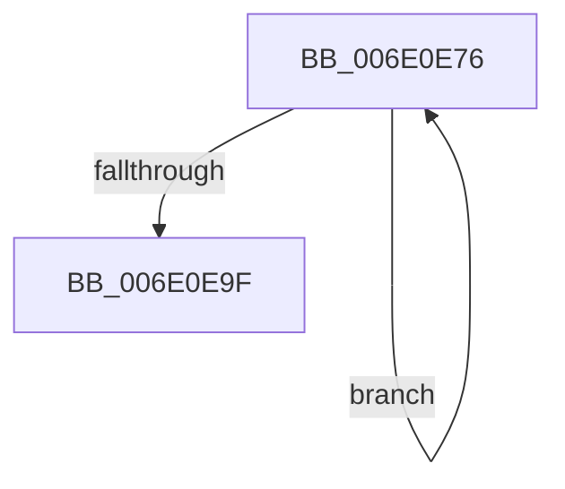

# sub_006E0E76

- RVA: `0x006E0E76`–`0x006E0EA9` (길이 `51` bytes)
- VA: `0x00000001406E0E76`
- 실행 섹션: `.text`
- PDB 이름 있음: `아니요`; PDB Function 태그: `아니요`
- unwind 정보 RVA: `0x00073EDC`
- 디코드: `14`개 명령, `51/51` bytes 표시
- 미해석 바이트: `0` (있으면 어셈블리에 `.byte`로 보존)

> 이 문서는 커널 이미지의 기계어와 PDB 기호를 분석해 생성했습니다. 4번과 5번은 함수 원형과 자료형을 바이너리 사용 방식에서 추정한 C 해석이며 원본 소스 복구 결과는 아닙니다.

## 1. Dependencies

- 직접 호출 지점: **1**; 고유 호출 대상: **1**
- 직접 호출자로 확인된 함수: **0**
- RIP 상대 이미지 참조: **0**

### Outgoing calls
- `0x006E0E8E` → [KiCompleteRescheduleContextEntry](../35/KiCompleteRescheduleContextEntry_function_00356330.md) (function, `0x00356330`)

### Direct callers
- 이 함수 시작 RVA로 연결되는 직접 call은 확인되지 않았습니다. 간접 호출은 완전히 역산할 수 없습니다.

### Static image references
- 디코드된 RIP-relative 메모리 참조가 없습니다.

## 2. Other-region calls and transfers

- 다른 실행 섹션으로 향하는 call: **0**
- call이 아닌 외부 분기/꼬리 이동: **1**
  - `0x006E0EA4` → [KiAttemptToStealStandbyThread + 0x506](../30/KiAttemptToStealStandbyThread_function_0030D790.md) (`tail-transfer`)

## 3. Assembly (complete function range)

```asm
006E0E76  41 8B CC                        mov ecx, r12d
006E0E79  45 33 C9                        xor r9d, r9d
006E0E7C  48 83 C1 02                     add rcx, 2
006E0E80  45 33 C0                        xor r8d, r8d
006E0E83  48 8B D3                        mov rdx, rbx
006E0E86  4A 8D 0C A1                     lea rcx, [rcx + r12*4]
006E0E8A  49 8D 0C CF                     lea rcx, [r15 + rcx*8]
006E0E8E  E8 9D 54 C7 FF                  call 0x140356330
006E0E93  41 0F B6 07                     movzx eax, byte ptr [r15]
006E0E97  44 03 E6                        add r12d, esi
006E0E9A  44 3B E0                        cmp r12d, eax
006E0E9D  72 D7                           jb 0x1406e0e76
006E0E9F  48 8B 5C 24 40                  mov rbx, qword ptr [rsp + 0x40]
006E0EA4  E9 ED CD C2 FF                  jmp 0x14030dc96
```

## 4. C-style interpretation (structured pseudocode)

```c
__int64 __fastcall sub_006E0E76(__int64 a1, __int64 a2, int a3, int a4, __int64 a5, __int64 a6, __int64 a7, __int64 a8)
{
    __int64 result;
    __int64 v_r12;

    a4 = 0;
    a1 = ((unsigned int)((unsigned int)(v_r12))) + (2);
    a3 = 0;
    result = KiCompleteRescheduleContextEntry(v_r15 + a1 + v_r12 * 4 * 8, v_rbx, a3, a4);
    v_r12 = (unsigned int)((v_r12) + ((unsigned int)(v_rsi)));
    if (((unsigned int)(v_r12)) < ((unsigned int)(*(unsigned __int8 *)(v_r15)))) goto loc_006E0E76;
}
```

## 5. (Beta) C Style

```c
int64_t sub_006E0E76(int64_t Arg1, int64_t Arg2, int32_t Arg3, int32_t Arg4, uint64_t Arg5, uint64_t Arg6, uint64_t Arg7, int64_t Arg8)
{
    int64_t result;
    int64_t local_r12;

    Arg4 = 0;
    Arg1 = ((uint32_t)((uint32_t)(local_r12))) + (2);
    Arg3 = 0;
    result = KiCompleteRescheduleContextEntry(local_r15 + Arg1 + local_r12 * 4 * 8, local_rbx, Arg3, Arg4);
    local_r12 = (uint32_t)((local_r12) + ((uint32_t)(local_rsi)));
    if (((uint32_t)(local_r12)) < ((uint32_t)(*(uint8_t *)(local_r15)))) goto loc_006E0E76;
}
```

## 6. Execution-region graph

[열기: 2D/3D 그래프와 함수 탐색 컨트롤 패널](../../../control-panel.html?section=text&rva=0x006E0E76&view=graph)

- 2D 그래프는 위에서 아래로 흐르고, 3D 그래프는 빈 공간을 드래그해 회전합니다. Shift+드래그는 이동, 휠은 확대·축소, 함수 노드 선택은 대상 보고서 이동입니다.

### Static fallback


