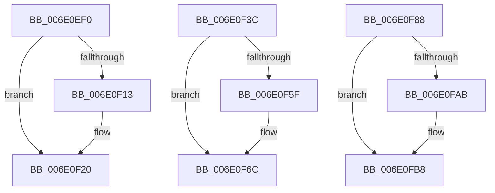

# sub_006E0EF0

- RVA: `0x006E0EF0`–`0x006E0FD4` (길이 `228` bytes)
- VA: `0x00000001406E0EF0`
- 실행 섹션: `.text`
- PDB 이름 있음: `아니요`; PDB Function 태그: `아니요`
- unwind 정보 RVA: `0x000741C8`
- 디코드: `54`개 명령, `228/228` bytes 표시
- 미해석 바이트: `0` (있으면 어셈블리에 `.byte`로 보존)

> 이 문서는 커널 이미지의 기계어와 PDB 기호를 분석해 생성했습니다. 4번과 5번은 함수 원형과 자료형을 바이너리 사용 방식에서 추정한 C 해석이며 원본 소스 복구 결과는 아닙니다.

## 1. Dependencies

- 직접 호출 지점: **6**; 고유 호출 대상: **2**
- 직접 호출자로 확인된 함수: **0**
- RIP 상대 이미지 참조: **0**

### Outgoing calls
- `0x006E0EFA` → [VmpProcessContextUnlockExclusive](../48/VmpProcessContextUnlockExclusive_function_004894C8.md) (function, `0x004894C8`)
- `0x006E0F05` → [VmpProcessContextLockExclusive](../31/VmpProcessContextLockExclusive_function_003147A4.md) (function, `0x003147A4`)
- `0x006E0F46` → [VmpProcessContextUnlockExclusive](../48/VmpProcessContextUnlockExclusive_function_004894C8.md) (function, `0x004894C8`)
- `0x006E0F51` → [VmpProcessContextLockExclusive](../31/VmpProcessContextLockExclusive_function_003147A4.md) (function, `0x003147A4`)
- `0x006E0F92` → [VmpProcessContextUnlockExclusive](../48/VmpProcessContextUnlockExclusive_function_004894C8.md) (function, `0x004894C8`)
- `0x006E0F9D` → [VmpProcessContextLockExclusive](../31/VmpProcessContextLockExclusive_function_003147A4.md) (function, `0x003147A4`)

### Direct callers
- 이 함수 시작 RVA로 연결되는 직접 call은 확인되지 않았습니다. 간접 호출은 완전히 역산할 수 없습니다.

### Static image references
- 디코드된 RIP-relative 메모리 참조가 없습니다.

## 2. Other-region calls and transfers

- 다른 실행 섹션으로 향하는 call: **0**
- call이 아닌 외부 분기/꼬리 이동: **3**
  - `0x006E0F37` → [VmpFlushTb + 0x128](../31/VmpFlushTb_function_00311BD0.md) (`tail-transfer`)
  - `0x006E0F83` → [VmpFlushTb + 0x352](../31/VmpFlushTb_function_00311BD0.md) (`tail-transfer`)
  - `0x006E0FCF` → [VmpFlushTb + 0x2A6](../31/VmpFlushTb_function_00311BD0.md) (`tail-transfer`)

## 3. Assembly (complete function range)

```asm
006E0EF0  48 8B 5F 48                     mov rbx, qword ptr [rdi + 0x48]
006E0EF4  49 8B D6                        mov rdx, r14
006E0EF7  48 8B CF                        mov rcx, rdi
006E0EFA  E8 C9 85 DA FF                  call 0x1404894c8
006E0EFF  48 8B CF                        mov rcx, rdi
006E0F02  45 33 FF                        xor r15d, r15d
006E0F05  E8 9A 38 C3 FF                  call 0x1403147a4
006E0F0A  4C 8B F0                        mov r14, rax
006E0F0D  48 3B 5F 48                     cmp rbx, qword ptr [rdi + 0x48]
006E0F11  74 0D                           je 0x1406e0f20
006E0F13  0F 57 C0                        xorps xmm0, xmm0
006E0F16  33 C0                           xor eax, eax
006E0F18  0F 11 45 07                     movups xmmword ptr [rbp + 7], xmm0
006E0F1C  48 89 45 17                     mov qword ptr [rbp + 0x17], rax
006E0F20  65 48 8B 04 25 20 00 00 00      mov rax, qword ptr gs:[0x20]
006E0F29  48 8B 98 50 8B 00 00            mov rbx, qword ptr [rax + 0x8b50]
006E0F30  48 81 C3 00 12 00 00            add rbx, 0x1200
006E0F37  E9 BC 0D C3 FF                  jmp 0x140311cf8
006E0F3C  48 8B 5F 48                     mov rbx, qword ptr [rdi + 0x48]
006E0F40  49 8B D6                        mov rdx, r14
006E0F43  48 8B CF                        mov rcx, rdi
006E0F46  E8 7D 85 DA FF                  call 0x1404894c8
006E0F4B  48 8B CF                        mov rcx, rdi
006E0F4E  45 33 FF                        xor r15d, r15d
006E0F51  E8 4E 38 C3 FF                  call 0x1403147a4
006E0F56  4C 8B F0                        mov r14, rax
006E0F59  48 3B 5F 48                     cmp rbx, qword ptr [rdi + 0x48]
006E0F5D  74 0D                           je 0x1406e0f6c
006E0F5F  0F 57 C0                        xorps xmm0, xmm0
006E0F62  33 C0                           xor eax, eax
006E0F64  0F 11 45 07                     movups xmmword ptr [rbp + 7], xmm0
006E0F68  48 89 45 17                     mov qword ptr [rbp + 0x17], rax
006E0F6C  65 48 8B 04 25 20 00 00 00      mov rax, qword ptr gs:[0x20]
006E0F75  48 8B 98 50 8B 00 00            mov rbx, qword ptr [rax + 0x8b50]
006E0F7C  48 81 C3 00 12 00 00            add rbx, 0x1200
006E0F83  E9 9A 0F C3 FF                  jmp 0x140311f22
006E0F88  48 8B 5F 48                     mov rbx, qword ptr [rdi + 0x48]
006E0F8C  49 8B D6                        mov rdx, r14
006E0F8F  48 8B CF                        mov rcx, rdi
006E0F92  E8 31 85 DA FF                  call 0x1404894c8
006E0F97  48 8B CF                        mov rcx, rdi
006E0F9A  45 33 FF                        xor r15d, r15d
006E0F9D  E8 02 38 C3 FF                  call 0x1403147a4
006E0FA2  4C 8B F0                        mov r14, rax
006E0FA5  48 3B 5F 48                     cmp rbx, qword ptr [rdi + 0x48]
006E0FA9  74 0D                           je 0x1406e0fb8
006E0FAB  0F 57 C0                        xorps xmm0, xmm0
006E0FAE  33 C0                           xor eax, eax
006E0FB0  0F 11 45 07                     movups xmmword ptr [rbp + 7], xmm0
006E0FB4  48 89 45 17                     mov qword ptr [rbp + 0x17], rax
006E0FB8  65 48 8B 04 25 20 00 00 00      mov rax, qword ptr gs:[0x20]
006E0FC1  48 8B 98 50 8B 00 00            mov rbx, qword ptr [rax + 0x8b50]
006E0FC8  48 81 C3 00 12 00 00            add rbx, 0x1200
006E0FCF  E9 A2 0E C3 FF                  jmp 0x140311e76
```

## 4. C-style interpretation (structured pseudocode)

```c
__int64 __fastcall sub_006E0EF0(void)
{
    __int64 result;
    __int64 v_r15;
    __int64 v_rbx;

    result = VmpProcessContextUnlockExclusive(v_rdi, v_r14, a3, a4);
    v_r15 = 0;
    result = VmpProcessContextLockExclusive(v_rdi, v_r14, a3, a4);
    if ((*(unsigned __int64 *)(v_rdi + 72)) != (*(unsigned __int64 *)(v_rdi + 72))) {
        result = 0;
        *(unsigned __int64 *)(v_rbp + 7) = v_xmm0;
        *(unsigned __int64 *)(v_rbp + 23) = 0;
    }
    v_rbx = (*(unsigned __int64 *)(*(unsigned __int64 *)(gs_base + (0 + 32)) + 35664)) + (0x1200ULL);
}
```

## 5. (Beta) C Style

```c
void sub_006E0EF0(void)
{
    int64_t result;
    int64_t local_r15;
    int64_t local_rbx;

    result = VmpProcessContextUnlockExclusive(local_rdi, local_r14, a3, a4);
    local_r15 = 0;
    result = VmpProcessContextLockExclusive(local_rdi, local_r14, a3, a4);
    if ((*(uint64_t *)(local_rdi + 0x48)) != (*(uint64_t *)(local_rdi + 0x48))) {
        result = 0;
        *(uint64_t *)(local_rbp + 0x7) = v_xmm0;
        *(uint64_t *)(local_rbp + 0x17) = 0;
    }
    local_rbx = (*(uint64_t *)(*(uint64_t *)(gs_base + (0 + 0x20)) + 0x8B50)) + (0x1200ULL);
}
```

## 6. Execution-region graph

[열기: 2D/3D 그래프와 함수 탐색 컨트롤 패널](../../../control-panel.html?section=text&rva=0x006E0EF0&view=graph)

- 2D 그래프는 위에서 아래로 흐르고, 3D 그래프는 빈 공간을 드래그해 회전합니다. Shift+드래그는 이동, 휠은 확대·축소, 함수 노드 선택은 대상 보고서 이동입니다.

### Static fallback


