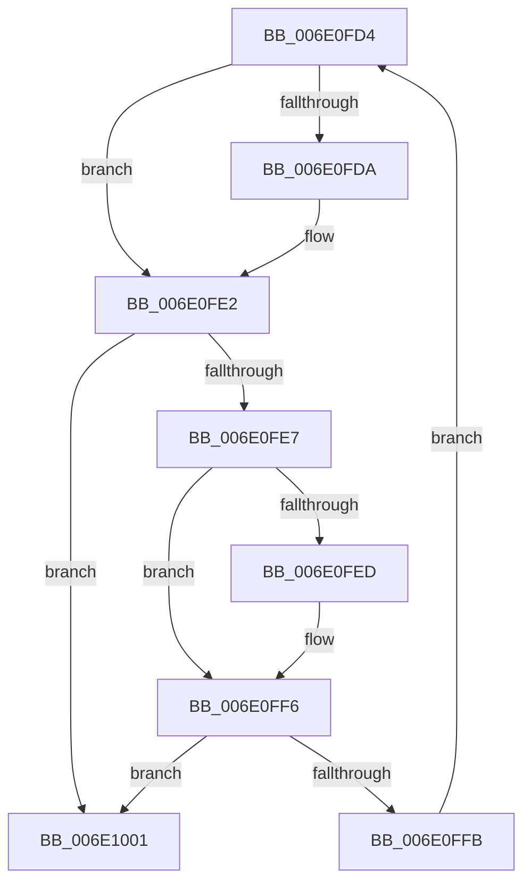

# sub_006E0FD4

- RVA: `0x006E0FD4`–`0x006E1009` (길이 `53` bytes)
- VA: `0x00000001406E0FD4`
- 실행 섹션: `.text`
- PDB 이름 있음: `아니요`; PDB Function 태그: `아니요`
- unwind 정보 RVA: `0x000744FC`
- 디코드: `16`개 명령, `53/53` bytes 표시
- 미해석 바이트: `0` (있으면 어셈블리에 `.byte`로 보존)

> 이 문서는 커널 이미지의 기계어와 PDB 기호를 분석해 생성했습니다. 4번과 5번은 함수 원형과 자료형을 바이너리 사용 방식에서 추정한 C 해석이며 원본 소스 복구 결과는 아닙니다.

## 1. Dependencies

- 직접 호출 지점: **0**; 고유 호출 대상: **0**
- 직접 호출자로 확인된 함수: **0**
- RIP 상대 이미지 참조: **0**

### Outgoing calls
- 직접 디코드된 call 명령이 없습니다.

### Direct callers
- 이 함수 시작 RVA로 연결되는 직접 call은 확인되지 않았습니다. 간접 호출은 완전히 역산할 수 없습니다.

### Static image references
- 디코드된 RIP-relative 메모리 참조가 없습니다.

## 2. Other-region calls and transfers

- 다른 실행 섹션으로 향하는 call: **0**
- call이 아닌 외부 분기/꼬리 이동: **1**
  - `0x006E1004` → [sub_00312E4F + 0x10](../31/Unknown_function_00312E4F.md) (`tail-transfer`)

## 3. Assembly (complete function range)

```asm
006E0FD4  41 F6 C0 01                     test r8b, 1
006E0FD8  74 08                           je 0x1406e0fe2
006E0FDA  41 0F B6 01                     movzx eax, byte ptr [r9]
006E0FDE  48 0F AB C2                     bts rdx, rax
006E0FE2  49 D1 E8                        shr r8, 1
006E0FE5  74 1A                           je 0x1406e1001
006E0FE7  41 F6 C0 01                     test r8b, 1
006E0FEB  74 09                           je 0x1406e0ff6
006E0FED  41 0F B6 41 02                  movzx eax, byte ptr [r9 + 2]
006E0FF2  48 0F AB C2                     bts rdx, rax
006E0FF6  49 D1 E8                        shr r8, 1
006E0FF9  74 06                           je 0x1406e1001
006E0FFB  49 83 C1 04                     add r9, 4
006E0FFF  EB D3                           jmp 0x1406e0fd4
006E1001  4C 8B C2                        mov r8, rdx
006E1004  E9 56 1E C3 FF                  jmp 0x140312e5f
```

## 4. C-style interpretation (structured pseudocode)

```c
__int64 __fastcall sub_006E0FD4(__int64 a1, __int64 a2, __int64 a3, __int64 a4)
{
    __int64 result;

    if ((((unsigned __int8)(a3)) & (1)) != 0) {
        result = *(unsigned __int8 *)(a4);
    }
    a3 = (a3) >> (1);
    if (condition_is_equal) goto loc_006E1001;
    if ((((unsigned __int8)(a3)) & (1)) != 0) {
        result = *(unsigned __int8 *)(a4 + 2);
    }
    a3 = (a3) >> (1);
    if (condition_is_equal) goto loc_006E1001;
    a4 = (a4) + (4);
    goto loc_006E0FD4;
loc_006E1001:
}
```

## 5. (Beta) C Style

```c
int64_t sub_006E0FD4(int64_t Arg1, int64_t Arg2, int64_t Arg3, void *Arg4)
{
    uint8_t *arg4 = (uint8_t *)Arg4;

    int64_t result;

    if ((((uint8_t)(Arg3)) & (1)) != 0) {
        result = *(uint8_t *)(arg4);
    }
    Arg3 = (Arg3) >> (1);
    if (condition_is_equal) goto loc_006E1001;
    if ((((uint8_t)(Arg3)) & (1)) != 0) {
        result = *(uint8_t *)(arg4 + 0x2);
    }
    Arg3 = (Arg3) >> (1);
    if (condition_is_equal) goto loc_006E1001;
    Arg4 = (Arg4) + (4);
    goto loc_006E0FD4;
loc_006E1001:
}
```

### 관측된 메모리 오프셋

구조체 형식이 확인되지 않은 접근은 인자 기준의 오프셋으로만 기록했습니다.

| 기준 인자 | 오프셋 표현 | 폭 (bit) | 접근 |
|---|---:|---:|---|
| `Arg4` | `+ 0x0` | `8` | `R` |
| `Arg4` | `+ 0x2` | `8` | `R` |

## 6. Execution-region graph

[열기: 2D/3D 그래프와 함수 탐색 컨트롤 패널](../../../control-panel.html?section=text&rva=0x006E0FD4&view=graph)

- 2D 그래프는 위에서 아래로 흐르고, 3D 그래프는 빈 공간을 드래그해 회전합니다. Shift+드래그는 이동, 휠은 확대·축소, 함수 노드 선택은 대상 보고서 이동입니다.

### Static fallback


