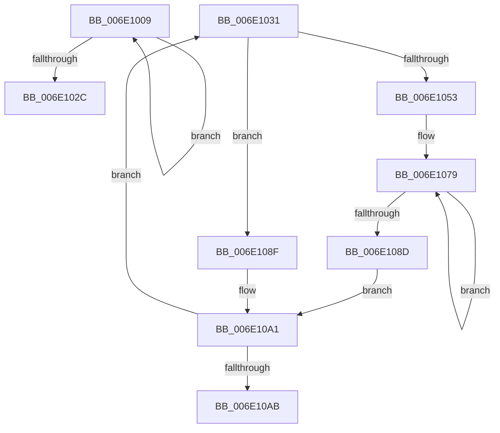

# sub_006E1009

- RVA: `0x006E1009`–`0x006E10B0` (길이 `167` bytes)
- VA: `0x00000001406E1009`
- 실행 섹션: `.text`
- PDB 이름 있음: `아니요`; PDB Function 태그: `아니요`
- unwind 정보 RVA: `0x00074518`
- 디코드: `45`개 명령, `167/167` bytes 표시
- 미해석 바이트: `0` (있으면 어셈블리에 `.byte`로 보존)

> 이 문서는 커널 이미지의 기계어와 PDB 기호를 분석해 생성했습니다. 4번과 5번은 함수 원형과 자료형을 바이너리 사용 방식에서 추정한 C 해석이며 원본 소스 복구 결과는 아닙니다.

## 1. Dependencies

- 직접 호출 지점: **0**; 고유 호출 대상: **0**
- 직접 호출자로 확인된 함수: **0**
- RIP 상대 이미지 참조: **0**

### Outgoing calls
- 직접 디코드된 call 명령이 없습니다.

### Direct callers
- 이 함수 시작 RVA로 연결되는 직접 call은 확인되지 않았습니다. 간접 호출은 완전히 역산할 수 없습니다.

### Static image references
- 디코드된 RIP-relative 메모리 참조가 없습니다.

## 2. Other-region calls and transfers

- 다른 실행 섹션으로 향하는 call: **0**
- call이 아닌 외부 분기/꼬리 이동: **2**
  - `0x006E102C` → [sub_00312CB7 + 0x18](../31/Unknown_function_00312CB7.md) (`tail-transfer`)
  - `0x006E10AB` → [sub_00312E68 + 0x92](../31/Unknown_function_00312E68.md) (`tail-transfer`)

## 3. Assembly (complete function range)

```asm
006E1009  48 8B 0A                        mov rcx, qword ptr [rdx]
006E100C  48 8D 52 08                     lea rdx, [rdx + 8]
006E1010  8B C1                           mov eax, ecx
006E1012  25 FF 03 00 00                  and eax, 0x3ff
006E1017  03 C6                           add eax, esi
006E1019  48 F7 C1 00 0C 00 00            test rcx, 0xc00
006E1020  0F 44 C6                        cmove eax, esi
006E1023  8D 70 01                        lea esi, [rax + 1]
006E1026  49 83 E8 01                     sub r8, 1
006E102A  75 DD                           jne 0x1406e1009
006E102C  E9 9E 1C C3 FF                  jmp 0x140312ccf
006E1031  49 8B 16                        mov rdx, qword ptr [r14]
006E1034  4C 8B CA                        mov r9, rdx
006E1037  49 C1 E9 0A                     shr r9, 0xa
006E103B  41 83 E1 03                     and r9d, 3
006E103F  48 F7 C2 FF 03 00 00            test rdx, 0x3ff
006E1046  0F 95 C1                        setne cl
006E1049  4D 85 C9                        test r9, r9
006E104C  0F 95 C0                        setne al
006E104F  84 C8                           test al, cl
006E1051  74 3C                           je 0x1406e108f
006E1053  41 0F B6 C9                     movzx ecx, r9b
006E1057  48 8B C2                        mov rax, rdx
006E105A  41 C0 E1 03                     shl r9b, 3
006E105E  48 25 00 F0 FF FF               and rax, 0xfffffffffffff000
006E1064  41 02 C9                        add cl, r9b
006E1067  81 E2 FF 03 00 00               and edx, 0x3ff
006E106D  41 B9 00 10 00 00               mov r9d, 0x1000
006E1073  49 D3 E1                        shl r9, cl
006E1076  48 FF C2                        inc rdx
006E1079  41 8B C8                        mov ecx, r8d
006E107C  41 FF C0                        inc r8d
006E107F  48 89 44 CD A8                  mov qword ptr [rbp + rcx*8 - 0x58], rax
006E1084  49 03 C1                        add rax, r9
006E1087  48 83 EA 01                     sub rdx, 1
006E108B  75 EC                           jne 0x1406e1079
006E108D  EB 12                           jmp 0x1406e10a1
006E108F  41 8B C0                        mov eax, r8d
006E1092  48 81 E2 FF F3 FF FF            and rdx, 0xfffffffffffff3ff
006E1099  41 FF C0                        inc r8d
006E109C  48 89 54 C5 A8                  mov qword ptr [rbp + rax*8 - 0x58], rdx
006E10A1  49 83 C6 08                     add r14, 8
006E10A5  49 83 EB 01                     sub r11, 1
006E10A9  75 86                           jne 0x1406e1031
006E10AB  E9 4A 1E C3 FF                  jmp 0x140312efa
```

## 4. C-style interpretation (structured pseudocode)

```c
__int64 __fastcall sub_006E1009(__int64 a1, __int64 a2, __int64 a3)
{
    __int64 result;

    result = (unsigned int)(((unsigned int)((unsigned int)(*(unsigned __int64 *)(a2)))) & (0x3FFULL));
    result = (unsigned int)((result) + ((unsigned int)(v_rsi)));
    if (((*(unsigned __int64 *)(a2)) & (0xC00ULL)) == 0) { result = (unsigned int)(v_rsi); }
    a3 = (a3) - (1);
    if (condition_is_not_equal) goto loc_006E1009;
}
```

## 5. (Beta) C Style

```c
int64_t sub_006E1009(int64_t Arg1, void *Arg2, int64_t Arg3)
{
    uint8_t *arg2 = (uint8_t *)Arg2;

    int64_t result;

    result = (uint32_t)(((uint32_t)((uint32_t)(*(uint64_t *)(arg2)))) & (0x3FFULL));
    result = (uint32_t)((result) + ((uint32_t)(local_rsi)));
    if (((*(uint64_t *)(arg2)) & (0xC00ULL)) == 0) { result = (uint32_t)(local_rsi); }
    Arg3 = (Arg3) - (1);
    if (condition_is_not_equal) goto loc_006E1009;
}
```

### 관측된 메모리 오프셋

구조체 형식이 확인되지 않은 접근은 인자 기준의 오프셋으로만 기록했습니다.

| 기준 인자 | 오프셋 표현 | 폭 (bit) | 접근 |
|---|---:|---:|---|
| `Arg2` | `+ 0x0` | `64` | `R` |
| `Arg2` | `+ 0x8` | `64` | `R` |

## 6. Execution-region graph

[열기: 2D/3D 그래프와 함수 탐색 컨트롤 패널](../../../control-panel.html?section=text&rva=0x006E1009&view=graph)

- 2D 그래프는 위에서 아래로 흐르고, 3D 그래프는 빈 공간을 드래그해 회전합니다. Shift+드래그는 이동, 휠은 확대·축소, 함수 노드 선택은 대상 보고서 이동입니다.

### Static fallback


