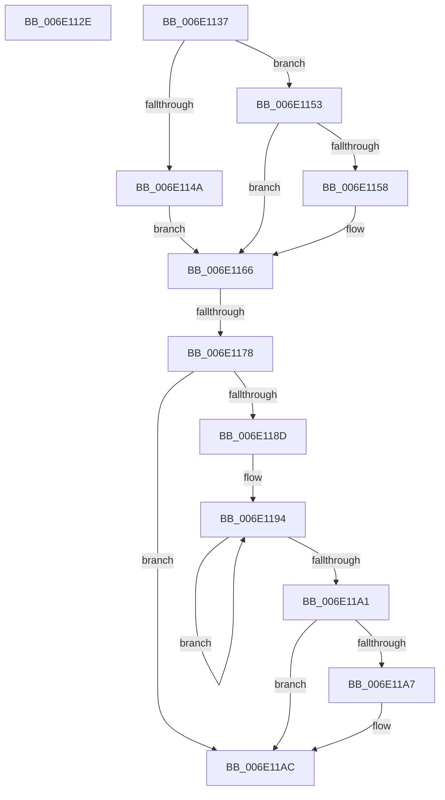

# sub_006E112E

- RVA: `0x006E112E`–`0x006E11B2` (길이 `132` bytes)
- VA: `0x00000001406E112E`
- 실행 섹션: `.text`
- PDB 이름 있음: `아니요`; PDB Function 태그: `아니요`
- unwind 정보 RVA: `0x00074580`
- 디코드: `31`개 명령, `132/132` bytes 표시
- 미해석 바이트: `0` (있으면 어셈블리에 `.byte`로 보존)

> 이 문서는 커널 이미지의 기계어와 PDB 기호를 분석해 생성했습니다. 4번과 5번은 함수 원형과 자료형을 바이너리 사용 방식에서 추정한 C 해석이며 원본 소스 복구 결과는 아닙니다.

## 1. Dependencies

- 직접 호출 지점: **1**; 고유 호출 대상: **1**
- 직접 호출자로 확인된 함수: **0**
- RIP 상대 이미지 참조: **0**

### Outgoing calls
- `0x006E11A7` → [KiRemoveSystemWorkPriorityKick](../26/KiRemoveSystemWorkPriorityKick_function_002631D0.md) (function, `0x002631D0`)

### Direct callers
- 이 함수 시작 RVA로 연결되는 직접 call은 확인되지 않았습니다. 간접 호출은 완전히 역산할 수 없습니다.

### Static image references
- 디코드된 RIP-relative 메모리 참조가 없습니다.

## 2. Other-region calls and transfers

- 다른 실행 섹션으로 향하는 call: **0**
- call이 아닌 외부 분기/꼬리 이동: **3**
  - `0x006E1132` → [HvlpReleaseHypercallPage + 0x2A](../31/HvlpReleaseHypercallPage_function_00313480.md) (`tail-transfer`)
  - `0x006E1172` → [HvlpReleaseHypercallPage + 0x2A](../31/HvlpReleaseHypercallPage_function_00313480.md) (`tail-transfer`)
  - `0x006E11AD` → [HvlpReleaseHypercallPage + 0x2A](../31/HvlpReleaseHypercallPage_function_00313480.md) (`tail-transfer`)

## 3. Assembly (complete function range)

```asm
006E112E  44 0F 22 C3                     mov cr8, rbx
006E1132  E9 73 23 C3 FF                  jmp 0x1403134aa
006E1137  65 48 8B 04 25 20 00 00 00      mov rax, qword ptr gs:[0x20]
006E1140  44 8B 41 0C                     mov r8d, dword ptr [rcx + 0xc]
006E1144  41 F6 C0 01                     test r8b, 1
006E1148  74 09                           je 0x1406e1153
006E114A  48 8B 90 00 8C 00 00            mov rdx, qword ptr [rax + 0x8c00]
006E1151  EB 13                           jmp 0x1406e1166
006E1153  45 84 C1                        test r9b, r8b
006E1156  74 0E                           je 0x1406e1166
006E1158  48 8B 90 00 8C 00 00            mov rdx, qword ptr [rax + 0x8c00]
006E115F  48 81 C2 00 10 00 00            add rdx, 0x1000
006E1166  48 8B 41 18                     mov rax, qword ptr [rcx + 0x18]
006E116A  48 89 42 10                     mov qword ptr [rdx + 0x10], rax
006E116E  80 79 08 00                     cmp byte ptr [rcx + 8], 0
006E1172  0F 84 32 23 C3 FF               je 0x1403134aa
006E1178  65 48 8B 0C 25 20 00 00 00      mov rcx, qword ptr gs:[0x20]
006E1181  4C 8B 81 B8 8E 00 00            mov r8, qword ptr [rcx + 0x8eb8]
006E1188  4D 85 C0                        test r8, r8
006E118B  74 1F                           je 0x1406e11ac
006E118D  41 0F 0D 08                     prefetchw byte ptr [r8]
006E1191  41 8B 00                        mov eax, dword ptr [r8]
006E1194  8B D0                           mov edx, eax
006E1196  0F BA F2 15                     btr edx, 0x15
006E119A  F0 41 0F B1 10                  lock cmpxchg dword ptr [r8], edx
006E119F  75 F3                           jne 0x1406e1194
006E11A1  0F BA E0 15                     bt eax, 0x15
006E11A5  73 05                           jae 0x1406e11ac
006E11A7  E8 24 20 B8 FF                  call 0x1402631d0
006E11AC  FB                              sti
006E11AD  E9 F8 22 C3 FF                  jmp 0x1403134aa
```

## 4. C-style interpretation (structured pseudocode)

```c
__int64 __fastcall sub_006E112E(__int64 a1, __int64 a2, __int64 a3, unsigned __int8 a4)
{
}
```

## 5. (Beta) C Style

```c
int64_t sub_006E112E(int64_t Arg1, int64_t Arg2, int64_t Arg3, uint8_t Arg4)
{
}
```

## 6. Execution-region graph

[열기: 2D/3D 그래프와 함수 탐색 컨트롤 패널](../../../control-panel.html?section=text&rva=0x006E112E&view=graph)

- 2D 그래프는 위에서 아래로 흐르고, 3D 그래프는 빈 공간을 드래그해 회전합니다. Shift+드래그는 이동, 휠은 확대·축소, 함수 노드 선택은 대상 보고서 이동입니다.

### Static fallback


