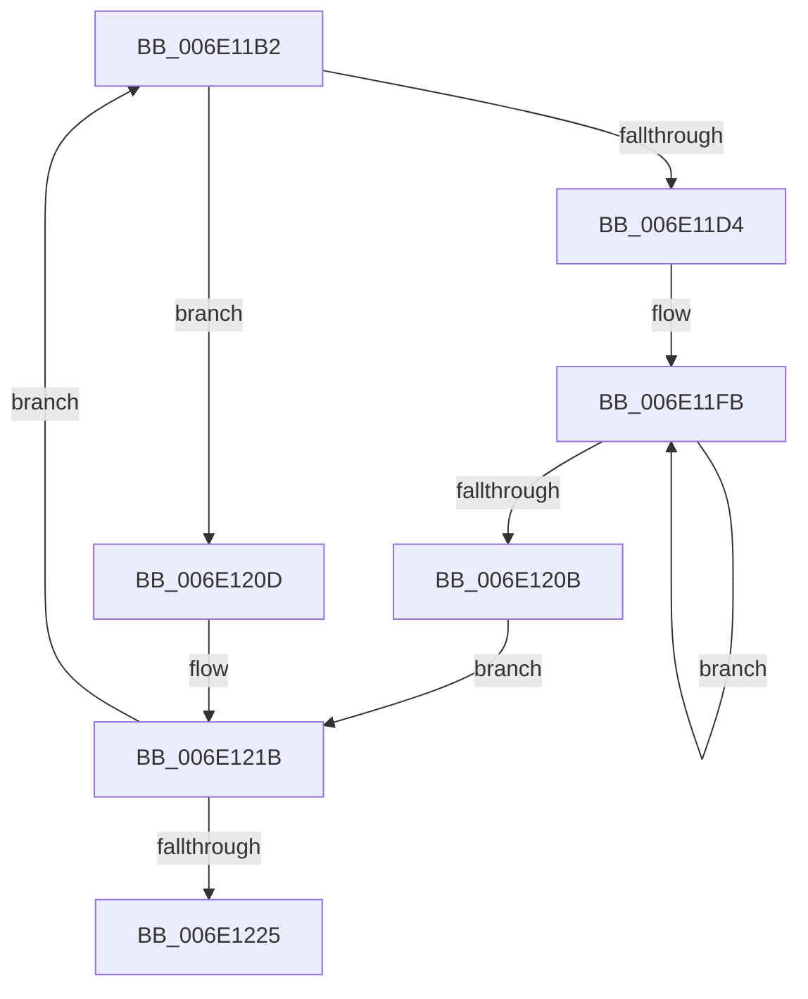

# sub_006E11B2

- RVA: `0x006E11B2`–`0x006E122E` (길이 `124` bytes)
- VA: `0x00000001406E11B2`
- 실행 섹션: `.text`
- PDB 이름 있음: `아니요`; PDB Function 태그: `아니요`
- unwind 정보 RVA: `0x00074668`
- 디코드: `33`개 명령, `124/124` bytes 표시
- 미해석 바이트: `0` (있으면 어셈블리에 `.byte`로 보존)

> 이 문서는 커널 이미지의 기계어와 PDB 기호를 분석해 생성했습니다. 4번과 5번은 함수 원형과 자료형을 바이너리 사용 방식에서 추정한 C 해석이며 원본 소스 복구 결과는 아닙니다.

## 1. Dependencies

- 직접 호출 지점: **0**; 고유 호출 대상: **0**
- 직접 호출자로 확인된 함수: **0**
- RIP 상대 이미지 참조: **0**

### Outgoing calls
- 직접 디코드된 call 명령이 없습니다.

### Direct callers
- 이 함수 시작 RVA로 연결되는 직접 call은 확인되지 않았습니다. 간접 호출은 완전히 역산할 수 없습니다.

### Static image references
- 디코드된 RIP-relative 메모리 참조가 없습니다.

## 2. Other-region calls and transfers

- 다른 실행 섹션으로 향하는 call: **0**
- call이 아닌 외부 분기/꼬리 이동: **1**
  - `0x006E1229` → [HvlpCopyFlushVaList + 0x39](../31/HvlpCopyFlushVaList_function_00313CC0.md) (`tail-transfer`)

## 3. Assembly (complete function range)

```asm
006E11B2  4C 8B 02                        mov r8, qword ptr [rdx]
006E11B5  4D 8B D8                        mov r11, r8
006E11B8  49 C1 EB 0A                     shr r11, 0xa
006E11BC  41 83 E3 03                     and r11d, 3
006E11C0  49 F7 C0 FF 03 00 00            test r8, 0x3ff
006E11C7  0F 95 C1                        setne cl
006E11CA  4D 85 DB                        test r11, r11
006E11CD  0F 95 C0                        setne al
006E11D0  84 C8                           test al, cl
006E11D2  74 39                           je 0x1406e120d
006E11D4  41 0F B6 CB                     movzx ecx, r11b
006E11D8  49 8B C0                        mov rax, r8
006E11DB  41 C0 E3 03                     shl r11b, 3
006E11DF  48 25 00 F0 FF FF               and rax, 0xfffffffffffff000
006E11E5  41 02 CB                        add cl, r11b
006E11E8  41 81 E0 FF 03 00 00            and r8d, 0x3ff
006E11EF  41 BB 00 10 00 00               mov r11d, 0x1000
006E11F5  49 D3 E3                        shl r11, cl
006E11F8  49 FF C0                        inc r8
006E11FB  4B 89 04 D1                     mov qword ptr [r9 + r10*8], rax
006E11FF  49 03 C3                        add rax, r11
006E1202  41 FF C2                        inc r10d
006E1205  49 83 E8 01                     sub r8, 1
006E1209  75 F0                           jne 0x1406e11fb
006E120B  EB 0E                           jmp 0x1406e121b
006E120D  49 81 E0 FF F3 FF FF            and r8, 0xfffffffffffff3ff
006E1214  4F 89 04 D1                     mov qword ptr [r9 + r10*8], r8
006E1218  41 FF C2                        inc r10d
006E121B  48 83 C2 08                     add rdx, 8
006E121F  48 83 EB 01                     sub rbx, 1
006E1223  75 8D                           jne 0x1406e11b2
006E1225  48 8B 1C 24                     mov rbx, qword ptr [rsp]
006E1229  E9 CB 2A C3 FF                  jmp 0x140313cf9
```

## 4. C-style interpretation (structured pseudocode)

```c
__int64 __fastcall sub_006E11B2(__int64 a1, __int64 a2, __int64 a3, __int64 a4)
{
    __int64 result;
    __int64 v_r10;
    __int64 v_r11;
    __int64 v_rbx;
    unsigned __int64 v_stack_p0;

    v_r11 = (*(unsigned __int64 *)(a2)) >> (10);
    v_r11 = (unsigned int)((v_r11) & (3));
    a1 = (((*(unsigned __int64 *)(a2)) & (0x3FFULL)) != 0) ? 1 : 0;
    result = (v_r11 != 0) ? 1 : 0;
    if ((((unsigned __int8)(result)) & ((unsigned __int8)(a1))) == 0) goto loc_006E120D;
    v_r11 = (unsigned __int8)((v_r11) << (3));
    result = (*(unsigned __int64 *)(a2)) & (0xFFFFFFFFFFFFF000ULL);
    a1 = (unsigned __int8)(((unsigned __int8)(v_r11)) + ((unsigned __int8)(v_r11)));
    a3 = (unsigned int)((*(unsigned __int64 *)(a2)) & (0x3FFULL));
    v_r11 = ((unsigned int)(0x1000ULL)) << ((unsigned __int8)(a1));
    a3 = (a3) + 1;
loc_006E11FB:
    *(unsigned __int64 *)(a4 + v_r10 * 8) = result;
    result = (result) + (v_r11);
    v_r10 = (unsigned int)((v_r10) + 1);
    a3 = (a3) - (1);
    if (condition_is_not_equal) goto loc_006E11FB;
    goto loc_006E121B;
loc_006E120D:
    a3 = (a3) & (0xFFFFFFFFFFFFF3FFULL);
    *(unsigned __int64 *)(a4 + v_r10 * 8) = a3;
    v_r10 = (unsigned int)((v_r10) + 1);
loc_006E121B:
    a2 = (a2) + (8);
    v_rbx = (v_rbx) - (1);
    if (condition_is_not_equal) goto loc_006E11B2;
}
```

## 5. (Beta) C Style

```c
int64_t sub_006E11B2(int64_t Arg1, void *Arg2, int64_t Arg3, void *Arg4)
{
    uint8_t *arg2 = (uint8_t *)Arg2;
    uint8_t *arg4 = (uint8_t *)Arg4;

    int64_t result;
    int64_t local_r10;
    int64_t local_r11;
    int64_t local_rbx;
    uint64_t v_stack_p0;

    local_r11 = (*(uint64_t *)(arg2)) >> (10);
    local_r11 = (uint32_t)((local_r11) & (3));
    Arg1 = (((*(uint64_t *)(arg2)) & (0x3FFULL)) != 0) ? 1 : 0;
    result = (local_r11 != 0) ? 1 : 0;
    if ((((uint8_t)(result)) & ((uint8_t)(Arg1))) == 0) goto loc_006E120D;
    local_r11 = (uint8_t)((local_r11) << (3));
    result = (*(uint64_t *)(arg2)) & (0xFFFFFFFFFFFFF000ULL);
    Arg1 = (uint8_t)(((uint8_t)(local_r11)) + ((uint8_t)(local_r11)));
    Arg3 = (uint32_t)((*(uint64_t *)(arg2)) & (0x3FFULL));
    local_r11 = ((uint32_t)(0x1000ULL)) << ((uint8_t)(Arg1));
    Arg3 = (Arg3) + 1;
loc_006E11FB:
    *(uint64_t *)(arg4 + local_r10 * 8) = result;
    result = (result) + (local_r11);
    local_r10 = (uint32_t)((local_r10) + 1);
    Arg3 = (Arg3) - (1);
    if (condition_is_not_equal) goto loc_006E11FB;
    goto loc_006E121B;
loc_006E120D:
    Arg3 = (Arg3) & (0xFFFFFFFFFFFFF3FFULL);
    *(uint64_t *)(arg4 + local_r10 * 8) = Arg3;
    local_r10 = (uint32_t)((local_r10) + 1);
loc_006E121B:
    Arg2 = (Arg2) + (8);
    local_rbx = (local_rbx) - (1);
    if (condition_is_not_equal) goto loc_006E11B2;
}
```

### 관측된 메모리 오프셋

구조체 형식이 확인되지 않은 접근은 인자 기준의 오프셋으로만 기록했습니다.

| 기준 인자 | 오프셋 표현 | 폭 (bit) | 접근 |
|---|---:|---:|---|
| `Arg2` | `+ 0x0` | `64` | `R` |
| `Arg4` | `+ 0x0 + r10*8` | `64` | `W` |

## 6. Execution-region graph

[열기: 2D/3D 그래프와 함수 탐색 컨트롤 패널](../../../control-panel.html?section=text&rva=0x006E11B2&view=graph)

- 2D 그래프는 위에서 아래로 흐르고, 3D 그래프는 빈 공간을 드래그해 회전합니다. Shift+드래그는 이동, 휠은 확대·축소, 함수 노드 선택은 대상 보고서 이동입니다.

### Static fallback


