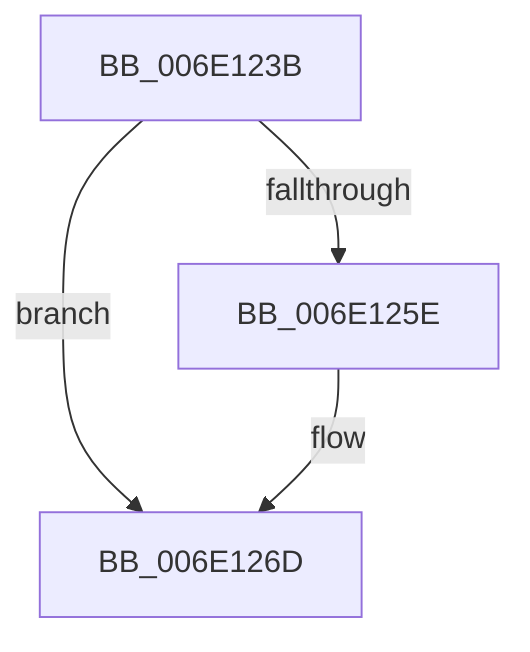

# sub_006E123B

- RVA: `0x006E123B`–`0x006E1289` (길이 `78` bytes)
- VA: `0x00000001406E123B`
- 실행 섹션: `.text`
- PDB 이름 있음: `아니요`; PDB Function 태그: `아니요`
- unwind 정보 RVA: `0x0007483C`
- 디코드: `18`개 명령, `78/78` bytes 표시
- 미해석 바이트: `0` (있으면 어셈블리에 `.byte`로 보존)

> 이 문서는 커널 이미지의 기계어와 PDB 기호를 분석해 생성했습니다. 4번과 5번은 함수 원형과 자료형을 바이너리 사용 방식에서 추정한 C 해석이며 원본 소스 복구 결과는 아닙니다.

## 1. Dependencies

- 직접 호출 지점: **2**; 고유 호출 대상: **2**
- 직접 호출자로 확인된 함수: **0**
- RIP 상대 이미지 참조: **0**

### Outgoing calls
- `0x006E1245` → [VmpProcessContextUnlockExclusive](../48/VmpProcessContextUnlockExclusive_function_004894C8.md) (function, `0x004894C8`)
- `0x006E1250` → [VmpProcessContextLockExclusive](../31/VmpProcessContextLockExclusive_function_003147A4.md) (function, `0x003147A4`)

### Direct callers
- 이 함수 시작 RVA로 연결되는 직접 call은 확인되지 않았습니다. 간접 호출은 완전히 역산할 수 없습니다.

### Static image references
- 디코드된 RIP-relative 메모리 참조가 없습니다.

## 2. Other-region calls and transfers

- 다른 실행 섹션으로 향하는 call: **0**
- call이 아닌 외부 분기/꼬리 이동: **1**
  - `0x006E1284` → [sub_00314541 + 0x41](../31/Unknown_function_00314541.md) (`tail-transfer`)

## 3. Assembly (complete function range)

```asm
006E123B  48 8B 5E 48                     mov rbx, qword ptr [rsi + 0x48]
006E123F  48 8B D5                        mov rdx, rbp
006E1242  48 8B CE                        mov rcx, rsi
006E1245  E8 7E 82 DA FF                  call 0x1404894c8
006E124A  48 8B CE                        mov rcx, rsi
006E124D  4D 8B F5                        mov r14, r13
006E1250  E8 4F 35 C3 FF                  call 0x1403147a4
006E1255  48 8B E8                        mov rbp, rax
006E1258  48 3B 5E 48                     cmp rbx, qword ptr [rsi + 0x48]
006E125C  74 0F                           je 0x1406e126d
006E125E  0F 57 C0                        xorps xmm0, xmm0
006E1261  33 C0                           xor eax, eax
006E1263  0F 11 44 24 60                  movups xmmword ptr [rsp + 0x60], xmm0
006E1268  48 89 44 24 70                  mov qword ptr [rsp + 0x70], rax
006E126D  65 48 8B 04 25 20 00 00 00      mov rax, qword ptr gs:[0x20]
006E1276  4C 8B A0 50 8B 00 00            mov r12, qword ptr [rax + 0x8b50]
006E127D  49 81 C4 00 12 00 00            add r12, 0x1200
006E1284  E9 F9 32 C3 FF                  jmp 0x140314582
```

## 4. C-style interpretation (structured pseudocode)

```c
__int64 __fastcall sub_006E123B(__int64 a1, __int64 a2, __int64 a3, __int64 a4, __int64 a5, __int64 a6, __int64 a7, __int64 a8, __int64 a9, __int64 a10, __int64 a11, __int64 a12)
{
    __int64 result;
    __int64 v_r12;
    unsigned __int64 v_stack_p70;

    result = VmpProcessContextUnlockExclusive(v_rsi, v_rbp, a3, a4);
    result = VmpProcessContextLockExclusive(v_rsi, v_rbp, a3, a4);
    if ((*(unsigned __int64 *)(v_rsi + 72)) != (*(unsigned __int64 *)(v_rsi + 72))) {
        result = 0;
        a12 = v_xmm0;
        v_stack_p70 = 0;
    }
    v_r12 = (*(unsigned __int64 *)(*(unsigned __int64 *)(gs_base + (0 + 32)) + 35664)) + (0x1200ULL);
}
```

## 5. (Beta) C Style

```c
int64_t sub_006E123B(int64_t Arg1, int64_t Arg2, int64_t Arg3, int64_t Arg4, uint64_t Arg5, uint64_t Arg6, uint64_t Arg7, uint64_t Arg8, uint64_t Arg9, uint64_t Arg10, uint64_t Arg11, int64_t Arg12)
{
    int64_t result;
    int64_t local_r12;
    uint64_t v_stack_p70;

    result = VmpProcessContextUnlockExclusive(local_rsi, local_rbp, Arg3, Arg4);
    result = VmpProcessContextLockExclusive(local_rsi, local_rbp, Arg3, Arg4);
    if ((*(uint64_t *)(local_rsi + 0x48)) != (*(uint64_t *)(local_rsi + 0x48))) {
        result = 0;
        Arg12 = v_xmm0;
        v_stack_p70 = 0;
    }
    local_r12 = (*(uint64_t *)(*(uint64_t *)(gs_base + (0 + 0x20)) + 0x8B50)) + (0x1200ULL);
}
```

## 6. Execution-region graph

[열기: 2D/3D 그래프와 함수 탐색 컨트롤 패널](../../../control-panel.html?section=text&rva=0x006E123B&view=graph)

- 2D 그래프는 위에서 아래로 흐르고, 3D 그래프는 빈 공간을 드래그해 회전합니다. Shift+드래그는 이동, 휠은 확대·축소, 함수 노드 선택은 대상 보고서 이동입니다.

### Static fallback


