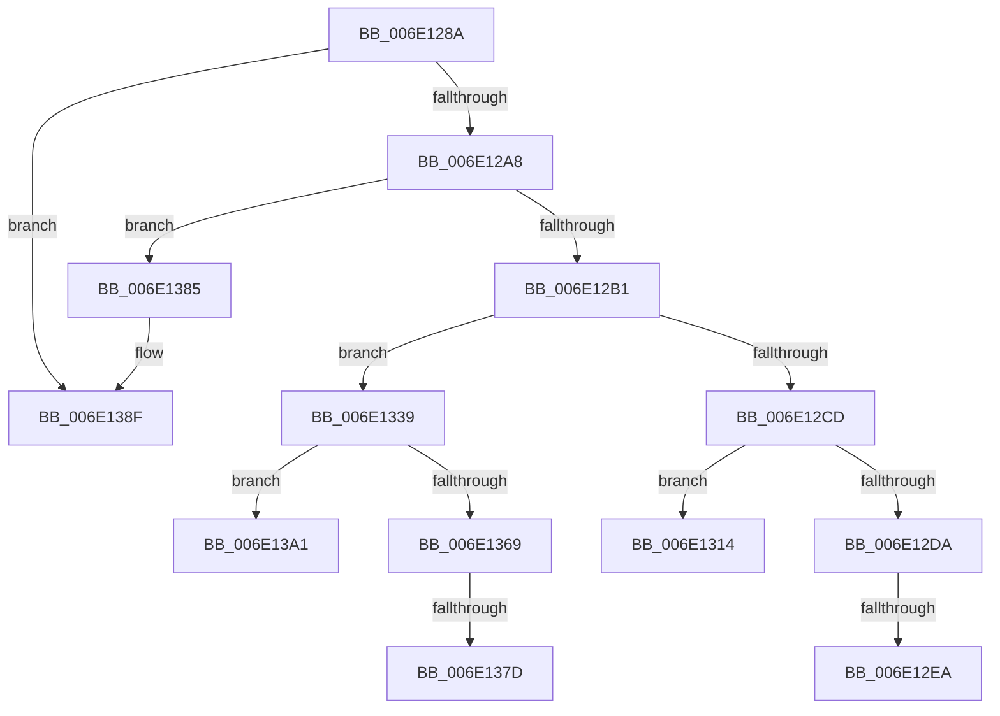

# sub_006E128A

- RVA: `0x006E128A`–`0x006E13AE` (길이 `292` bytes)
- VA: `0x00000001406E128A`
- 실행 섹션: `.text`
- PDB 이름 있음: `아니요`; PDB Function 태그: `아니요`
- unwind 정보 RVA: `0x00074880`
- 디코드: `71`개 명령, `292/292` bytes 표시
- 미해석 바이트: `0` (있으면 어셈블리에 `.byte`로 보존)

> 이 문서는 커널 이미지의 기계어와 PDB 기호를 분석해 생성했습니다. 4번과 5번은 함수 원형과 자료형을 바이너리 사용 방식에서 추정한 C 해석이며 원본 소스 복구 결과는 아닙니다.

## 1. Dependencies

- 직접 호출 지점: **4**; 고유 호출 대상: **2**
- 직접 호출자로 확인된 함수: **0**
- RIP 상대 이미지 참조: **0**

### Outgoing calls
- `0x006E1299` → [VmpFindNextPinnedPageStateHelper](../64/VmpFindNextPinnedPageStateHelper_function_0064C7E4.md) (function, `0x0064C7E4`)
- `0x006E12BF` → [VmpFindNextPinnedPageStateHelper](../64/VmpFindNextPinnedPageStateHelper_function_0064C7E4.md) (function, `0x0064C7E4`)
- `0x006E12F5` → [VmpVaMemoryRangeGetNext](../4A/VmpVaMemoryRangeGetNext_function_004ACEEC.md) (function, `0x004ACEEC`)
- `0x006E1359` → [VmpFindNextPinnedPageStateHelper](../64/VmpFindNextPinnedPageStateHelper_function_0064C7E4.md) (function, `0x0064C7E4`)

### Direct callers
- 이 함수 시작 RVA로 연결되는 직접 call은 확인되지 않았습니다. 간접 호출은 완전히 역산할 수 없습니다.

### Static image references
- 디코드된 RIP-relative 메모리 참조가 없습니다.

## 2. Other-region calls and transfers

- 다른 실행 섹션으로 향하는 call: **0**
- call이 아닌 외부 분기/꼬리 이동: **7**
  - `0x006E12E4` → [VmpConvertPortionVpnRangeToGpnRange + 0x196](../31/VmpConvertPortionVpnRangeToGpnRange_function_003147F0.md) (`tail-transfer`)
  - `0x006E130F` → [VmpConvertPortionVpnRangeToGpnRange + 0x36](../31/VmpConvertPortionVpnRangeToGpnRange_function_003147F0.md) (`tail-transfer`)
  - `0x006E1334` → [VmpConvertPortionVpnRangeToGpnRange + 0x36](../31/VmpConvertPortionVpnRangeToGpnRange_function_003147F0.md) (`tail-transfer`)
  - `0x006E1377` → [VmpConvertPortionVpnRangeToGpnRange + 0xFC](../31/VmpConvertPortionVpnRangeToGpnRange_function_003147F0.md) (`tail-transfer`)
  - `0x006E1380` → [VmpConvertPortionVpnRangeToGpnRange + 0xFC](../31/VmpConvertPortionVpnRangeToGpnRange_function_003147F0.md) (`tail-transfer`)
  - `0x006E139C` → [VmpConvertPortionVpnRangeToGpnRange + 0xF7](../31/VmpConvertPortionVpnRangeToGpnRange_function_003147F0.md) (`tail-transfer`)
  - `0x006E13A9` → [VmpConvertPortionVpnRangeToGpnRange + 0xFC](../31/VmpConvertPortionVpnRangeToGpnRange_function_003147F0.md) (`tail-transfer`)

## 3. Assembly (complete function range)

```asm
006E128A  41 B9 01 00 00 00               mov r9d, 1
006E1290  4D 8B C7                        mov r8, r15
006E1293  48 8B D5                        mov rdx, rbp
006E1296  49 8B CB                        mov rcx, r11
006E1299  E8 46 B5 F6 FF                  call 0x14064c7e4
006E129E  48 83 F8 FF                     cmp rax, -1
006E12A2  0F 84 E7 00 00 00               je 0x1406e138f
006E12A8  48 3B C5                        cmp rax, rbp
006E12AB  0F 85 D4 00 00 00               jne 0x1406e1385
006E12B1  48 8B 4C 24 70                  mov rcx, qword ptr [rsp + 0x70]
006E12B6  45 33 C9                        xor r9d, r9d
006E12B9  4D 8B C7                        mov r8, r15
006E12BC  48 8B D0                        mov rdx, rax
006E12BF  E8 20 B5 F6 FF                  call 0x14064c7e4
006E12C4  48 8B E8                        mov rbp, rax
006E12C7  48 83 F8 FF                     cmp rax, -1
006E12CB  75 6C                           jne 0x1406e1339
006E12CD  49 8B 0C 24                     mov rcx, qword ptr [r12]
006E12D1  48 8D 47 28                     lea rax, [rdi + 0x28]
006E12D5  48 3B C8                        cmp rcx, rax
006E12D8  75 3A                           jne 0x1406e1314
006E12DA  48 8B 5F 20                     mov rbx, qword ptr [rdi + 0x20]
006E12DE  48 FF C3                        inc rbx
006E12E1  49 3B DE                        cmp rbx, r14
006E12E4  0F 87 9C 36 C3 FF               ja 0x140314986
006E12EA  4C 8B 5C 24 70                  mov r11, qword ptr [rsp + 0x70]
006E12EF  48 8B D7                        mov rdx, rdi
006E12F2  49 8B CB                        mov rcx, r11
006E12F5  E8 F2 BB DC FF                  call 0x1404aceec
006E12FA  4C 8B 54 24 78                  mov r10, qword ptr [rsp + 0x78]
006E12FF  4C 2B F3                        sub r14, rbx
006E1302  49 FF C6                        inc r14
006E1305  48 89 06                        mov qword ptr [rsi], rax
006E1308  49 89 1A                        mov qword ptr [r10], rbx
006E130B  4D 89 72 08                     mov qword ptr [r10 + 8], r14
006E130F  E9 12 35 C3 FF                  jmp 0x140314826
006E1314  48 8B 47 18                     mov rax, qword ptr [rdi + 0x18]
006E1318  4C 8B 54 24 78                  mov r10, qword ptr [rsp + 0x78]
006E131D  4C 8B 5C 24 70                  mov r11, qword ptr [rsp + 0x70]
006E1322  48 89 4E 08                     mov qword ptr [rsi + 8], rcx
006E1326  49 8B 0A                        mov rcx, qword ptr [r10]
006E1329  48 3B C8                        cmp rcx, rax
006E132C  48 0F 46 C8                     cmovbe rcx, rax
006E1330  48 89 4E 10                     mov qword ptr [rsi + 0x10], rcx
006E1334  E9 ED 34 C3 FF                  jmp 0x140314826
006E1339  48 8B 5F 18                     mov rbx, qword ptr [rdi + 0x18]
006E133D  4D 8B C7                        mov r8, r15
006E1340  49 2B 5C 24 30                  sub rbx, qword ptr [r12 + 0x30]
006E1345  41 B9 01 00 00 00               mov r9d, 1
006E134B  4C 8B 7C 24 70                  mov r15, qword ptr [rsp + 0x70]
006E1350  48 8B D5                        mov rdx, rbp
006E1353  49 8B CF                        mov rcx, r15
006E1356  48 03 DD                        add rbx, rbp
006E1359  E8 86 B4 F6 FF                  call 0x14064c7e4
006E135E  4C 8B 54 24 78                  mov r10, qword ptr [rsp + 0x78]
006E1363  48 83 F8 FF                     cmp rax, -1
006E1367  74 38                           je 0x1406e13a1
006E1369  48 2B C5                        sub rax, rbp
006E136C  48 8B AC 24 98 00 00 00         mov rbp, qword ptr [rsp + 0x98]
006E1374  49 3B C5                        cmp rax, r13
006E1377  0F 83 6F 35 C3 FF               jae 0x1403148ec
006E137D  4C 8B E8                        mov r13, rax
006E1380  E9 67 35 C3 FF                  jmp 0x1403148ec
006E1385  48 2B C5                        sub rax, rbp
006E1388  49 3B C5                        cmp rax, r13
006E138B  4C 0F 42 E8                     cmovb r13, rax
006E138F  48 8B AC 24 98 00 00 00         mov rbp, qword ptr [rsp + 0x98]
006E1397  4C 8B 54 24 78                  mov r10, qword ptr [rsp + 0x78]
006E139C  E9 46 35 C3 FF                  jmp 0x1403148e7
006E13A1  48 8B AC 24 98 00 00 00         mov rbp, qword ptr [rsp + 0x98]
006E13A9  E9 3E 35 C3 FF                  jmp 0x1403148ec
```

## 4. C-style interpretation (structured pseudocode)

```c
__int64 __fastcall sub_006E128A(__int64 a1, __int64 a2, __int64 a3, __int64 a4, __int64 a5, __int64 a6, __int64 a7, __int64 a8, __int64 a9, __int64 a10, __int64 a11, __int64 a12, __int64 a13, __int64 a14, __int64 a15, __int64 a16, __int64 a17, __int64 a18, __int64 a19)
{
    __int64 result;
    __int64 v_r13;
    __int64 v_r14;
    __int64 v_rbx;

    result = VmpFindNextPinnedPageStateHelper(v_r11, v_rbp, v_r15, 1);
    if (result == -1) goto loc_006E138F;
    if (result != v_rbp) goto loc_006E1385;
    a4 = 0;
    result = VmpFindNextPinnedPageStateHelper(a14, result, v_r15, a4);
    if (result != -1) goto loc_006E1339;
    if ((*(unsigned __int64 *)(v_r12)) != (v_rdi + 40)) goto loc_006E1314;
    v_rbx = (*(unsigned __int64 *)(v_rdi + 32)) + 1;
    result = VmpVaMemoryRangeGetNext(a14, v_rdi, v_r15, a4);
    v_r14 = (v_r14) - (v_rbx);
    v_r14 = (v_r14) + 1;
    *(unsigned __int64 *)(v_rsi) = result;
    *(unsigned __int64 *)(a15) = v_rbx;
    *(unsigned __int64 *)(a15 + 8) = v_r14;
loc_006E1314:
    *(unsigned __int64 *)(v_rsi + 8) = a14;
    a1 = *(unsigned __int64 *)(a15);
    if ((*(unsigned __int64 *)(a15)) <= (*(unsigned __int64 *)(v_rdi + 24))) { a1 = *(unsigned __int64 *)(v_rdi + 24); }
    *(unsigned __int64 *)(v_rsi + 16) = a1;
loc_006E1339:
    v_rbx = (*(unsigned __int64 *)(v_rdi + 24)) - (*(unsigned __int64 *)(v_r12 + 48));
    v_rbx = (v_rbx) + (result);
    result = VmpFindNextPinnedPageStateHelper(a14, result, v_r15, 1);
    if (result == -1) goto loc_006E13A1;
    result = (result) - (result);
loc_006E1385:
    result = (result) - (a19);
    v_r13 = result;
    if (result < result) { v_r13 = result; }
loc_006E138F:
loc_006E13A1:
}
```

## 5. (Beta) C Style

```c
int64_t sub_006E128A(int64_t Arg1, int64_t Arg2, int64_t Arg3, int64_t Arg4, uint64_t Arg5, uint64_t Arg6, uint64_t Arg7, uint64_t Arg8, uint64_t Arg9, uint64_t Arg10, uint64_t Arg11, uint64_t Arg12, uint64_t Arg13, int64_t Arg14, void *Arg15, uint64_t Arg16, uint64_t Arg17, uint64_t Arg18, int64_t Arg19)
{
    uint8_t *arg15 = (uint8_t *)Arg15;

    int64_t result;
    int64_t local_r13;
    int64_t local_r14;
    int64_t local_rbx;

    result = VmpFindNextPinnedPageStateHelper(local_r11, local_rbp, local_r15, 1);
    if (result == -1) goto loc_006E138F;
    if (result != local_rbp) goto loc_006E1385;
    Arg4 = 0;
    result = VmpFindNextPinnedPageStateHelper(Arg14, result, local_r15, Arg4);
    if (result != -1) goto loc_006E1339;
    if ((*(uint64_t *)(local_r12)) != (local_rdi + 40)) goto loc_006E1314;
    local_rbx = (*(uint64_t *)(local_rdi + 0x20)) + 1;
    result = VmpVaMemoryRangeGetNext(Arg14, local_rdi, local_r15, Arg4);
    local_r14 = (local_r14) - (local_rbx);
    local_r14 = (local_r14) + 1;
    *(uint64_t *)(local_rsi) = result;
    *(uint64_t *)(arg15) = local_rbx;
    *(uint64_t *)(arg15 + 0x8) = local_r14;
loc_006E1314:
    *(uint64_t *)(local_rsi + 0x8) = Arg14;
    Arg1 = *(uint64_t *)(arg15);
    if ((*(uint64_t *)(arg15)) <= (*(uint64_t *)(local_rdi + 0x18))) { Arg1 = *(uint64_t *)(local_rdi + 0x18); }
    *(uint64_t *)(local_rsi + 0x10) = Arg1;
loc_006E1339:
    local_rbx = (*(uint64_t *)(local_rdi + 0x18)) - (*(uint64_t *)(local_r12 + 0x30));
    local_rbx = (local_rbx) + (result);
    result = VmpFindNextPinnedPageStateHelper(Arg14, result, local_r15, 1);
    if (result == -1) goto loc_006E13A1;
    result = (result) - (result);
loc_006E1385:
    result = (result) - (Arg19);
    local_r13 = result;
    if (result < result) { local_r13 = result; }
loc_006E138F:
loc_006E13A1:
}
```

### 관측된 메모리 오프셋

구조체 형식이 확인되지 않은 접근은 인자 기준의 오프셋으로만 기록했습니다.

| 기준 인자 | 오프셋 표현 | 폭 (bit) | 접근 |
|---|---:|---:|---|
| `Arg15` | `+ 0x0` | `64` | `R` |
| `Arg15` | `+ 0x0` | `64` | `W` |
| `Arg15` | `+ 0x8` | `64` | `W` |

## 6. Execution-region graph

[열기: 2D/3D 그래프와 함수 탐색 컨트롤 패널](../../../control-panel.html?section=text&rva=0x006E128A&view=graph)

- 2D 그래프는 위에서 아래로 흐르고, 3D 그래프는 빈 공간을 드래그해 회전합니다. Shift+드래그는 이동, 휠은 확대·축소, 함수 노드 선택은 대상 보고서 이동입니다.

### Static fallback


