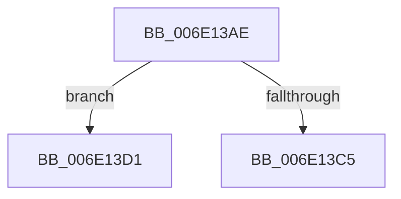

# sub_006E13AE

- RVA: `0x006E13AE`–`0x006E13DB` (길이 `45` bytes)
- VA: `0x00000001406E13AE`
- 실행 섹션: `.text`
- PDB 이름 있음: `아니요`; PDB Function 태그: `아니요`
- unwind 정보 RVA: `0x0007494C`
- 디코드: `11`개 명령, `45/45` bytes 표시
- 미해석 바이트: `0` (있으면 어셈블리에 `.byte`로 보존)

> 이 문서는 커널 이미지의 기계어와 PDB 기호를 분석해 생성했습니다. 4번과 5번은 함수 원형과 자료형을 바이너리 사용 방식에서 추정한 C 해석이며 원본 소스 복구 결과는 아닙니다.

## 1. Dependencies

- 직접 호출 지점: **1**; 고유 호출 대상: **1**
- 직접 호출자로 확인된 함수: **0**
- RIP 상대 이미지 참조: **0**

### Outgoing calls
- `0x006E13BB` → [MiReleaseSpinLockExclusive](../24/MiReleaseSpinLockExclusive_function_002482C0.md) (function, `0x002482C0`)

### Direct callers
- 이 함수 시작 RVA로 연결되는 직접 call은 확인되지 않았습니다. 간접 호출은 완전히 역산할 수 없습니다.

### Static image references
- 디코드된 RIP-relative 메모리 참조가 없습니다.

## 2. Other-region calls and transfers

- 다른 실행 섹션으로 향하는 call: **0**
- call이 아닌 외부 분기/꼬리 이동: **2**
  - `0x006E13CC` → [MiReplenishCombineResources + 0x2F](../31/MiReplenishCombineResources_function_00316140.md) (`tail-transfer`)
  - `0x006E13D6` → [MiReplenishCombineResources + 0x3A](../31/MiReplenishCombineResources_function_00316140.md) (`tail-transfer`)

## 3. Assembly (complete function range)

```asm
006E13AE  B9 03 00 00 00                  mov ecx, 3
006E13B3  CD 29                           int 0x29
006E13B5  B2 11                           mov dl, 0x11
006E13B7  48 8D 4E 58                     lea rcx, [rsi + 0x58]
006E13BB  E8 00 6F B6 FF                  call 0x1402482c0
006E13C0  48 85 DB                        test rbx, rbx
006E13C3  74 0C                           je 0x1406e13d1
006E13C5  48 89 9F 28 01 00 00            mov qword ptr [rdi + 0x128], rbx
006E13CC  E9 9E 4D C3 FF                  jmp 0x14031616f
006E13D1  B8 2D 02 00 C0                  mov eax, 0xc000022d
006E13D6  E9 9F 4D C3 FF                  jmp 0x14031617a
```

## 4. C-style interpretation (structured pseudocode)

```c
__int64 __fastcall sub_006E13AE(void)
{
    __int64 result;

    result = MiReleaseSpinLockExclusive(v_rsi + 88, 17, a3, a4);
    if (v_rbx == 0) goto loc_006E13D1;
    *(unsigned __int64 *)(v_rdi + 296) = v_rbx;
loc_006E13D1:
}
```

## 5. (Beta) C Style

```c
void sub_006E13AE(void)
{
    int64_t result;

    result = MiReleaseSpinLockExclusive(local_rsi + 88, 17, a3, a4);
    if (local_rbx == 0) goto loc_006E13D1;
    *(uint64_t *)(local_rdi + 0x128) = local_rbx;
loc_006E13D1:
}
```

## 6. Execution-region graph

[열기: 2D/3D 그래프와 함수 탐색 컨트롤 패널](../../../control-panel.html?section=text&rva=0x006E13AE&view=graph)

- 2D 그래프는 위에서 아래로 흐르고, 3D 그래프는 빈 공간을 드래그해 회전합니다. Shift+드래그는 이동, 휠은 확대·축소, 함수 노드 선택은 대상 보고서 이동입니다.

### Static fallback


