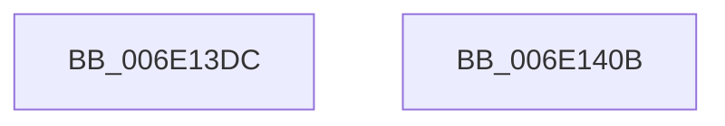

# sub_006E13DC

- RVA: `0x006E13DC`–`0x006E141D` (길이 `65` bytes)
- VA: `0x00000001406E13DC`
- 실행 섹션: `.text`
- PDB 이름 있음: `아니요`; PDB Function 태그: `아니요`
- unwind 정보 RVA: `0x000749B8`
- 디코드: `14`개 명령, `65/65` bytes 표시
- 미해석 바이트: `0` (있으면 어셈블리에 `.byte`로 보존)

> 이 문서는 커널 이미지의 기계어와 PDB 기호를 분석해 생성했습니다. 4번과 5번은 함수 원형과 자료형을 바이너리 사용 방식에서 추정한 C 해석이며 원본 소스 복구 결과는 아닙니다.

## 1. Dependencies

- 직접 호출 지점: **3**; 고유 호출 대상: **2**
- 직접 호출자로 확인된 함수: **0**
- RIP 상대 이미지 참조: **0**

### Outgoing calls
- `0x006E13DF` → [MiWaitForVadDeletion](../31/MiWaitForVadDeletion_function_00316F1C.md) (function, `0x00316F1C`)
- `0x006E13E7` → [MiUnlockAndDereferenceVad](../31/MiUnlockAndDereferenceVad_function_00316E60.md) (function, `0x00316E60`)
- `0x006E140B` → [MiUnlockAndDereferenceVad](../31/MiUnlockAndDereferenceVad_function_00316E60.md) (function, `0x00316E60`)

### Direct callers
- 이 함수 시작 RVA로 연결되는 직접 call은 확인되지 않았습니다. 간접 호출은 완전히 역산할 수 없습니다.

### Static image references
- 디코드된 RIP-relative 메모리 참조가 없습니다.

## 2. Other-region calls and transfers

- 다른 실행 섹션으로 향하는 call: **0**
- call이 아닌 외부 분기/꼬리 이동: **2**
  - `0x006E1406` → [sub_00316832 + 0x31](../31/Unknown_function_00316832.md) (`tail-transfer`)
  - `0x006E1418` → [sub_00316832 + 0x31](../31/Unknown_function_00316832.md) (`tail-transfer`)

## 3. Assembly (complete function range)

```asm
006E13DC  48 8B CB                        mov rcx, rbx
006E13DF  E8 38 5B C3 FF                  call 0x140316f1c
006E13E4  48 8B CB                        mov rcx, rbx
006E13E7  E8 74 5A C3 FF                  call 0x140316e60
006E13EC  41 8B 85 F4 01 00 00            mov eax, dword ptr [r13 + 0x1f4]
006E13F3  B9 A0 00 00 C0                  mov ecx, 0xc00000a0
006E13F8  A8 20                           test al, 0x20
006E13FA  B8 0A 01 00 C0                  mov eax, 0xc000010a
006E13FF  0F 44 C1                        cmove eax, ecx
006E1402  41 89 04 24                     mov dword ptr [r12], eax
006E1406  E9 58 54 C3 FF                  jmp 0x140316863
006E140B  E8 50 5A C3 FF                  call 0x140316e60
006E1410  41 C7 04 24 A0 00 00 C0         mov dword ptr [r12], 0xc00000a0
006E1418  E9 46 54 C3 FF                  jmp 0x140316863
```

## 4. C-style interpretation (structured pseudocode)

```c
__int64 __fastcall sub_006E13DC(void)
{
    __int64 result;

    result = MiWaitForVadDeletion(v_rbx, a2, a3, a4);
    result = MiUnlockAndDereferenceVad(v_rbx, a2, a3, a4);
    result = (unsigned int)(0xC000010AULL);
    if ((((unsigned __int8)((unsigned int)(*(unsigned int *)(v_r13 + 500)))) & (32)) == 0) { result = (unsigned int)((unsigned int)(0xC00000A0ULL)); }
    *(unsigned int *)(v_r12) = (unsigned int)(result);
}
```

## 5. (Beta) C Style

```c
void sub_006E13DC(void)
{
    int64_t result;

    result = MiWaitForVadDeletion(local_rbx, a2, a3, a4);
    result = MiUnlockAndDereferenceVad(local_rbx, a2, a3, a4);
    result = (uint32_t)(0xC000010AULL);
    if ((((uint8_t)((uint32_t)(*(uint32_t *)(local_r13 + 0x1F4)))) & (32)) == 0) { result = (uint32_t)((uint32_t)(0xC00000A0ULL)); }
    *(uint32_t *)(local_r12) = (uint32_t)(result);
}
```

## 6. Execution-region graph

[열기: 2D/3D 그래프와 함수 탐색 컨트롤 패널](../../../control-panel.html?section=text&rva=0x006E13DC&view=graph)

- 2D 그래프는 위에서 아래로 흐르고, 3D 그래프는 빈 공간을 드래그해 회전합니다. Shift+드래그는 이동, 휠은 확대·축소, 함수 노드 선택은 대상 보고서 이동입니다.

### Static fallback


