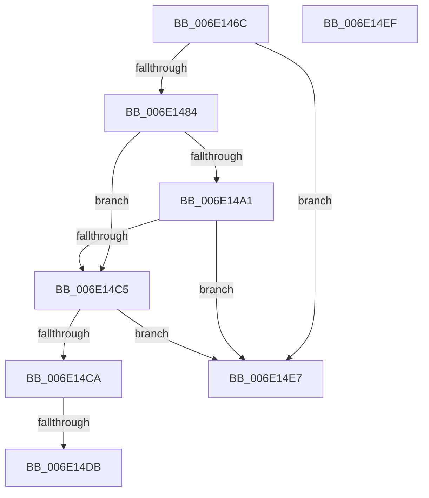

# sub_006E146C

- RVA: `0x006E146C`–`0x006E1546` (길이 `218` bytes)
- VA: `0x00000001406E146C`
- 실행 섹션: `.text`
- PDB 이름 있음: `아니요`; PDB Function 태그: `아니요`
- unwind 정보 RVA: `0x000750EC`
- 디코드: `47`개 명령, `218/218` bytes 표시
- 미해석 바이트: `0` (있으면 어셈블리에 `.byte`로 보존)

> 이 문서는 커널 이미지의 기계어와 PDB 기호를 분석해 생성했습니다. 4번과 5번은 함수 원형과 자료형을 바이너리 사용 방식에서 추정한 C 해석이며 원본 소스 복구 결과는 아닙니다.

## 1. Dependencies

- 직접 호출 지점: **1**; 고유 호출 대상: **1**
- 직접 호출자로 확인된 함수: **0**
- RIP 상대 이미지 참조: **1**

### Outgoing calls
- `0x006E148A` → [MiGetLeafPfnBuddy](../43/MiGetLeafPfnBuddy_function_00438E30.md) (function, `0x00438E30`)

### Direct callers
- 이 함수 시작 RVA로 연결되는 직접 call은 확인되지 않았습니다. 간접 호출은 완전히 역산할 수 없습니다.

### Static image references
- `0x006E14A1` → RVA `0x00E2DCE0` (`.data`; read)

## 2. Other-region calls and transfers

- 다른 실행 섹션으로 향하는 call: **0**
- call이 아닌 외부 분기/꼬리 이동: **4**
  - `0x006E14D5` → [sub_0031CBBA + 0x73](../31/Unknown_function_0031CBBA.md) (`tail-transfer`)
  - `0x006E14E2` → [sub_0031CBBA + 0x73](../31/Unknown_function_0031CBBA.md) (`tail-transfer`)
  - `0x006E14EA` → [sub_0031D09C + 0xE9](../31/Unknown_function_0031D09C.md) (`tail-transfer`)
  - `0x006E1541` → [sub_0031CBBA + 0xC3](../31/Unknown_function_0031CBBA.md) (`tail-transfer`)

## 3. Assembly (complete function range)

```asm
006E146C  48 8B 07                        mov rax, qword ptr [rdi]
006E146F  48 BA FF FF FF FF FF 00 00 00   movabs rdx, 0xffffffffff
006E1479  48 23 C2                        and rax, rdx
006E147C  48 3D 00 00 04 00               cmp rax, 0x40000
006E1482  76 63                           jbe 0x1406e14e7
006E1484  41 8B D2                        mov edx, r10d
006E1487  48 8B CF                        mov rcx, rdi
006E148A  E8 A1 79 D5 FF                  call 0x140438e30
006E148F  48 B9 00 00 00 00 00 DE FF FF   movabs rcx, 0xffffde0000000000
006E1499  48 8B C9                        mov rcx, rcx
006E149C  48 3B C1                        cmp rax, rcx
006E149F  72 24                           jb 0x1406e14c5
006E14A1  48 8B 0D 38 C8 74 00            mov rcx, qword ptr [rip + 0x74c838]
006E14A8  48 8D 14 49                     lea rdx, [rcx + rcx*2]
006E14AC  48 B9 30 00 00 00 00 DE FF FF   movabs rcx, 0xffffde0000000030
006E14B6  48 C1 E2 04                     shl rdx, 4
006E14BA  48 8B C9                        mov rcx, rcx
006E14BD  48 03 D1                        add rdx, rcx
006E14C0  48 3B C2                        cmp rax, rdx
006E14C3  72 22                           jb 0x1406e14e7
006E14C5  48 85 C0                        test rax, rax
006E14C8  74 1D                           je 0x1406e14e7
006E14CA  48 81 38 40 19 06 00            cmp qword ptr [rax], 0x61940
006E14D1  48 8B 4D 77                     mov rcx, qword ptr [rbp + 0x77]
006E14D5  0F 84 52 B7 C3 FF               je 0x14031cc2d
006E14DB  44 8B A0 D0 01 00 00            mov r12d, dword ptr [rax + 0x1d0]
006E14E2  E9 46 B7 C3 FF                  jmp 0x14031cc2d
006E14E7  45 8B FA                        mov r15d, r10d
006E14EA  E9 96 BC C3 FF                  jmp 0x14031d185
006E14EF  48 8B 45 77                     mov rax, qword ptr [rbp + 0x77]
006E14F3  48 BA F3 01 00 00 00 00 00 FE   movabs rdx, 0xfe000000000001f3
006E14FD  48 23 DA                        and rbx, rdx
006E1500  8B 80 A8 FE FF FF               mov eax, dword ptr [rax - 0x158]
006E1506  48 C1 E0 09                     shl rax, 9
006E150A  48 0B C3                        or rax, rbx
006E150D  48 83 C8 03                     or rax, 3
006E1511  48 89 06                        mov qword ptr [rsi], rax
006E1514  48 B8 68 DF BE 7D FB F6 FF FF   movabs rax, 0xfffff6fb7dbedf68
006E151E  48 8B C8                        mov rcx, rax
006E1521  48 C1 E1 19                     shl rcx, 0x19
006E1525  48 BF 00 00 00 00 80 F6 FF FF   movabs rdi, 0xfffff68000000000
006E152F  48 8B C7                        mov rax, rdi
006E1532  48 C1 E0 19                     shl rax, 0x19
006E1536  48 2B C8                        sub rcx, rax
006E1539  48 C1 F9 10                     sar rcx, 0x10
006E153D  48 89 4E 10                     mov qword ptr [rsi + 0x10], rcx
006E1541  E9 37 B7 C3 FF                  jmp 0x14031cc7d
```

## 4. C-style interpretation (structured pseudocode)

```c
__int64 __fastcall sub_006E146C(void)
{
    __int64 result;

    result = (*(unsigned __int64 *)(v_rdi)) & (a2);
    if (result <= 0x40000ULL) goto loc_006E14E7;
    result = MiGetLeafPfnBuddy(v_rdi, (unsigned int)((unsigned int)(v_r10)), a3, a4);
    if (result < v_rdi) goto loc_006E14C5;
    a2 = (*(unsigned __int64 *)(v_rip + 7653432) + *(unsigned __int64 *)(v_rip + 7653432) * 2) << (4);
    a2 = (a2) + (*(unsigned __int64 *)(v_rip + 7653432));
    if (result < a2) goto loc_006E14E7;
loc_006E14C5:
    if (result == 0) goto loc_006E14E7;
loc_006E14E7:
}
```

## 5. (Beta) C Style

```c
void sub_006E146C(void)
{
    int64_t result;

    result = (*(uint64_t *)(local_rdi)) & (a2);
    if (result <= 0x40000ULL) goto loc_006E14E7;
    result = MiGetLeafPfnBuddy(local_rdi, (uint32_t)((uint32_t)(local_r10)), a3, a4);
    if (result < local_rdi) goto loc_006E14C5;
    a2 = (*(uint64_t *)(v_rip + 0x74C838) + *(uint64_t *)(v_rip + 0x74C838) * 2) << (4);
    a2 = (a2) + (*(uint64_t *)(v_rip + 0x74C838));
    if (result < a2) goto loc_006E14E7;
loc_006E14C5:
    if (result == 0) goto loc_006E14E7;
loc_006E14E7:
}
```

## 6. Execution-region graph

[열기: 2D/3D 그래프와 함수 탐색 컨트롤 패널](../../../control-panel.html?section=text&rva=0x006E146C&view=graph)

- 2D 그래프는 위에서 아래로 흐르고, 3D 그래프는 빈 공간을 드래그해 회전합니다. Shift+드래그는 이동, 휠은 확대·축소, 함수 노드 선택은 대상 보고서 이동입니다.

### Static fallback


