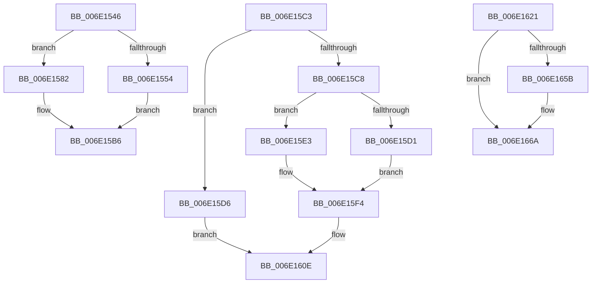

# sub_006E1546

- RVA: `0x006E1546`–`0x006E167A` (길이 `308` bytes)
- VA: `0x00000001406E1546`
- 실행 섹션: `.text`
- PDB 이름 있음: `아니요`; PDB Function 태그: `아니요`
- unwind 정보 RVA: `0x00075110`
- 디코드: `76`개 명령, `308/308` bytes 표시
- 미해석 바이트: `0` (있으면 어셈블리에 `.byte`로 보존)

> 이 문서는 커널 이미지의 기계어와 PDB 기호를 분석해 생성했습니다. 4번과 5번은 함수 원형과 자료형을 바이너리 사용 방식에서 추정한 C 해석이며 원본 소스 복구 결과는 아닙니다.

## 1. Dependencies

- 직접 호출 지점: **4**; 고유 호출 대상: **2**
- 직접 호출자로 확인된 함수: **0**
- RIP 상대 이미지 참조: **0**

### Outgoing calls
- `0x006E155D` → [MiGetPfnPidSafe](../43/MiGetPfnPidSafe_function_00438D88.md) (function, `0x00438D88`)
- `0x006E15EC` → [MiGetPfnPidSafe](../43/MiGetPfnPidSafe_function_00438D88.md) (function, `0x00438D88`)
- `0x006E1624` → [MiGetTopLevelPfn](../2B/MiGetTopLevelPfn_function_002B44E0.md) (function, `0x002B44E0`)
- `0x006E1634` → [MiGetPfnPidSafe](../43/MiGetPfnPidSafe_function_00438D88.md) (function, `0x00438D88`)

### Direct callers
- 이 함수 시작 RVA로 연결되는 직접 call은 확인되지 않았습니다. 간접 호출은 완전히 역산할 수 없습니다.

### Static image references
- 디코드된 RIP-relative 메모리 참조가 없습니다.

## 2. Other-region calls and transfers

- 다른 실행 섹션으로 향하는 call: **0**
- call이 아닌 외부 분기/꼬리 이동: **3**
  - `0x006E15BE` → [sub_0031CC85](../31/Unknown_function_0031CC85.md) (`tail-transfer`)
  - `0x006E161C` → [sub_0031CC85](../31/Unknown_function_0031CC85.md) (`tail-transfer`)
  - `0x006E1675` → [sub_0031D2E0 + 0x43](../31/Unknown_function_0031D2E0.md) (`tail-transfer`)

## 3. Assembly (complete function range)

```asm
006E1546  48 8B 45 17                     mov rax, qword ptr [rbp + 0x17]
006E154A  48 C1 E8 3C                     shr rax, 0x3c
006E154E  24 07                           and al, 7
006E1550  3C 01                           cmp al, 1
006E1552  75 2E                           jne 0x1406e1582
006E1554  BA 03 00 00 00                  mov edx, 3
006E1559  48 8D 4D EF                     lea rcx, [rbp - 0x11]
006E155D  E8 26 78 D5 FF                  call 0x140438d88
006E1562  44 8B D0                        mov r10d, eax
006E1565  48 BA F9 01 00 00 00 00 00 FE   movabs rdx, 0xfe000000000001f9
006E156F  48 8B 06                        mov rax, qword ptr [rsi]
006E1572  48 23 C2                        and rax, rdx
006E1575  49 C1 E2 09                     shl r10, 9
006E1579  4C 0B D0                        or r10, rax
006E157C  49 83 CA 09                     or r10, 9
006E1580  EB 34                           jmp 0x1406e15b6
006E1582  48 8B 45 17                     mov rax, qword ptr [rbp + 0x17]
006E1586  48 BA FF FF FF FF FF 00 00 00   movabs rdx, 0xffffffffff
006E1590  4C 8B 16                        mov r10, qword ptr [rsi]
006E1593  48 23 C2                        and rax, rdx
006E1596  49 8B CA                        mov rcx, r10
006E1599  48 BA FE FF FF FF 3F 00 00 00   movabs rdx, 0x3ffffffffe
006E15A3  48 83 E1 FA                     and rcx, 0xfffffffffffffffa
006E15A7  49 83 E2 F0                     and r10, 0xfffffffffffffff0
006E15AB  48 83 C9 0A                     or rcx, 0xa
006E15AF  48 3B C2                        cmp rax, rdx
006E15B2  4C 0F 44 D1                     cmove r10, rcx
006E15B6  4C 89 16                        mov qword ptr [rsi], r10
006E15B9  B8 01 00 00 00                  mov eax, 1
006E15BE  E9 C2 B6 C3 FF                  jmp 0x14031cc85
006E15C3  48 85 C0                        test rax, rax
006E15C6  74 0E                           je 0x1406e15d6
006E15C8  48 81 38 40 19 06 00            cmp qword ptr [rax], 0x61940
006E15CF  75 12                           jne 0x1406e15e3
006E15D1  45 33 E4                        xor r12d, r12d
006E15D4  EB 1E                           jmp 0x1406e15f4
006E15D6  48 8B 0E                        mov rcx, qword ptr [rsi]
006E15D9  48 83 E1 9F                     and rcx, 0xffffffffffffff9f
006E15DD  48 83 C9 10                     or rcx, 0x10
006E15E1  EB 2B                           jmp 0x1406e160e
006E15E3  BA 03 00 00 00                  mov edx, 3
006E15E8  48 8D 4D EF                     lea rcx, [rbp - 0x11]
006E15EC  E8 97 77 D5 FF                  call 0x140438d88
006E15F1  44 8B E0                        mov r12d, eax
006E15F4  48 8B 06                        mov rax, qword ptr [rsi]
006E15F7  48 BA FF 01 00 00 00 00 00 FE   movabs rdx, 0xfe000000000001ff
006E1601  41 8B CC                        mov ecx, r12d
006E1604  48 23 C2                        and rax, rdx
006E1607  48 C1 E1 09                     shl rcx, 9
006E160B  48 0B C8                        or rcx, rax
006E160E  48 83 E1 F9                     and rcx, 0xfffffffffffffff9
006E1612  49 8B C2                        mov rax, r10
006E1615  48 83 C9 09                     or rcx, 9
006E1619  48 89 0E                        mov qword ptr [rsi], rcx
006E161C  E9 64 B6 C3 FF                  jmp 0x14031cc85
006E1621  48 8B CB                        mov rcx, rbx
006E1624  E8 B7 2E BD FF                  call 0x1402b44e0
006E1629  BA 02 00 00 00                  mov edx, 2
006E162E  48 8B C8                        mov rcx, rax
006E1631  4C 8B D8                        mov r11, rax
006E1634  E8 4F 77 D5 FF                  call 0x140438d88
006E1639  48 8B 0E                        mov rcx, qword ptr [rsi]
006E163C  48 BA FF 01 00 00 00 00 00 FE   movabs rdx, 0xfe000000000001ff
006E1646  48 23 CA                        and rcx, rdx
006E1649  44 8B D0                        mov r10d, eax
006E164C  49 C1 E2 09                     shl r10, 9
006E1650  4C 0B D1                        or r10, rcx
006E1653  4C 89 16                        mov qword ptr [rsi], r10
006E1656  4C 3B DB                        cmp r11, rbx
006E1659  74 0F                           je 0x1406e166a
006E165B  48 B8 FF FF FF FF FF FF FF 7F   movabs rax, 0x7fffffffffffffff
006E1665  F0 49 21 43 18                  lock and qword ptr [r11 + 0x18], rax
006E166A  48 8B 06                        mov rax, qword ptr [rsi]
006E166D  48 83 E0 FC                     and rax, 0xfffffffffffffffc
006E1671  48 83 C8 0C                     or rax, 0xc
006E1675  E9 A9 BC C3 FF                  jmp 0x14031d323
```

## 4. C-style interpretation (structured pseudocode)

```c
__int64 __fastcall sub_006E1546(void)
{
    __int64 result;
    __int64 v_r10;

    result = (*(unsigned __int64 *)(v_rbp + 23)) >> (60);
    result = (unsigned __int8)((result) & (7));
    if (((unsigned __int8)(result)) != 1) goto loc_006E1582;
    result = MiGetPfnPidSafe(v_rbp - 17, 3, a3, a4);
    result = (*(unsigned __int64 *)(v_rsi)) & (3);
    v_r10 = ((unsigned int)((unsigned int)(result))) << (9);
    v_r10 = (v_r10) | (result);
    v_r10 = (v_r10) | (9);
    goto loc_006E15B6;
loc_006E1582:
    result = (*(unsigned __int64 *)(v_rbp + 23)) & (3);
    a1 = (*(unsigned __int64 *)(v_rsi)) & (-6);
    v_r10 = (*(unsigned __int64 *)(v_rsi)) & (-16);
    a1 = (a1) | (10);
    if (result == 3) { v_r10 = a1; }
loc_006E15B6:
    *(unsigned __int64 *)(v_rsi) = v_r10;
}
```

## 5. (Beta) C Style

```c
void sub_006E1546(void)
{
    int64_t result;
    int64_t local_r10;

    result = (*(uint64_t *)(local_rbp + 0x17)) >> (60);
    result = (uint8_t)((result) & (7));
    if (((uint8_t)(result)) != 1) goto loc_006E1582;
    result = MiGetPfnPidSafe(local_rbp - 17, 3, a3, a4);
    result = (*(uint64_t *)(local_rsi)) & (3);
    local_r10 = ((uint32_t)((uint32_t)(result))) << (9);
    local_r10 = (local_r10) | (result);
    local_r10 = (local_r10) | (9);
    goto loc_006E15B6;
loc_006E1582:
    result = (*(uint64_t *)(local_rbp + 0x17)) & (3);
    a1 = (*(uint64_t *)(local_rsi)) & (-6);
    local_r10 = (*(uint64_t *)(local_rsi)) & (-16);
    a1 = (a1) | (10);
    if (result == 3) { local_r10 = a1; }
loc_006E15B6:
    *(uint64_t *)(local_rsi) = local_r10;
}
```

## 6. Execution-region graph

[열기: 2D/3D 그래프와 함수 탐색 컨트롤 패널](../../../control-panel.html?section=text&rva=0x006E1546&view=graph)

- 2D 그래프는 위에서 아래로 흐르고, 3D 그래프는 빈 공간을 드래그해 회전합니다. Shift+드래그는 이동, 휠은 확대·축소, 함수 노드 선택은 대상 보고서 이동입니다.

### Static fallback


