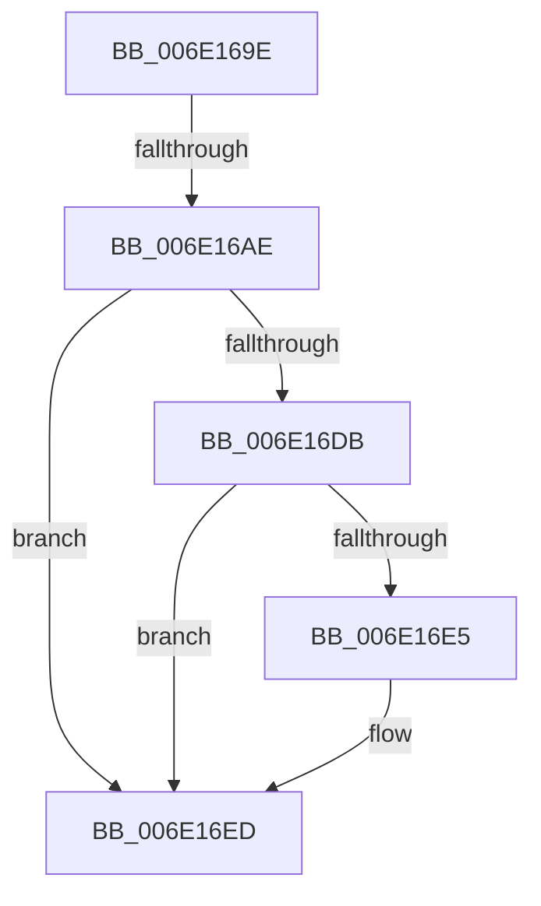

# sub_006E169E

- RVA: `0x006E169E`–`0x006E16FD` (길이 `95` bytes)
- VA: `0x00000001406E169E`
- 실행 섹션: `.text`
- PDB 이름 있음: `아니요`; PDB Function 태그: `아니요`
- unwind 정보 RVA: `0x00075200`
- 디코드: `23`개 명령, `95/95` bytes 표시
- 미해석 바이트: `0` (있으면 어셈블리에 `.byte`로 보존)

> 이 문서는 커널 이미지의 기계어와 PDB 기호를 분석해 생성했습니다. 4번과 5번은 함수 원형과 자료형을 바이너리 사용 방식에서 추정한 C 해석이며 원본 소스 복구 결과는 아닙니다.

## 1. Dependencies

- 직접 호출 지점: **3**; 고유 호출 대상: **3**
- 직접 호출자로 확인된 함수: **0**
- RIP 상대 이미지 참조: **1**

### Outgoing calls
- `0x006E16D0` → [MiAddPageToHeatList](../44/MiAddPageToHeatList_function_0044603C.md) (function, `0x0044603C`)
- `0x006E16E8` → [MiIssuePageHeatList](../44/MiIssuePageHeatList_function_0044615C.md) (function, `0x0044615C`)
- `0x006E16F2` → [MiSetFreeZeroPfnCold](../37/MiSetFreeZeroPfnCold_function_00379428.md) (function, `0x00379428`)

### Direct callers
- 이 함수 시작 RVA로 연결되는 직접 call은 확인되지 않았습니다. 간접 호출은 완전히 역산할 수 없습니다.

### Static image references
- `0x006E169E` → RVA `0x00FC6AB8` (`ALMOSTRO`; read)

## 2. Other-region calls and transfers

- 다른 실행 섹션으로 향하는 call: **0**
- call이 아닌 외부 분기/꼬리 이동: **2**
  - `0x006E16A8` → [MiGetLargePage + 0x19E](../31/MiGetLargePage_function_0031E210.md) (`tail-transfer`)
  - `0x006E16F8` → [MiGetLargePage + 0x1AB](../31/MiGetLargePage_function_0031E210.md) (`tail-transfer`)

## 3. Assembly (complete function range)

```asm
006E169E  F7 05 10 54 8E 00 00 00 20 00   test dword ptr [rip + 0x8e5410], 0x200000
006E16A8  0F 84 00 CD C3 FF               je 0x14031e3ae
006E16AE  48 8B 44 24 40                  mov rax, qword ptr [rsp + 0x40]
006E16B3  48 8D 6C 24 60                  lea rbp, [rsp + 0x60]
006E16B8  48 85 C0                        test rax, rax
006E16BB  C7 44 24 60 81 00 00 00         mov dword ptr [rsp + 0x60], 0x81
006E16C3  45 8B C4                        mov r8d, r12d
006E16C6  49 8B D1                        mov rdx, r9
006E16C9  48 0F 45 E8                     cmovne rbp, rax
006E16CD  48 8B CD                        mov rcx, rbp
006E16D0  E8 67 49 D6 FF                  call 0x14044603c
006E16D5  44 39 7D 04                     cmp dword ptr [rbp + 4], r15d
006E16D9  74 12                           je 0x1406e16ed
006E16DB  48 8D 44 24 60                  lea rax, [rsp + 0x60]
006E16E0  48 3B E8                        cmp rbp, rax
006E16E3  75 08                           jne 0x1406e16ed
006E16E5  48 8B CD                        mov rcx, rbp
006E16E8  E8 6F 4A D6 FF                  call 0x14044615c
006E16ED  33 D2                           xor edx, edx
006E16EF  48 8B CF                        mov rcx, rdi
006E16F2  E8 31 7D C9 FF                  call 0x140379428
006E16F7  90                              nop
006E16F8  E9 BE CC C3 FF                  jmp 0x14031e3bb
```

## 4. C-style interpretation (structured pseudocode)

```c
__int64 __fastcall sub_006E169E(__int64 a1, __int64 a2, __int64 a3, __int64 a4, __int64 a5, __int64 a6, __int64 a7, __int64 a8, __int64 a9, __int64 a10, __int64 a11, __int64 a12)
{
    __int64 result;
    unsigned int v_stack_p60;
    unsigned int v_stack_p64;

    v_stack_p60 = 129;
    if (a8 != 0) { a12 = a8; }
    result = MiAddPageToHeatList(a12, a4, (unsigned int)((unsigned int)(v_r12)), a4);
    if (v_stack_p64 == ((unsigned int)(v_r15))) goto loc_006E16ED;
    result = a12;
    if (a12 == a12) {
        a1 = a12;
        result = MiIssuePageHeatList(a1, a4, (unsigned int)((unsigned int)(v_r12)), a4);
    }
    a2 = 0;
    result = MiSetFreeZeroPfnCold(v_rdi, a2, (unsigned int)((unsigned int)(v_r12)), a4);
}
```

## 5. (Beta) C Style

```c
int64_t sub_006E169E(int64_t Arg1, int64_t Arg2, int64_t Arg3, int64_t Arg4, uint64_t Arg5, uint64_t Arg6, uint64_t Arg7, int64_t Arg8, uint64_t Arg9, uint64_t Arg10, uint64_t Arg11, int64_t Arg12)
{
    int64_t result;
    uint32_t v_stack_p60;
    uint32_t v_stack_p64;

    v_stack_p60 = 129;
    if (Arg8 != 0) { Arg12 = Arg8; }
    result = MiAddPageToHeatList(Arg12, Arg4, (uint32_t)((uint32_t)(local_r12)), Arg4);
    if (v_stack_p64 == ((uint32_t)(local_r15))) goto loc_006E16ED;
    result = Arg12;
    if (Arg12 == Arg12) {
        Arg1 = Arg12;
        result = MiIssuePageHeatList(Arg1, Arg4, (uint32_t)((uint32_t)(local_r12)), Arg4);
    }
    Arg2 = 0;
    result = MiSetFreeZeroPfnCold(local_rdi, Arg2, (uint32_t)((uint32_t)(local_r12)), Arg4);
}
```

## 6. Execution-region graph

[열기: 2D/3D 그래프와 함수 탐색 컨트롤 패널](../../../control-panel.html?section=text&rva=0x006E169E&view=graph)

- 2D 그래프는 위에서 아래로 흐르고, 3D 그래프는 빈 공간을 드래그해 회전합니다. Shift+드래그는 이동, 휠은 확대·축소, 함수 노드 선택은 대상 보고서 이동입니다.

### Static fallback


