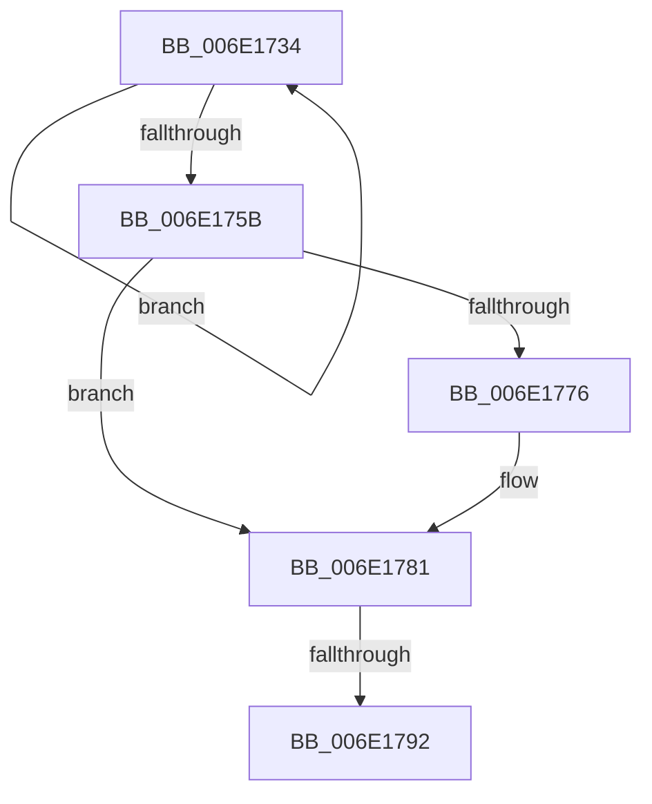

# sub_006E1734

- RVA: `0x006E1734`–`0x006E17A2` (길이 `110` bytes)
- VA: `0x00000001406E1734`
- 실행 섹션: `.text`
- PDB 이름 있음: `아니요`; PDB Function 태그: `아니요`
- unwind 정보 RVA: `0x00075268`
- 디코드: `29`개 명령, `110/110` bytes 표시
- 미해석 바이트: `0` (있으면 어셈블리에 `.byte`로 보존)

> 이 문서는 커널 이미지의 기계어와 PDB 기호를 분석해 생성했습니다. 4번과 5번은 함수 원형과 자료형을 바이너리 사용 방식에서 추정한 C 해석이며 원본 소스 복구 결과는 아닙니다.

## 1. Dependencies

- 직접 호출 지점: **0**; 고유 호출 대상: **0**
- 직접 호출자로 확인된 함수: **0**
- RIP 상대 이미지 참조: **0**

### Outgoing calls
- 직접 디코드된 call 명령이 없습니다.

### Direct callers
- 이 함수 시작 RVA로 연결되는 직접 call은 확인되지 않았습니다. 간접 호출은 완전히 역산할 수 없습니다.

### Static image references
- 디코드된 RIP-relative 메모리 참조가 없습니다.

## 2. Other-region calls and transfers

- 다른 실행 섹션으로 향하는 call: **0**
- call이 아닌 외부 분기/꼬리 이동: **2**
  - `0x006E178C` → [MiTryZeroMemory + 0x124](../31/MiTryZeroMemory_function_0031E720.md) (`tail-transfer`)
  - `0x006E179D` → [MiTryZeroMemory + 0x94](../31/MiTryZeroMemory_function_0031E720.md) (`tail-transfer`)

## 3. Assembly (complete function range)

```asm
006E1734  41 FF C1                        inc r9d
006E1737  41 8B 04 24                     mov eax, dword ptr [r12]
006E173B  48 8D 0C C5 18 00 00 00         lea rcx, [rax*8 + 0x18]
006E1743  49 03 CD                        add rcx, r13
006E1746  48 8D 42 08                     lea rax, [rdx + 8]
006E174A  48 3B D1                        cmp rdx, rcx
006E174D  48 0F 43 C2                     cmovae rax, rdx
006E1751  48 8B D0                        mov rdx, rax
006E1754  48 8B 00                        mov rax, qword ptr [rax]
006E1757  A8 01                           test al, 1
006E1759  75 D9                           jne 0x1406e1734
006E175B  49 C1 E0 0C                     shl r8, 0xc
006E175F  48 8B 54 24 38                  mov rdx, qword ptr [rsp + 0x38]
006E1764  49 03 D0                        add rdx, r8
006E1767  49 8B C0                        mov rax, r8
006E176A  48 F7 D8                        neg rax
006E176D  48 23 D0                        and rdx, rax
006E1770  41 83 F9 01                     cmp r9d, 1
006E1774  74 0B                           je 0x1406e1781
006E1776  41 8D 49 FF                     lea ecx, [r9 - 1]
006E177A  49 0F AF C8                     imul rcx, r8
006E177E  48 03 D1                        add rdx, rcx
006E1781  4C 2B FA                        sub r15, rdx
006E1784  49 03 DF                        add rbx, r15
006E1787  48 89 5C 24 40                  mov qword ptr [rsp + 0x40], rbx
006E178C  0F 84 B2 D0 C3 FF               je 0x14031e844
006E1792  4C 8B FA                        mov r15, rdx
006E1795  48 89 94 24 B8 00 00 00         mov qword ptr [rsp + 0xb8], rdx
006E179D  E9 12 D0 C3 FF                  jmp 0x14031e7b4
```

## 4. C-style interpretation (structured pseudocode)

```c
__int64 __fastcall sub_006E1734(__int64 a1, __int64 a2, __int64 a3, int a4, __int64 a5, __int64 a6, __int64 a7)
{
    __int64 result;
    __int64 v_r15;
    __int64 v_rbx;
    unsigned __int64 v_stack_p40;
    unsigned __int64 v_stack_pB8;

    a4 = (unsigned int)((a4) + 1);
    a1 = ((unsigned int)(*(unsigned int *)(v_r12)) * 8 + 24) + (v_r13);
    result = a2 + 8;
    if (a2 >= a1) { result = a2; }
    if ((((unsigned __int8)(*(unsigned __int64 *)(result))) & (1)) != 0) goto loc_006E1734;
    a3 = (a3) << (12);
    a2 = (a7) + (a3);
    result = -(a3);
    a2 = (a2) & (result);
    if (a4 != 1) {
        a1 = a4 - 1;
        a1 = (a1) * (a3);
        a2 = (a2) + (a1);
    }
    v_r15 = (v_r15) - (a2);
    v_rbx = (v_rbx) + (v_r15);
    v_stack_p40 = v_rbx;
    v_stack_pB8 = a2;
}
```

## 5. (Beta) C Style

```c
int64_t sub_006E1734(int64_t Arg1, int64_t Arg2, int64_t Arg3, int32_t Arg4, uint64_t Arg5, uint64_t Arg6, int64_t Arg7)
{
    int64_t result;
    int64_t local_r15;
    int64_t local_rbx;
    uint64_t v_stack_p40;
    uint64_t v_stack_pB8;

    Arg4 = (uint32_t)((Arg4) + 1);
    Arg1 = ((uint32_t)(*(uint32_t *)(local_r12)) * 8 + 24) + (local_r13);
    result = Arg2 + 8;
    if (Arg2 >= Arg1) { result = Arg2; }
    if ((((uint8_t)(*(uint64_t *)(result))) & (1)) != 0) goto loc_006E1734;
    Arg3 = (Arg3) << (12);
    Arg2 = (Arg7) + (Arg3);
    result = -(Arg3);
    Arg2 = (Arg2) & (result);
    if (Arg4 != 1) {
        Arg1 = Arg4 - 1;
        Arg1 = (Arg1) * (Arg3);
        Arg2 = (Arg2) + (Arg1);
    }
    local_r15 = (local_r15) - (Arg2);
    local_rbx = (local_rbx) + (local_r15);
    v_stack_p40 = local_rbx;
    v_stack_pB8 = Arg2;
}
```

## 6. Execution-region graph

[열기: 2D/3D 그래프와 함수 탐색 컨트롤 패널](../../../control-panel.html?section=text&rva=0x006E1734&view=graph)

- 2D 그래프는 위에서 아래로 흐르고, 3D 그래프는 빈 공간을 드래그해 회전합니다. Shift+드래그는 이동, 휠은 확대·축소, 함수 노드 선택은 대상 보고서 이동입니다.

### Static fallback


