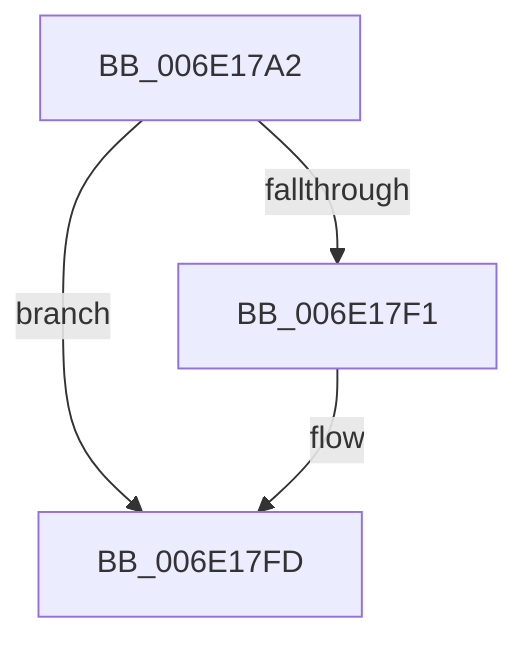

# sub_006E17A2

- RVA: `0x006E17A2`–`0x006E182B` (길이 `137` bytes)
- VA: `0x00000001406E17A2`
- 실행 섹션: `.text`
- PDB 이름 있음: `아니요`; PDB Function 태그: `아니요`
- unwind 정보 RVA: `0x00075314`
- 디코드: `31`개 명령, `137/137` bytes 표시
- 미해석 바이트: `0` (있으면 어셈블리에 `.byte`로 보존)

> 이 문서는 커널 이미지의 기계어와 PDB 기호를 분석해 생성했습니다. 4번과 5번은 함수 원형과 자료형을 바이너리 사용 방식에서 추정한 C 해석이며 원본 소스 복구 결과는 아닙니다.

## 1. Dependencies

- 직접 호출 지점: **2**; 고유 호출 대상: **2**
- 직접 호출자로 확인된 함수: **0**
- RIP 상대 이미지 참조: **1**

### Outgoing calls
- `0x006E17AF` → [MiFinalizePageAttribute](../33/MiFinalizePageAttribute_function_00332E30.md) (function, `0x00332E30`)
- `0x006E17D4` → [MiPageToNode](../33/MiPageToNode_function_00338CD0.md) (function, `0x00338CD0`)

### Direct callers
- 이 함수 시작 RVA로 연결되는 직접 call은 확인되지 않았습니다. 간접 호출은 완전히 역산할 수 없습니다.

### Static image references
- `0x006E17BD` → RVA `0x00E30088` (`.data`; read)

## 2. Other-region calls and transfers

- 다른 실행 섹션으로 향하는 call: **0**
- call이 아닌 외부 분기/꼬리 이동: **1**
  - `0x006E1826` → [sub_0031EA17 + 0x89](../31/Unknown_function_0031EA17.md) (`tail-transfer`)

## 3. Assembly (complete function range)

```asm
006E17A2  B8 01 00 00 00                  mov eax, 1
006E17A7  49 8B C9                        mov rcx, r9
006E17AA  44 8B C0                        mov r8d, eax
006E17AD  8B D0                           mov edx, eax
006E17AF  E8 7C 16 C5 FF                  call 0x140332e30
006E17B4  48 8B 44 24 20                  mov rax, qword ptr [rsp + 0x20]
006E17B9  48 8B 40 28                     mov rax, qword ptr [rax + 0x28]
006E17BD  48 8B 0D C4 E8 74 00            mov rcx, qword ptr [rip + 0x74e8c4]
006E17C4  48 C1 E8 2B                     shr rax, 0x2b
006E17C8  25 FF 03 00 00                  and eax, 0x3ff
006E17CD  48 8B 1C C1                     mov rbx, qword ptr [rcx + rax*8]
006E17D1  49 8B CD                        mov rcx, r13
006E17D4  E8 F7 74 C5 FF                  call 0x140338cd0
006E17D9  8B C8                           mov ecx, eax
006E17DB  48 69 D1 80 DF 00 00            imul rdx, rcx, 0xdf80
006E17E2  33 C9                           xor ecx, ecx
006E17E4  48 03 53 10                     add rdx, qword ptr [rbx + 0x10]
006E17E8  49 81 FD 00 00 10 00            cmp r13, 0x100000
006E17EF  73 0C                           jae 0x1406e17fd
006E17F1  41 83 FE 03                     cmp r14d, 3
006E17F5  B8 01 00 00 00                  mov eax, 1
006E17FA  0F 45 C8                        cmovne ecx, eax
006E17FD  41 8B C6                        mov eax, r14d
006E1800  48 8D 04 80                     lea rax, [rax + rax*4]
006E1804  48 8D 0C C1                     lea rcx, [rcx + rax*8]
006E1808  48 C1 E1 05                     shl rcx, 5
006E180C  F0 48 FF 4C 11 30               lock dec qword ptr [rcx + rdx + 0x30]
006E1812  F0 48 FF 44 11 20               lock inc qword ptr [rcx + rdx + 0x20]
006E1818  4C 8B 4C 24 20                  mov r9, qword ptr [rsp + 0x20]
006E181D  44 0F B6 94 24 E0 00 00 00      movzx r10d, byte ptr [rsp + 0xe0]
006E1826  E9 75 D2 C3 FF                  jmp 0x14031eaa0
```

## 4. C-style interpretation (structured pseudocode)

```c
__int64 __fastcall sub_006E17A2(__int64 a1, __int64 a2, __int64 a3, __int64 a4, __int64 a5, __int64 a6, __int64 a7, __int64 a8, __int64 a9, __int64 a10, __int64 a11, __int64 a12, __int64 a13, __int64 a14, __int64 a15, __int64 a16, __int64 a17, __int64 a18, __int64 a19, __int64 a20, __int64 a21, __int64 a22, __int64 a23, __int64 a24, __int64 a25, __int64 a26, __int64 a27, unsigned __int8 a28)
{
    __int64 result;
    unsigned __int64 v_stack_p20;

    result = MiFinalizePageAttribute(a4, 1, 1, a4);
    result = (*(unsigned __int64 *)(v_stack_p20 + 40)) >> (43);
    result = (unsigned int)((result) & (0x3FFULL));
    result = MiPageToNode(v_r13, 1, 1, a4);
    a2 = (1) * ((unsigned int)((unsigned int)(result)));
    a1 = 0;
    a2 = (a2) + (*(unsigned __int64 *)(*(unsigned __int64 *)(*(unsigned __int64 *)(v_rip + 7661764) + result * 8) + 16));
    if (v_r13 < 0x100000ULL) {
        result = 1;
        if (((unsigned int)(v_r14)) != 3) { a1 = (unsigned int)(result); }
    }
    a1 = (a1 + (unsigned int)((unsigned int)(v_r14)) + (unsigned int)((unsigned int)(v_r14)) * 4 * 8) << (5);
}
```

## 5. (Beta) C Style

```c
int64_t sub_006E17A2(int64_t Arg1, int64_t Arg2, int64_t Arg3, int64_t Arg4, uint64_t Arg5, uint64_t Arg6, uint64_t Arg7, uint64_t Arg8, uint64_t Arg9, uint64_t Arg10, uint64_t Arg11, uint64_t Arg12, uint64_t Arg13, uint64_t Arg14, uint64_t Arg15, uint64_t Arg16, uint64_t Arg17, uint64_t Arg18, uint64_t Arg19, uint64_t Arg20, uint64_t Arg21, uint64_t Arg22, uint64_t Arg23, uint64_t Arg24, uint64_t Arg25, uint64_t Arg26, uint64_t Arg27, uint8_t Arg28)
{
    int64_t result;
    uint64_t v_stack_p20;

    result = MiFinalizePageAttribute(Arg4, 1, 1, Arg4);
    result = (*(uint64_t *)(v_stack_p20 + 0x28)) >> (43);
    result = (uint32_t)((result) & (0x3FFULL));
    result = MiPageToNode(local_r13, 1, 1, Arg4);
    Arg2 = (1) * ((uint32_t)((uint32_t)(result)));
    Arg1 = 0;
    Arg2 = (Arg2) + (*(uint64_t *)(*(uint64_t *)(*(uint64_t *)(v_rip + 0x74E8C4) + result * 8) + 0x10));
    if (local_r13 < 0x100000ULL) {
        result = 1;
        if (((uint32_t)(local_r14)) != 3) { Arg1 = (uint32_t)(result); }
    }
    Arg1 = (Arg1 + (uint32_t)((uint32_t)(local_r14)) + (uint32_t)((uint32_t)(local_r14)) * 4 * 8) << (5);
}
```

## 6. Execution-region graph

[열기: 2D/3D 그래프와 함수 탐색 컨트롤 패널](../../../control-panel.html?section=text&rva=0x006E17A2&view=graph)

- 2D 그래프는 위에서 아래로 흐르고, 3D 그래프는 빈 공간을 드래그해 회전합니다. Shift+드래그는 이동, 휠은 확대·축소, 함수 노드 선택은 대상 보고서 이동입니다.

### Static fallback


