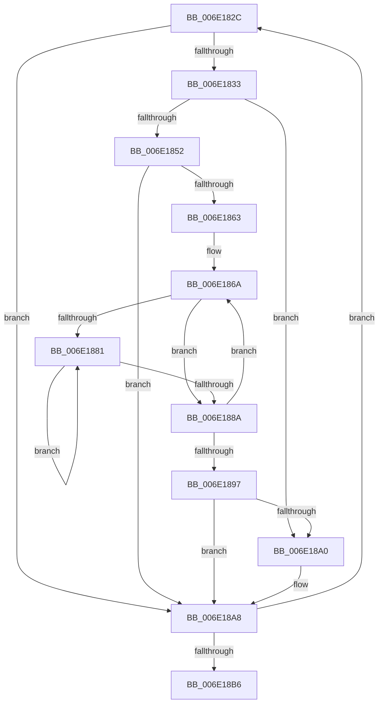

# sub_006E182C

- RVA: `0x006E182C`–`0x006E18C3` (길이 `151` bytes)
- VA: `0x00000001406E182C`
- 실행 섹션: `.text`
- PDB 이름 있음: `아니요`; PDB Function 태그: `아니요`
- unwind 정보 RVA: `0x00075354`
- 디코드: `42`개 명령, `151/151` bytes 표시
- 미해석 바이트: `0` (있으면 어셈블리에 `.byte`로 보존)

> 이 문서는 커널 이미지의 기계어와 PDB 기호를 분석해 생성했습니다. 4번과 5번은 함수 원형과 자료형을 바이너리 사용 방식에서 추정한 C 해석이며 원본 소스 복구 결과는 아닙니다.

## 1. Dependencies

- 직접 호출 지점: **2**; 고유 호출 대상: **2**
- 직접 호출자로 확인된 함수: **0**
- RIP 상대 이미지 참조: **0**

### Outgoing calls
- `0x006E1849` → [MiAddPageToHeatRanges](../44/MiAddPageToHeatRanges_function_00446064.md) (function, `0x00446064`)
- `0x006E18A3` → [MiFlushZeroPageHeatBatch](../47/MiFlushZeroPageHeatBatch_function_0047445C.md) (function, `0x0047445C`)

### Direct callers
- 이 함수 시작 RVA로 연결되는 직접 call은 확인되지 않았습니다. 간접 호출은 완전히 역산할 수 없습니다.

### Static image references
- 디코드된 RIP-relative 메모리 참조가 없습니다.

## 2. Other-region calls and transfers

- 다른 실행 섹션으로 향하는 call: **0**
- call이 아닌 외부 분기/꼬리 이동: **1**
  - `0x006E18BE` → [MiBackgroundZeroLocalPages + 0x490](../31/MiBackgroundZeroLocalPages_function_0031EF30.md) (`tail-transfer`)

## 3. Assembly (complete function range)

```asm
006E182C  48 8B 13                        mov rdx, qword ptr [rbx]
006E182F  84 D2                           test dl, dl
006E1831  79 75                           jns 0x1406e18a8
006E1833  48 8B 75 D8                     mov rsi, qword ptr [rbp - 0x28]
006E1837  44 8B 45 BC                     mov r8d, dword ptr [rbp - 0x44]
006E183B  48 C1 EA 0C                     shr rdx, 0xc
006E183F  49 23 D4                        and rdx, r12
006E1842  48 8B 8E A0 02 00 00            mov rcx, qword ptr [rsi + 0x2a0]
006E1849  E8 16 48 D6 FF                  call 0x140446064
006E184E  85 C0                           test eax, eax
006E1850  75 4E                           jne 0x1406e18a0
006E1852  48 8B 86 A0 02 00 00            mov rax, qword ptr [rsi + 0x2a0]
006E1859  4C 8B CF                        mov r9, rdi
006E185C  8B 48 04                        mov ecx, dword ptr [rax + 4]
006E185F  85 C9                           test ecx, ecx
006E1861  74 45                           je 0x1406e18a8
006E1863  4C 8D 40 10                     lea r8, [rax + 0x10]
006E1867  44 8B D1                        mov r10d, ecx
006E186A  49 8B 10                        mov rdx, qword ptr [r8]
006E186D  48 8B C2                        mov rax, rdx
006E1870  48 C1 EA 0A                     shr rdx, 0xa
006E1874  25 FF 03 00 00                  and eax, 0x3ff
006E1879  48 FF C0                        inc rax
006E187C  83 E2 03                        and edx, 3
006E187F  74 09                           je 0x1406e188a
006E1881  48 C1 E0 09                     shl rax, 9
006E1885  83 C2 FF                        add edx, -1
006E1888  75 F7                           jne 0x1406e1881
006E188A  4C 03 C8                        add r9, rax
006E188D  49 83 C0 08                     add r8, 8
006E1891  49 83 EA 01                     sub r10, 1
006E1895  75 D3                           jne 0x1406e186a
006E1897  49 81 F9 00 02 00 00            cmp r9, 0x200
006E189E  72 08                           jb 0x1406e18a8
006E18A0  48 8B CE                        mov rcx, rsi
006E18A3  E8 B4 2B D9 FF                  call 0x14047445c
006E18A8  48 83 C3 08                     add rbx, 8
006E18AC  49 83 EE 01                     sub r14, 1
006E18B0  0F 85 76 FF FF FF               jne 0x1406e182c
006E18B6  48 8B 7D 10                     mov rdi, qword ptr [rbp + 0x10]
006E18BA  C6 45 B3 00                     mov byte ptr [rbp - 0x4d], 0
006E18BE  E9 FD DA C3 FF                  jmp 0x14031f3c0
```

## 4. C-style interpretation (structured pseudocode)

```c
__int64 __fastcall sub_006E182C(void)
{
    __int64 result;
    __int64 v_r10;
    __int64 v_r14;
    __int64 v_rbx;

    if (!sign_flag) goto loc_006E18A8;
    a2 = (*(unsigned __int64 *)(v_rbx)) >> (12);
    a2 = (a2) & (v_r12);
    result = MiAddPageToHeatRanges(*(unsigned __int64 *)(*(unsigned __int64 *)(v_rbp - 40) + 672), a2, (unsigned int)(*(unsigned int *)(v_rbp - 68)), a4);
    if ((unsigned int)(result) != 0) goto loc_006E18A0;
    if ((unsigned int)((unsigned int)(*(unsigned int *)(*(unsigned __int64 *)(*(unsigned __int64 *)(v_rbp - 40) + 672) + 4))) == 0) goto loc_006E18A8;
loc_006E186A:
    a2 = (*(unsigned __int64 *)(*(unsigned __int64 *)(*(unsigned __int64 *)(v_rbp - 40) + 672) + 16)) >> (10);
    result = (unsigned int)((*(unsigned __int64 *)(*(unsigned __int64 *)(*(unsigned __int64 *)(v_rbp - 40) + 672) + 16)) & (0x3FFULL));
    result = (result) + 1;
    a2 = (unsigned int)((a2) & (3));
    if (condition_is_equal) goto loc_006E188A;
loc_006E1881:
    result = (result) << (9);
    a2 = (unsigned int)((a2) + (-1));
    if (condition_is_not_equal) goto loc_006E1881;
loc_006E188A:
    a4 = (v_rdi) + (result);
    a3 = (*(unsigned __int64 *)(*(unsigned __int64 *)(v_rbp - 40) + 672) + 16) + (8);
    v_r10 = ((unsigned int)((unsigned int)((unsigned int)(*(unsigned int *)(*(unsigned __int64 *)(*(unsigned __int64 *)(v_rbp - 40) + 672) + 4))))) - (1);
    if (condition_is_not_equal) goto loc_006E186A;
    if (a4 >= 512) {
        a1 = *(unsigned __int64 *)(v_rbp - 40);
        result = MiFlushZeroPageHeatBatch(a1, a2, a3, a4);
    }
    v_rbx = (v_rbx) + (8);
    v_r14 = (v_r14) - (1);
    if (condition_is_not_equal) goto loc_006E182C;
    *(unsigned __int8 *)(v_rbp - 77) = 0;
}
```

## 5. (Beta) C Style

```c
void sub_006E182C(void)
{
    int64_t result;
    int64_t local_r10;
    int64_t local_r14;
    int64_t local_rbx;

    if (!sign_flag) goto loc_006E18A8;
    a2 = (*(uint64_t *)(local_rbx)) >> (12);
    a2 = (a2) & (local_r12);
    result = MiAddPageToHeatRanges(*(uint64_t *)(*(uint64_t *)(local_rbp - 0x28) + 0x2A0), a2, (uint32_t)(*(uint32_t *)(local_rbp - 0x44)), a4);
    if ((uint32_t)(result) != 0) goto loc_006E18A0;
    if ((uint32_t)((uint32_t)(*(uint32_t *)(*(uint64_t *)(*(uint64_t *)(local_rbp - 0x28) + 0x2A0) + 0x4))) == 0) goto loc_006E18A8;
loc_006E186A:
    a2 = (*(uint64_t *)(*(uint64_t *)(*(uint64_t *)(local_rbp - 0x28) + 0x2A0) + 0x10)) >> (10);
    result = (uint32_t)((*(uint64_t *)(*(uint64_t *)(*(uint64_t *)(local_rbp - 0x28) + 0x2A0) + 0x10)) & (0x3FFULL));
    result = (result) + 1;
    a2 = (uint32_t)((a2) & (3));
    if (condition_is_equal) goto loc_006E188A;
loc_006E1881:
    result = (result) << (9);
    a2 = (uint32_t)((a2) + (-1));
    if (condition_is_not_equal) goto loc_006E1881;
loc_006E188A:
    a4 = (local_rdi) + (result);
    a3 = (*(uint64_t *)(*(uint64_t *)(local_rbp - 0x28) + 0x2A0) + 16) + (8);
    local_r10 = ((uint32_t)((uint32_t)((uint32_t)(*(uint32_t *)(*(uint64_t *)(*(uint64_t *)(local_rbp - 0x28) + 0x2A0) + 0x4))))) - (1);
    if (condition_is_not_equal) goto loc_006E186A;
    if (a4 >= 512) {
        a1 = *(uint64_t *)(local_rbp - 0x28);
        result = MiFlushZeroPageHeatBatch(a1, a2, a3, a4);
    }
    local_rbx = (local_rbx) + (8);
    local_r14 = (local_r14) - (1);
    if (condition_is_not_equal) goto loc_006E182C;
    *(uint8_t *)(local_rbp - 0x4D) = 0;
}
```

## 6. Execution-region graph

[열기: 2D/3D 그래프와 함수 탐색 컨트롤 패널](../../../control-panel.html?section=text&rva=0x006E182C&view=graph)

- 2D 그래프는 위에서 아래로 흐르고, 3D 그래프는 빈 공간을 드래그해 회전합니다. Shift+드래그는 이동, 휠은 확대·축소, 함수 노드 선택은 대상 보고서 이동입니다.

### Static fallback


