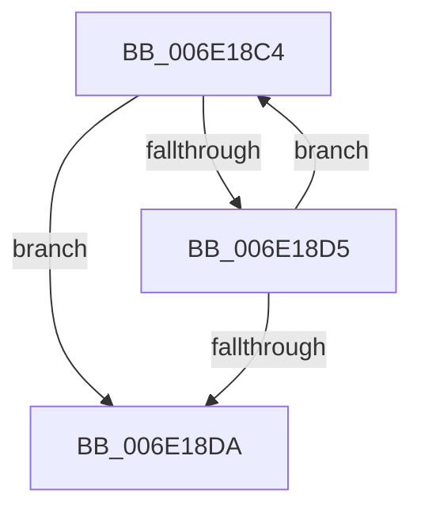

# sub_006E18C4

- RVA: `0x006E18C4`–`0x006E18E4` (길이 `32` bytes)
- VA: `0x00000001406E18C4`
- 실행 섹션: `.text`
- PDB 이름 있음: `아니요`; PDB Function 태그: `아니요`
- unwind 정보 RVA: `0x000755B4`
- 디코드: `10`개 명령, `32/32` bytes 표시
- 미해석 바이트: `0` (있으면 어셈블리에 `.byte`로 보존)

> 이 문서는 커널 이미지의 기계어와 PDB 기호를 분석해 생성했습니다. 4번과 5번은 함수 원형과 자료형을 바이너리 사용 방식에서 추정한 C 해석이며 원본 소스 복구 결과는 아닙니다.

## 1. Dependencies

- 직접 호출 지점: **0**; 고유 호출 대상: **0**
- 직접 호출자로 확인된 함수: **0**
- RIP 상대 이미지 참조: **0**

### Outgoing calls
- 직접 디코드된 call 명령이 없습니다.

### Direct callers
- 이 함수 시작 RVA로 연결되는 직접 call은 확인되지 않았습니다. 간접 호출은 완전히 역산할 수 없습니다.

### Static image references
- 디코드된 RIP-relative 메모리 참조가 없습니다.

## 2. Other-region calls and transfers

- 다른 실행 섹션으로 향하는 call: **0**
- call이 아닌 외부 분기/꼬리 이동: **1**
  - `0x006E18DF` → [sub_00320232 + 0x57](../32/Unknown_function_00320232.md) (`tail-transfer`)

## 3. Assembly (complete function range)

```asm
006E18C4  8B C1                           mov eax, ecx
006E18C6  83 C1 10                        add ecx, 0x10
006E18C9  83 E0 3F                        and eax, 0x3f
006E18CC  49 0F AB C1                     bts r9, rax
006E18D0  83 F9 40                        cmp ecx, 0x40
006E18D3  73 05                           jae 0x1406e18da
006E18D5  41 3B C8                        cmp ecx, r8d
006E18D8  72 EA                           jb 0x1406e18c4
006E18DA  4C 89 4C 24 38                  mov qword ptr [rsp + 0x38], r9
006E18DF  E9 A5 E9 C3 FF                  jmp 0x140320289
```

## 4. C-style interpretation (structured pseudocode)

```c
__int64 __fastcall sub_006E18C4(int a1, __int64 a2, int a3, __int64 a4)
{
    __int64 result;
    unsigned __int64 v_stack_p38;

    a1 = (unsigned int)((a1) + (16));
    result = (unsigned int)(((unsigned int)(a1)) & (63));
    if (a1 >= 64) goto loc_006E18DA;
    if (a1 < a3) goto loc_006E18C4;
loc_006E18DA:
    v_stack_p38 = a4;
}
```

## 5. (Beta) C Style

```c
int64_t sub_006E18C4(int32_t Arg1, int64_t Arg2, int32_t Arg3, int64_t Arg4)
{
    int64_t result;
    uint64_t v_stack_p38;

    Arg1 = (uint32_t)((Arg1) + (16));
    result = (uint32_t)(((uint32_t)(Arg1)) & (63));
    if (Arg1 >= 64) goto loc_006E18DA;
    if (Arg1 < Arg3) goto loc_006E18C4;
loc_006E18DA:
    v_stack_p38 = Arg4;
}
```

## 6. Execution-region graph

[열기: 2D/3D 그래프와 함수 탐색 컨트롤 패널](../../../control-panel.html?section=text&rva=0x006E18C4&view=graph)

- 2D 그래프는 위에서 아래로 흐르고, 3D 그래프는 빈 공간을 드래그해 회전합니다. Shift+드래그는 이동, 휠은 확대·축소, 함수 노드 선택은 대상 보고서 이동입니다.

### Static fallback


