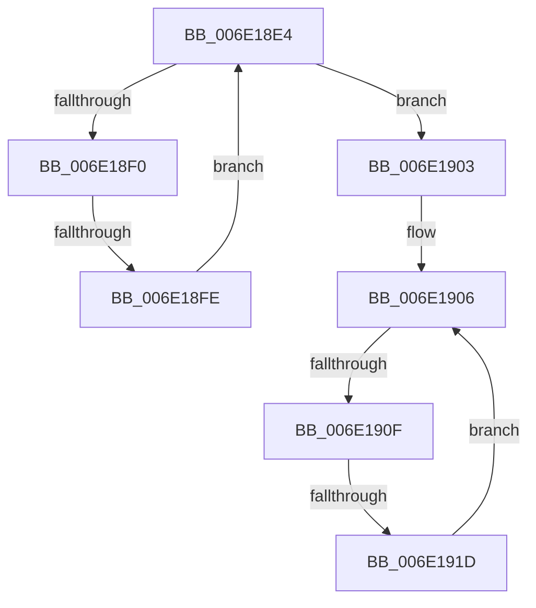

# sub_006E18E4

- RVA: `0x006E18E4`–`0x006E1922` (길이 `62` bytes)
- VA: `0x00000001406E18E4`
- 실행 섹션: `.text`
- PDB 이름 있음: `아니요`; PDB Function 태그: `아니요`
- unwind 정보 RVA: `0x00075620`
- 디코드: `16`개 명령, `62/62` bytes 표시
- 미해석 바이트: `0` (있으면 어셈블리에 `.byte`로 보존)

> 이 문서는 커널 이미지의 기계어와 PDB 기호를 분석해 생성했습니다. 4번과 5번은 함수 원형과 자료형을 바이너리 사용 방식에서 추정한 C 해석이며 원본 소스 복구 결과는 아닙니다.

## 1. Dependencies

- 직접 호출 지점: **0**; 고유 호출 대상: **0**
- 직접 호출자로 확인된 함수: **0**
- RIP 상대 이미지 참조: **1**

### Outgoing calls
- 직접 디코드된 call 명령이 없습니다.

### Direct callers
- 이 함수 시작 RVA로 연결되는 직접 call은 확인되지 않았습니다. 간접 호출은 완전히 역산할 수 없습니다.

### Static image references
- `0x006E18E4` → RVA `0x00FC5002` (`ALMOSTRO`; read)

## 2. Other-region calls and transfers

- 다른 실행 섹션으로 향하는 call: **0**
- call이 아닌 외부 분기/꼬리 이동: **3**
  - `0x006E18F8` → [sub_00320467 + 0x1F](../32/Unknown_function_00320467.md) (`tail-transfer`)
  - `0x006E1909` → [sub_00320467 + 0x1C](../32/Unknown_function_00320467.md) (`tail-transfer`)
  - `0x006E1917` → [sub_00320467 + 0x1F](../32/Unknown_function_00320467.md) (`tail-transfer`)

## 3. Assembly (complete function range)

```asm
006E18E4  0F B6 1D 17 37 8E 00            movzx ebx, byte ptr [rip + 0x8e3717]
006E18EB  44 3A C3                        cmp r8b, bl
006E18EE  73 13                           jae 0x1406e1903
006E18F0  41 0F B6 C8                     movzx ecx, r8b
006E18F4  80 3C 39 01                     cmp byte ptr [rcx + rdi], 1
006E18F8  0F 84 88 EB C3 FF               je 0x140320486
006E18FE  41 FE C0                        inc r8b
006E1901  EB E1                           jmp 0x1406e18e4
006E1903  45 32 C0                        xor r8b, r8b
006E1906  44 3A C3                        cmp r8b, bl
006E1909  0F 83 74 EB C3 FF               jae 0x140320483
006E190F  41 0F B6 C8                     movzx ecx, r8b
006E1913  80 3C 39 02                     cmp byte ptr [rcx + rdi], 2
006E1917  0F 84 69 EB C3 FF               je 0x140320486
006E191D  41 FE C0                        inc r8b
006E1920  EB E4                           jmp 0x1406e1906
```

## 4. C-style interpretation (structured pseudocode)

```c
void __fastcall sub_006E18E4(__int64 a1, __int64 a2, unsigned __int8 a3)
{
    if (a3 >= ((unsigned __int8)(*(unsigned __int8 *)(v_rip + 9320215)))) goto loc_006E1903;
    a3 = (unsigned __int8)((a3) + 1);
    goto loc_006E18E4;
loc_006E1903:
    a3 = 0;
loc_006E1906:
    a3 = (unsigned __int8)((a3) + 1);
    goto loc_006E1906;
}
```

## 5. (Beta) C Style

```c
void sub_006E18E4(int64_t Arg1, int64_t Arg2, uint8_t Arg3)
{
    if (Arg3 >= ((uint8_t)(*(uint8_t *)(v_rip + 0x8E3717)))) goto loc_006E1903;
    Arg3 = (uint8_t)((Arg3) + 1);
    goto loc_006E18E4;
loc_006E1903:
    Arg3 = 0;
loc_006E1906:
    Arg3 = (uint8_t)((Arg3) + 1);
    goto loc_006E1906;
}
```

## 6. Execution-region graph

[열기: 2D/3D 그래프와 함수 탐색 컨트롤 패널](../../../control-panel.html?section=text&rva=0x006E18E4&view=graph)

- 2D 그래프는 위에서 아래로 흐르고, 3D 그래프는 빈 공간을 드래그해 회전합니다. Shift+드래그는 이동, 휠은 확대·축소, 함수 노드 선택은 대상 보고서 이동입니다.

### Static fallback


