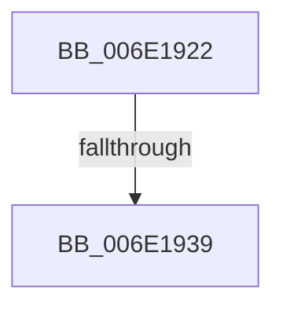

# sub_006E1922

- RVA: `0x006E1922`–`0x006E1950` (길이 `46` bytes)
- VA: `0x00000001406E1922`
- 실행 섹션: `.text`
- PDB 이름 있음: `아니요`; PDB Function 태그: `아니요`
- unwind 정보 RVA: `0x00075814`
- 디코드: `10`개 명령, `46/46` bytes 표시
- 미해석 바이트: `0` (있으면 어셈블리에 `.byte`로 보존)

> 이 문서는 커널 이미지의 기계어와 PDB 기호를 분석해 생성했습니다. 4번과 5번은 함수 원형과 자료형을 바이너리 사용 방식에서 추정한 C 해석이며 원본 소스 복구 결과는 아닙니다.

## 1. Dependencies

- 직접 호출 지점: **1**; 고유 호출 대상: **1**
- 직접 호출자로 확인된 함수: **0**
- RIP 상대 이미지 참조: **0**

### Outgoing calls
- `0x006E1945` → [KeSetEvent](../33/KeSetEvent_function_0033F310.md) (function, `0x0033F310`)

### Direct callers
- 이 함수 시작 RVA로 연결되는 직접 call은 확인되지 않았습니다. 간접 호출은 완전히 역산할 수 없습니다.

### Static image references
- 디코드된 RIP-relative 메모리 참조가 없습니다.

## 2. Other-region calls and transfers

- 다른 실행 섹션으로 향하는 call: **0**
- call이 아닌 외부 분기/꼬리 이동: **2**
  - `0x006E1933` → [MiReleaseNonPagedResources + 0x1F8](../32/MiReleaseNonPagedResources_function_0032299C.md) (`tail-transfer`)
  - `0x006E194B` → [MiReleaseNonPagedResources + 0x1F8](../32/MiReleaseNonPagedResources_function_0032299C.md) (`tail-transfer`)

## 3. Assembly (complete function range)

```asm
006E1922  48 8B 8B 98 4C 00 00            mov rcx, qword ptr [rbx + 0x4c98]
006E1929  48 8B 83 C8 41 00 00            mov rax, qword ptr [rbx + 0x41c8]
006E1930  48 3B C8                        cmp rcx, rax
006E1933  0F 85 5B 12 C4 FF               jne 0x140322b94
006E1939  48 8B 8B 38 01 00 00            mov rcx, qword ptr [rbx + 0x138]
006E1940  45 33 C0                        xor r8d, r8d
006E1943  33 D2                           xor edx, edx
006E1945  E8 C6 D9 C5 FF                  call 0x14033f310
006E194A  90                              nop
006E194B  E9 44 12 C4 FF                  jmp 0x140322b94
```

## 4. C-style interpretation (structured pseudocode)

```c
__int64 __fastcall sub_006E1922(__int64 a1, int a2, int a3)
{
    __int64 result;

    a3 = 0;
    a2 = 0;
    result = KeSetEvent(*(unsigned __int64 *)(v_rbx + 312), a2, a3, a4);
}
```

## 5. (Beta) C Style

```c
int64_t sub_006E1922(int64_t Arg1, int32_t Arg2, int32_t Arg3)
{
    int64_t result;

    Arg3 = 0;
    Arg2 = 0;
    result = KeSetEvent(*(uint64_t *)(local_rbx + 0x138), Arg2, Arg3, a4);
}
```

## 6. Execution-region graph

[열기: 2D/3D 그래프와 함수 탐색 컨트롤 패널](../../../control-panel.html?section=text&rva=0x006E1922&view=graph)

- 2D 그래프는 위에서 아래로 흐르고, 3D 그래프는 빈 공간을 드래그해 회전합니다. Shift+드래그는 이동, 휠은 확대·축소, 함수 노드 선택은 대상 보고서 이동입니다.

### Static fallback


