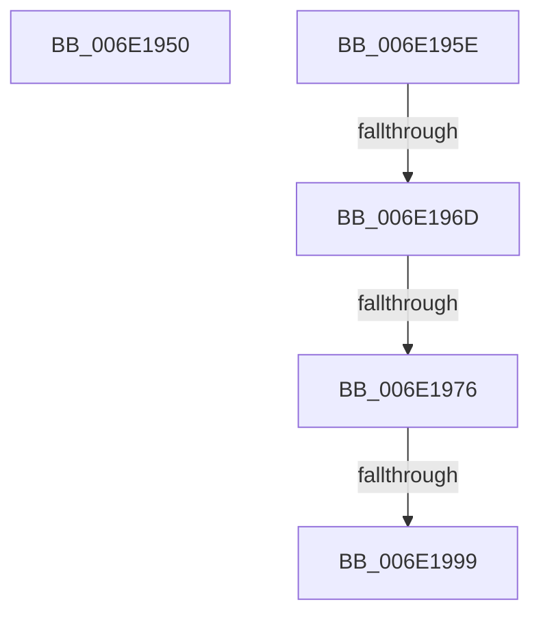

# sub_006E1950

- RVA: `0x006E1950`–`0x006E19B0` (길이 `96` bytes)
- VA: `0x00000001406E1950`
- 실행 섹션: `.text`
- PDB 이름 있음: `아니요`; PDB Function 태그: `아니요`
- unwind 정보 RVA: `0x000758F8`
- 디코드: `20`개 명령, `96/96` bytes 표시
- 미해석 바이트: `0` (있으면 어셈블리에 `.byte`로 보존)

> 이 문서는 커널 이미지의 기계어와 PDB 기호를 분석해 생성했습니다. 4번과 5번은 함수 원형과 자료형을 바이너리 사용 방식에서 추정한 C 해석이며 원본 소스 복구 결과는 아닙니다.

## 1. Dependencies

- 직접 호출 지점: **2**; 고유 호출 대상: **2**
- 직접 호출자로 확인된 함수: **0**
- RIP 상대 이미지 참조: **1**

### Outgoing calls
- `0x006E1953` → [MiWriteValidPteNewPage](../37/MiWriteValidPteNewPage_function_00376068.md) (function, `0x00376068`)
- `0x006E19A5` → [MiCheckLinearProtectedPteAccessedBit](../29/MiCheckLinearProtectedPteAccessedBit_function_00292D80.md) (function, `0x00292D80`)

### Direct callers
- 이 함수 시작 RVA로 연결되는 직접 call은 확인되지 않았습니다. 간접 호출은 완전히 역산할 수 없습니다.

### Static image references
- `0x006E195E` → RVA `0x00FC6A88` (`ALMOSTRO`; read)

## 2. Other-region calls and transfers

- 다른 실행 섹션으로 향하는 call: **0**
- call이 아닌 외부 분기/꼬리 이동: **5**
  - `0x006E1959` → [MiRewritePteWithLockBit + 0x79](../32/MiRewritePteWithLockBit_function_00322FEC.md) (`tail-transfer`)
  - `0x006E1967` → [MiRewritePteWithLockBit + 0x148](../32/MiRewritePteWithLockBit_function_00322FEC.md) (`tail-transfer`)
  - `0x006E1970` → [MiRewritePteWithLockBit + 0x148](../32/MiRewritePteWithLockBit_function_00322FEC.md) (`tail-transfer`)
  - `0x006E1993` → [MiRewritePteWithLockBit + 0x148](../32/MiRewritePteWithLockBit_function_00322FEC.md) (`tail-transfer`)
  - `0x006E19AB` → [MiRewritePteWithLockBit + 0x148](../32/MiRewritePteWithLockBit_function_00322FEC.md) (`tail-transfer`)

## 3. Assembly (complete function range)

```asm
006E1950  45 33 C0                        xor r8d, r8d
006E1953  E8 10 47 C9 FF                  call 0x140376068
006E1958  90                              nop
006E1959  E9 07 17 C4 FF                  jmp 0x140323065
006E195E  48 0F BA 25 21 51 8E 00 24      bt qword ptr [rip + 0x8e5121], 0x24
006E1967  0F 83 C7 17 C4 FF               jae 0x140323134
006E196D  F6 C3 20                        test bl, 0x20
006E1970  0F 85 BE 17 C4 FF               jne 0x140323134
006E1976  48 B8 00 00 00 00 80 F6 FF FF   movabs rax, 0xfffff68000000000
006E1980  48 8B C0                        mov rax, rax
006E1983  48 B9 00 00 00 00 40 00 00 00   movabs rcx, 0x4000000000
006E198D  48 03 C1                        add rax, rcx
006E1990  48 3B F8                        cmp rdi, rax
006E1993  0F 82 9B 17 C4 FF               jb 0x140323134
006E1999  41 B8 80 00 00 00               mov r8d, 0x80
006E199F  48 8B D3                        mov rdx, rbx
006E19A2  48 8B CF                        mov rcx, rdi
006E19A5  E8 D6 13 BB FF                  call 0x140292d80
006E19AA  90                              nop
006E19AB  E9 84 17 C4 FF                  jmp 0x140323134
```

## 4. C-style interpretation (structured pseudocode)

```c
__int64 __fastcall sub_006E1950(__int64 a1, __int64 a2, int a3)
{
    __int64 result;

    a3 = 0;
    result = MiWriteValidPteNewPage(a1, a2, a3, a4);
}
```

## 5. (Beta) C Style

```c
int64_t sub_006E1950(int64_t Arg1, int64_t Arg2, int32_t Arg3)
{
    int64_t result;

    Arg3 = 0;
    result = MiWriteValidPteNewPage(Arg1, Arg2, Arg3, a4);
}
```

## 6. Execution-region graph

[열기: 2D/3D 그래프와 함수 탐색 컨트롤 패널](../../../control-panel.html?section=text&rva=0x006E1950&view=graph)

- 2D 그래프는 위에서 아래로 흐르고, 3D 그래프는 빈 공간을 드래그해 회전합니다. Shift+드래그는 이동, 휠은 확대·축소, 함수 노드 선택은 대상 보고서 이동입니다.

### Static fallback


