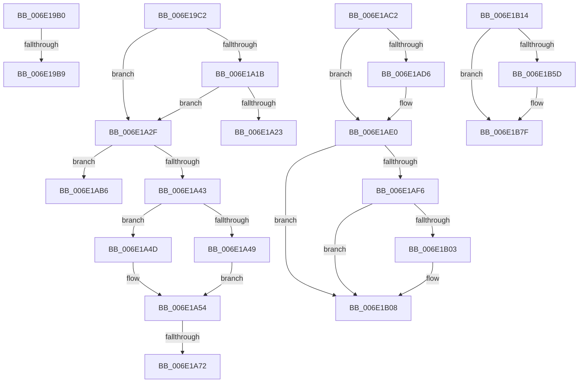

# sub_006E19B0

- RVA: `0x006E19B0`–`0x006E1B8B` (길이 `475` bytes)
- VA: `0x00000001406E19B0`
- 실행 섹션: `.text`
- PDB 이름 있음: `아니요`; PDB Function 태그: `아니요`
- unwind 정보 RVA: `0x00075BA4`
- 디코드: `112`개 명령, `475/475` bytes 표시
- 미해석 바이트: `0` (있으면 어셈블리에 `.byte`로 보존)

> 이 문서는 커널 이미지의 기계어와 PDB 기호를 분석해 생성했습니다. 4번과 5번은 함수 원형과 자료형을 바이너리 사용 방식에서 추정한 C 해석이며 원본 소스 복구 결과는 아닙니다.

## 1. Dependencies

- 직접 호출 지점: **14**; 고유 호출 대상: **8**
- 직접 호출자로 확인된 함수: **0**
- RIP 상대 이미지 참조: **1**

### Outgoing calls
- `0x006E19DA` → [MiReleaseSpinLockExclusive](../24/MiReleaseSpinLockExclusive_function_002482C0.md) (function, `0x002482C0`)
- `0x006E1A02` → [MiAllocateFileExtents](../../page/AB/MiAllocateFileExtents_function_00ABDF54.md) (function, `0x00ABDF54`)
- `0x006E1A33` → [ExAcquireSpinLockExclusive](../24/ExAcquireSpinLockExclusive_function_00248690.md) (function, `0x00248690`)
- `0x006E1A61` → [MiDecrementSubsections](../29/MiDecrementSubsections_function_00298B50.md) (function, `0x00298B50`)
- `0x006E1A7A` → [MiReleaseSpinLockExclusive](../24/MiReleaseSpinLockExclusive_function_002482C0.md) (function, `0x002482C0`)
- `0x006E1AA2` → [MiReturnCrossPartitionSectionCharges](../4B/MiReturnCrossPartitionSectionCharges_function_004BA61C.md) (function, `0x004BA61C`)
- `0x006E1AAB` → [ExAcquireSpinLockExclusive](../24/ExAcquireSpinLockExclusive_function_00248690.md) (function, `0x00248690`)
- `0x006E1ADB` → [ExfTryToWakePushLock](../26/ExfTryToWakePushLock_function_00265DD0.md) (function, `0x00265DD0`)
- `0x006E1AE5` → [KeAbPostRelease](../2E/KeAbPostRelease_function_002E1600.md) (function, `0x002E1600`)
- `0x006E1B03` → [KiCheckForKernelApcDelivery](../2E/KiCheckForKernelApcDelivery_function_002E2C80.md) (function, `0x002E2C80`)
- `0x006E1B2E` → [ExAcquireSpinLockExclusive](../24/ExAcquireSpinLockExclusive_function_00248690.md) (function, `0x00248690`)
- `0x006E1B44` → [MiDecrementSubsections](../29/MiDecrementSubsections_function_00298B50.md) (function, `0x00298B50`)
- `0x006E1B53` → [MiReleaseSpinLockExclusive](../24/MiReleaseSpinLockExclusive_function_002482C0.md) (function, `0x002482C0`)
- `0x006E1B7A` → [MiReturnCrossPartitionSectionCharges](../4B/MiReturnCrossPartitionSectionCharges_function_004BA61C.md) (function, `0x004BA61C`)

### Direct callers
- 이 함수 시작 RVA로 연결되는 직접 call은 확인되지 않았습니다. 간접 호출은 완전히 역산할 수 없습니다.

### Static image references
- `0x006E1A92` → RVA `0x00E30088` (`.data`; read)

## 2. Other-region calls and transfers

- 다른 실행 섹션으로 향하는 call: **1**
  - `0x006E1A02` → [MiAllocateFileExtents](../../page/AB/MiAllocateFileExtents_function_00ABDF54.md) (`.text` → `PAGE`)
- call이 아닌 외부 분기/꼬리 이동: **8**
  - `0x006E19B3` → [MiAddViewsForSection + 0x604](../32/MiAddViewsForSection_function_00324990.md) (`tail-transfer`)
  - `0x006E19BD` → [MiAddViewsForSection + 0x604](../32/MiAddViewsForSection_function_00324990.md) (`tail-transfer`)
  - `0x006E1A2A` → [MiAddViewsForSection + 0x4AC](../32/MiAddViewsForSection_function_00324990.md) (`tail-transfer`)
  - `0x006E1A6C` → [MiAddViewsForSection + 0x3E1](../32/MiAddViewsForSection_function_00324990.md) (`tail-transfer`)
  - `0x006E1AB1` → [MiAddViewsForSection + 0x3E1](../32/MiAddViewsForSection_function_00324990.md) (`tail-transfer`)
  - `0x006E1ABD` → [MiAddViewsForSection + 0x14D](../32/MiAddViewsForSection_function_00324990.md) (`tail-transfer`)
  - `0x006E1B0F` → [MiAddViewsForSection + 0x4A7](../32/MiAddViewsForSection_function_00324990.md) (`tail-transfer`)
  - `0x006E1B86` → [MiAddViewsForSection + 0x4B5](../32/MiAddViewsForSection_function_00324990.md) (`tail-transfer`)

## 3. Assembly (complete function range)

```asm
006E19B0  48 85 C9                        test rcx, rcx
006E19B3  0F 84 DB 35 C4 FF               je 0x140324f94
006E19B9  C6 41 0A 01                     mov byte ptr [rcx + 0xa], 1
006E19BD  E9 D2 35 C4 FF                  jmp 0x140324f94
006E19C2  41 8B 7D 2C                     mov edi, dword ptr [r13 + 0x2c]
006E19C6  49 8D 4E 48                     lea rcx, [r14 + 0x48]
006E19CA  25 FF FF FF 3F                  and eax, 0x3fffffff
006E19CF  41 0F B6 D4                     movzx edx, r12b
006E19D3  89 84 24 D0 00 00 00            mov dword ptr [rsp + 0xd0], eax
006E19DA  E8 E1 68 B6 FF                  call 0x1402482c0
006E19DF  2B BC 24 D0 00 00 00            sub edi, dword ptr [rsp + 0xd0]
006E19E6  33 D2                           xor edx, edx
006E19E8  4D 8B 45 08                     mov r8, qword ptr [r13 + 8]
006E19EC  44 8B CF                        mov r9d, edi
006E19EF  C7 44 24 28 FF FF FF FF         mov dword ptr [rsp + 0x28], 0xffffffff
006E19F7  49 8B CD                        mov rcx, r13
006E19FA  C7 44 24 20 00 00 00 00         mov dword ptr [rsp + 0x20], 0
006E1A02  E8 4D C5 3D 00                  call 0x140abdf54
006E1A07  BA 00 00 00 80                  mov edx, 0x80000000
006E1A0C  89 84 24 D0 00 00 00            mov dword ptr [rsp + 0xd0], eax
006E1A13  8B C8                           mov ecx, eax
006E1A15  03 C2                           add eax, edx
006E1A17  85 C2                           test edx, eax
006E1A19  75 14                           jne 0x1406e1a2f
006E1A1B  81 F9 0A 02 00 C0               cmp ecx, 0xc000020a
006E1A21  74 0C                           je 0x1406e1a2f
006E1A23  8B BC 24 D8 00 00 00            mov edi, dword ptr [rsp + 0xd8]
006E1A2A  E9 0D 34 C4 FF                  jmp 0x140324e3c
006E1A2F  49 8D 4E 48                     lea rcx, [r14 + 0x48]
006E1A33  E8 58 6C B6 FF                  call 0x140248690
006E1A38  8B 84 24 D0 00 00 00            mov eax, dword ptr [rsp + 0xd0]
006E1A3F  85 C0                           test eax, eax
006E1A41  79 73                           jns 0x1406e1ab6
006E1A43  40 F6 C5 05                     test bpl, 5
006E1A47  74 04                           je 0x1406e1a4d
006E1A49  33 C0                           xor eax, eax
006E1A4B  EB 07                           jmp 0x1406e1a54
006E1A4D  8B 44 24 40                     mov eax, dword ptr [rsp + 0x40]
006E1A51  83 C8 08                        or eax, 8
006E1A54  44 8B C0                        mov r8d, eax
006E1A57  89 44 24 30                     mov dword ptr [rsp + 0x30], eax
006E1A5B  49 8B D5                        mov rdx, r13
006E1A5E  49 8B CD                        mov rcx, r13
006E1A61  E8 EA 70 BB FF                  call 0x140298b50
006E1A66  48 8B F8                        mov rdi, rax
006E1A69  48 85 C0                        test rax, rax
006E1A6C  0F 84 FF 32 C4 FF               je 0x140324d71
006E1A72  41 0F B6 D4                     movzx edx, r12b
006E1A76  49 8D 4E 48                     lea rcx, [r14 + 0x48]
006E1A7A  E8 41 68 B6 FF                  call 0x1402482c0
006E1A7F  41 0F B7 4E 3C                  movzx ecx, word ptr [r14 + 0x3c]
006E1A84  B8 FF 03 00 00                  mov eax, 0x3ff
006E1A89  66 23 C8                        and cx, ax
006E1A8C  4C 8B C7                        mov r8, rdi
006E1A8F  0F B7 D1                        movzx edx, cx
006E1A92  48 8B 0D EF E5 74 00            mov rcx, qword ptr [rip + 0x74e5ef]
006E1A99  48 8B 0C D1                     mov rcx, qword ptr [rcx + rdx*8]
006E1A9D  BA 01 00 00 00                  mov edx, 1
006E1AA2  E8 75 8B DD FF                  call 0x1404ba61c
006E1AA7  49 8D 4E 48                     lea rcx, [r14 + 0x48]
006E1AAB  E8 E0 6B B6 FF                  call 0x140248690
006E1AB0  90                              nop
006E1AB1  E9 BB 32 C4 FF                  jmp 0x140324d71
006E1AB6  8B BC 24 D8 00 00 00            mov edi, dword ptr [rsp + 0xd8]
006E1ABD  E9 1B 30 C4 FF                  jmp 0x140324add
006E1AC2  4C 8B 64 24 48                  mov r12, qword ptr [rsp + 0x48]
006E1AC7  F0 49 0F C1 5C 24 28            lock xadd qword ptr [r12 + 0x28], rbx
006E1ACE  80 E3 06                        and bl, 6
006E1AD1  80 FB 02                        cmp bl, 2
006E1AD4  75 0A                           jne 0x1406e1ae0
006E1AD6  49 8D 4C 24 28                  lea rcx, [r12 + 0x28]
006E1ADB  E8 F0 42 B8 FF                  call 0x140265dd0
006E1AE0  49 8D 4C 24 28                  lea rcx, [r12 + 0x28]
006E1AE5  E8 16 FB BF FF                  call 0x1402e1600
006E1AEA  90                              nop
006E1AEB  66 41 83 87 E6 01 00 00 01      add word ptr [r15 + 0x1e6], 1
006E1AF4  75 12                           jne 0x1406e1b08
006E1AF6  49 8D 87 98 00 00 00            lea rax, [r15 + 0x98]
006E1AFD  90                              nop
006E1AFE  48 39 00                        cmp qword ptr [rax], rax
006E1B01  74 05                           je 0x1406e1b08
006E1B03  E8 78 11 C0 FF                  call 0x1402e2c80
006E1B08  8B 8C 24 D0 00 00 00            mov ecx, dword ptr [rsp + 0xd0]
006E1B0F  E9 23 33 C4 FF                  jmp 0x140324e37
006E1B14  44 8B 7C 24 40                  mov r15d, dword ptr [rsp + 0x40]
006E1B19  49 8D 4E 48                     lea rcx, [r14 + 0x48]
006E1B1D  41 83 CF 08                     or r15d, 8
006E1B21  B8 00 00 00 00                  mov eax, 0
006E1B26  40 F6 C5 05                     test bpl, 5
006E1B2A  44 0F 45 F8                     cmovne r15d, eax
006E1B2E  E8 5D 6B B6 FF                  call 0x140248690
006E1B33  48 8B 8C 24 C0 00 00 00         mov rcx, qword ptr [rsp + 0xc0]
006E1B3B  45 8B C7                        mov r8d, r15d
006E1B3E  49 8B D5                        mov rdx, r13
006E1B41  0F B6 D8                        movzx ebx, al
006E1B44  E8 07 70 BB FF                  call 0x140298b50
006E1B49  0F B6 D3                        movzx edx, bl
006E1B4C  49 8D 4E 48                     lea rcx, [r14 + 0x48]
006E1B50  4C 8B F8                        mov r15, rax
006E1B53  E8 68 67 B6 FF                  call 0x1402482c0
006E1B58  4D 85 FF                        test r15, r15
006E1B5B  74 22                           je 0x1406e1b7f
006E1B5D  45 0F B7 46 3C                  movzx r8d, word ptr [r14 + 0x3c]
006E1B62  B8 FF 03 00 00                  mov eax, 0x3ff
006E1B67  48 8B 0D 1A E5 74 00            mov rcx, qword ptr [rip + 0x74e51a]
006E1B6E  4C 23 C0                        and r8, rax
006E1B71  8B D7                           mov edx, edi
006E1B73  4A 8B 0C C1                     mov rcx, qword ptr [rcx + r8*8]
006E1B77  4D 8B C7                        mov r8, r15
006E1B7A  E8 9D 8A DD FF                  call 0x1404ba61c
006E1B7F  8B 8C 24 D0 00 00 00            mov ecx, dword ptr [rsp + 0xd0]
006E1B86  E9 BA 32 C4 FF                  jmp 0x140324e45
```

## 4. C-style interpretation (structured pseudocode)

```c
__int64 __fastcall sub_006E19B0(__int64 a1)
{
    unsigned int v_stack_p20;
    unsigned int v_stack_p28;
    unsigned int v_stack_p30;
    unsigned int v_stack_p40;
    unsigned __int64 v_stack_p48;
    unsigned __int64 v_stack_pC0;
    unsigned int v_stack_pD0;
    unsigned int v_stack_pD8;

    *(unsigned __int8 *)(a1 + 10) = 1;
}
```

## 5. (Beta) C Style

```c
int64_t sub_006E19B0(int64_t Arg1)
{
    uint32_t v_stack_p20;
    uint32_t v_stack_p28;
    uint32_t v_stack_p30;
    uint32_t v_stack_p40;
    uint64_t v_stack_p48;
    uint64_t v_stack_pC0;
    uint32_t v_stack_pD0;
    uint32_t v_stack_pD8;

    *(uint8_t *)(Arg1 + 0xA) = 1;
}
```

## 6. Execution-region graph

[열기: 2D/3D 그래프와 함수 탐색 컨트롤 패널](../../../control-panel.html?section=text&rva=0x006E19B0&view=graph)

- 2D 그래프는 위에서 아래로 흐르고, 3D 그래프는 빈 공간을 드래그해 회전합니다. Shift+드래그는 이동, 휠은 확대·축소, 함수 노드 선택은 대상 보고서 이동입니다.

### Static fallback


