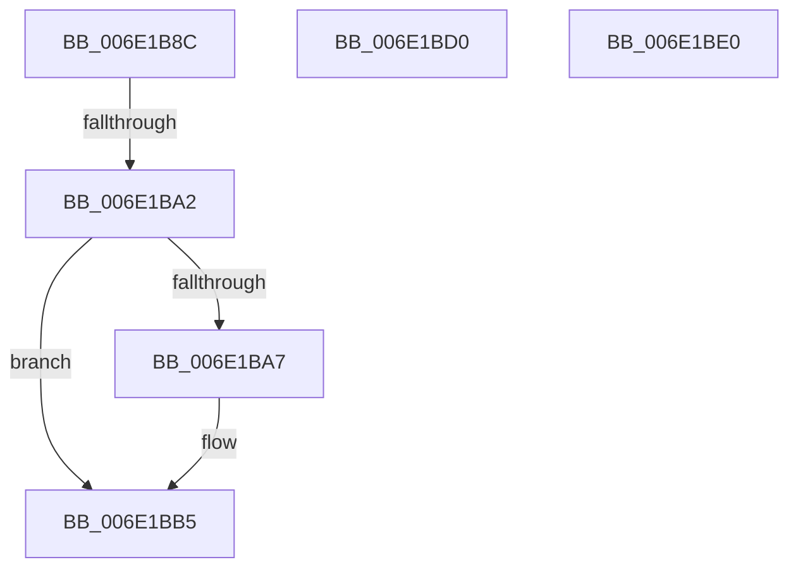

# sub_006E1B8C

- RVA: `0x006E1B8C`–`0x006E1BEA` (길이 `94` bytes)
- VA: `0x00000001406E1B8C`
- 실행 섹션: `.text`
- PDB 이름 있음: `아니요`; PDB Function 태그: `아니요`
- unwind 정보 RVA: `0x00075BD0`
- 디코드: `26`개 명령, `94/94` bytes 표시
- 미해석 바이트: `0` (있으면 어셈블리에 `.byte`로 보존)

> 이 문서는 커널 이미지의 기계어와 PDB 기호를 분석해 생성했습니다. 4번과 5번은 함수 원형과 자료형을 바이너리 사용 방식에서 추정한 C 해석이며 원본 소스 복구 결과는 아닙니다.

## 1. Dependencies

- 직접 호출 지점: **4**; 고유 호출 대상: **4**
- 직접 호출자로 확인된 함수: **0**
- RIP 상대 이미지 참조: **0**

### Outgoing calls
- `0x006E1B95` → [MiChargeResident](../28/MiChargeResident_function_0028A0F0.md) (function, `0x0028A0F0`)
- `0x006E1BB0` → [MiReturnCommit](../24/MiReturnCommit_function_00248410.md) (function, `0x00248410`)
- `0x006E1BC0` → [MiReturnCrossPartitionCharges](../28/MiReturnCrossPartitionCharges_function_002867D0.md) (function, `0x002867D0`)
- `0x006E1BD5` → [MiUpdateSubsectionCrossPartitionRefs](../4F/MiUpdateSubsectionCrossPartitionRefs_function_004FB5DC.md) (function, `0x004FB5DC`)

### Direct callers
- 이 함수 시작 RVA로 연결되는 직접 call은 확인되지 않았습니다. 간접 호출은 완전히 역산할 수 없습니다.

### Static image references
- 디코드된 RIP-relative 메모리 참조가 없습니다.

## 2. Other-region calls and transfers

- 다른 실행 섹션으로 향하는 call: **0**
- call이 아닌 외부 분기/꼬리 이동: **4**
  - `0x006E1B9C` → [MiReferenceActiveSubsection + 0x3D3](../32/MiReferenceActiveSubsection_function_00325060.md) (`tail-transfer`)
  - `0x006E1BCB` → [MiReferenceActiveSubsection + 0x29E](../32/MiReferenceActiveSubsection_function_00325060.md) (`tail-transfer`)
  - `0x006E1BDB` → [MiReferenceActiveSubsection + 0x87](../32/MiReferenceActiveSubsection_function_00325060.md) (`tail-transfer`)
  - `0x006E1BE5` → [MiReferenceActiveSubsection + 0x122](../32/MiReferenceActiveSubsection_function_00325060.md) (`tail-transfer`)

## 3. Assembly (complete function range)

```asm
006E1B8C  45 33 C0                        xor r8d, r8d
006E1B8F  49 8B D5                        mov rdx, r13
006E1B92  48 8B CE                        mov rcx, rsi
006E1B95  E8 56 85 BA FF                  call 0x14028a0f0
006E1B9A  85 C0                           test eax, eax
006E1B9C  0F 85 91 38 C4 FF               jne 0x140325433
006E1BA2  48 85 ED                        test rbp, rbp
006E1BA5  74 0E                           je 0x1406e1bb5
006E1BA7  45 33 C0                        xor r8d, r8d
006E1BAA  49 8B D5                        mov rdx, r13
006E1BAD  48 8B CE                        mov rcx, rsi
006E1BB0  E8 5B 68 B6 FF                  call 0x140248410
006E1BB5  4D 8B CD                        mov r9, r13
006E1BB8  44 8B C7                        mov r8d, edi
006E1BBB  33 D2                           xor edx, edx
006E1BBD  48 8B CE                        mov rcx, rsi
006E1BC0  E8 0B 4C BA FF                  call 0x1402867d0
006E1BC5  41 BF 17 00 00 C0               mov r15d, 0xc0000017
006E1BCB  E9 2E 37 C4 FF                  jmp 0x1403252fe
006E1BD0  FF C2                           inc edx
006E1BD2  49 8B CF                        mov rcx, r15
006E1BD5  E8 02 9A E1 FF                  call 0x1404fb5dc
006E1BDA  90                              nop
006E1BDB  E9 07 35 C4 FF                  jmp 0x1403250e7
006E1BE0  B8 2D 01 00 C0                  mov eax, 0xc000012d
006E1BE5  E9 98 35 C4 FF                  jmp 0x140325182
```

## 4. C-style interpretation (structured pseudocode)

```c
__int64 __fastcall sub_006E1B8C(__int64 a1, __int64 a2, int a3)
{
    __int64 result;

    a3 = 0;
    result = MiChargeResident(v_rsi, v_r13, a3, a4);
    if (v_rbp != 0) {
        a3 = 0;
        a2 = v_r13;
        a1 = v_rsi;
        result = MiReturnCommit(a1, a2, a3, a4);
    }
    a2 = 0;
    result = MiReturnCrossPartitionCharges(v_rsi, a2, (unsigned int)((unsigned int)(v_rdi)), v_r13);
}
```

## 5. (Beta) C Style

```c
int64_t sub_006E1B8C(int64_t Arg1, int64_t Arg2, int32_t Arg3)
{
    int64_t result;

    Arg3 = 0;
    result = MiChargeResident(local_rsi, local_r13, Arg3, a4);
    if (local_rbp != 0) {
        Arg3 = 0;
        Arg2 = local_r13;
        Arg1 = local_rsi;
        result = MiReturnCommit(Arg1, Arg2, Arg3, a4);
    }
    Arg2 = 0;
    result = MiReturnCrossPartitionCharges(local_rsi, Arg2, (uint32_t)((uint32_t)(local_rdi)), local_r13);
}
```

## 6. Execution-region graph

[열기: 2D/3D 그래프와 함수 탐색 컨트롤 패널](../../../control-panel.html?section=text&rva=0x006E1B8C&view=graph)

- 2D 그래프는 위에서 아래로 흐르고, 3D 그래프는 빈 공간을 드래그해 회전합니다. Shift+드래그는 이동, 휠은 확대·축소, 함수 노드 선택은 대상 보고서 이동입니다.

### Static fallback


