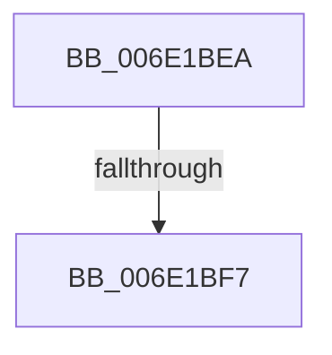

# sub_006E1BEA

- RVA: `0x006E1BEA`–`0x006E1C04` (길이 `26` bytes)
- VA: `0x00000001406E1BEA`
- 실행 섹션: `.text`
- PDB 이름 있음: `아니요`; PDB Function 태그: `아니요`
- unwind 정보 RVA: `0x00075DE4`
- 디코드: `5`개 명령, `26/26` bytes 표시
- 미해석 바이트: `0` (있으면 어셈블리에 `.byte`로 보존)

> 이 문서는 커널 이미지의 기계어와 PDB 기호를 분석해 생성했습니다. 4번과 5번은 함수 원형과 자료형을 바이너리 사용 방식에서 추정한 C 해석이며 원본 소스 복구 결과는 아닙니다.

## 1. Dependencies

- 직접 호출 지점: **0**; 고유 호출 대상: **0**
- 직접 호출자로 확인된 함수: **0**
- RIP 상대 이미지 참조: **0**

### Outgoing calls
- 직접 디코드된 call 명령이 없습니다.

### Direct callers
- 이 함수 시작 RVA로 연결되는 직접 call은 확인되지 않았습니다. 간접 호출은 완전히 역산할 수 없습니다.

### Static image references
- 디코드된 RIP-relative 메모리 참조가 없습니다.

## 2. Other-region calls and transfers

- 다른 실행 섹션으로 향하는 call: **0**
- call이 아닌 외부 분기/꼬리 이동: **2**
  - `0x006E1BF1` → [RtlCSparseBitmapFindBitSetCapped + 0x176](../32/RtlCSparseBitmapFindBitSetCapped_function_003274AC.md) (`tail-transfer`)
  - `0x006E1BFF` → [RtlCSparseBitmapFindBitSetCapped + 0x176](../32/RtlCSparseBitmapFindBitSetCapped_function_003274AC.md) (`tail-transfer`)

## 3. Assembly (complete function range)

```asm
006E1BEA  48 81 F9 00 00 00 40            cmp rcx, 0x40000000
006E1BF1  0F 8E 2B 5A C4 FF               jle 0x140327622
006E1BF7  BB 00 00 00 40                  mov ebx, 0x40000000
006E1BFC  48 2B D8                        sub rbx, rax
006E1BFF  E9 1E 5A C4 FF                  jmp 0x140327622
```

## 4. C-style interpretation (structured pseudocode)

```c
void __fastcall sub_006E1BEA(__int64 a1)
{
    __int64 v_rbx;

    v_rbx = ((unsigned int)(0x40000000ULL)) - (result);
}
```

## 5. (Beta) C Style

```c
void sub_006E1BEA(int64_t Arg1)
{
    int64_t local_rbx;

    local_rbx = ((uint32_t)(0x40000000ULL)) - (result);
}
```

## 6. Execution-region graph

[열기: 2D/3D 그래프와 함수 탐색 컨트롤 패널](../../../control-panel.html?section=text&rva=0x006E1BEA&view=graph)

- 2D 그래프는 위에서 아래로 흐르고, 3D 그래프는 빈 공간을 드래그해 회전합니다. Shift+드래그는 이동, 휠은 확대·축소, 함수 노드 선택은 대상 보고서 이동입니다.

### Static fallback


