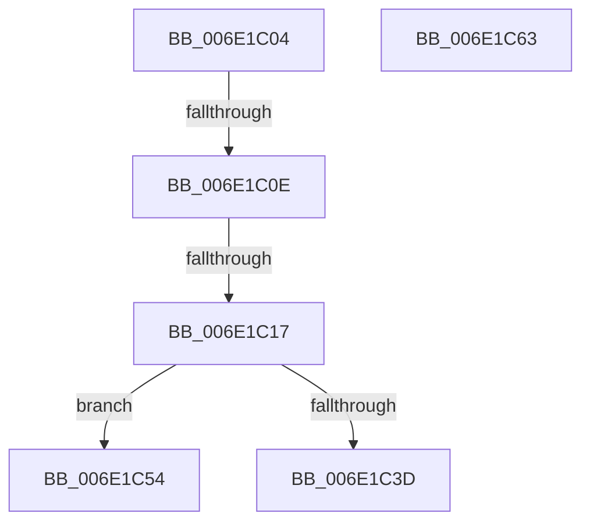

# sub_006E1C04

- RVA: `0x006E1C04`–`0x006E1C8D` (길이 `137` bytes)
- VA: `0x00000001406E1C04`
- 실행 섹션: `.text`
- PDB 이름 있음: `아니요`; PDB Function 태그: `아니요`
- unwind 정보 RVA: `0x00075E40`
- 디코드: `35`개 명령, `137/137` bytes 표시
- 미해석 바이트: `0` (있으면 어셈블리에 `.byte`로 보존)

> 이 문서는 커널 이미지의 기계어와 PDB 기호를 분석해 생성했습니다. 4번과 5번은 함수 원형과 자료형을 바이너리 사용 방식에서 추정한 C 해석이며 원본 소스 복구 결과는 아닙니다.

## 1. Dependencies

- 직접 호출 지점: **3**; 고유 호출 대상: **3**
- 직접 호출자로 확인된 함수: **0**
- RIP 상대 이미지 참조: **0**

### Outgoing calls
- `0x006E1C2C` → [MiMapContiguousMemoryLarge](../3B/MiMapContiguousMemoryLarge_function_003B44CC.md) (function, `0x003B44CC`)
- `0x006E1C6E` → [MiProtectionToCacheAttribute](../2B/MiProtectionToCacheAttribute_function_002B8530.md) (function, `0x002B8530`)
- `0x006E1C82` → [MiInsertPteTracker](../69/MiInsertPteTracker_function_00697BE4.md) (function, `0x00697BE4`)

### Direct callers
- 이 함수 시작 RVA로 연결되는 직접 call은 확인되지 않았습니다. 간접 호출은 완전히 역산할 수 없습니다.

### Static image references
- 디코드된 RIP-relative 메모리 참조가 없습니다.

## 2. Other-region calls and transfers

- 다른 실행 섹션으로 향하는 call: **0**
- call이 아닌 외부 분기/꼬리 이동: **5**
  - `0x006E1C08` → [MiMapContiguousMemory + 0x122](../32/MiMapContiguousMemory_function_0032787C.md) (`tail-transfer`)
  - `0x006E1C11` → [MiMapContiguousMemory + 0x122](../32/MiMapContiguousMemory_function_0032787C.md) (`tail-transfer`)
  - `0x006E1C4F` → [MiMapContiguousMemory + 0x206](../32/MiMapContiguousMemory_function_0032787C.md) (`tail-transfer`)
  - `0x006E1C5E` → [MiMapContiguousMemory + 0x122](../32/MiMapContiguousMemory_function_0032787C.md) (`tail-transfer`)
  - `0x006E1C88` → [MiMapContiguousMemory + 0x223](../32/MiMapContiguousMemory_function_0032787C.md) (`tail-transfer`)

## 3. Assembly (complete function range)

```asm
006E1C04  41 F6 C0 01                     test r8b, 1
006E1C08  0F 85 90 5D C4 FF               jne 0x14032799e
006E1C0E  4D 3B F2                        cmp r14, r10
006E1C11  0F 85 87 5D C4 FF               jne 0x14032799e
006E1C17  48 8D 4D 8F                     lea rcx, [rbp - 0x71]
006E1C1B  45 8B C8                        mov r9d, r8d
006E1C1E  48 89 4C 24 20                  mov qword ptr [rsp + 0x20], rcx
006E1C23  45 8B C5                        mov r8d, r13d
006E1C26  48 8B C8                        mov rcx, rax
006E1C29  49 8B D2                        mov rdx, r10
006E1C2C  E8 9B 28 CD FF                  call 0x1403b44cc
006E1C31  48 89 45 A7                     mov qword ptr [rbp - 0x59], rax
006E1C35  48 8B C8                        mov rcx, rax
006E1C38  48 85 C0                        test rax, rax
006E1C3B  74 17                           je 0x1406e1c54
006E1C3D  4D 8B FE                        mov r15, r14
006E1C40  48 8B F8                        mov rdi, rax
006E1C43  49 C1 E7 0C                     shl r15, 0xc
006E1C47  49 8B F4                        mov rsi, r12
006E1C4A  48 83 65 9F 00                  and qword ptr [rbp - 0x61], 0
006E1C4F  E9 2E 5E C4 FF                  jmp 0x140327a82
006E1C54  44 8B 45 93                     mov r8d, dword ptr [rbp - 0x6d]
006E1C58  41 BB FF FF FF FF               mov r11d, 0xffffffff
006E1C5E  E9 3B 5D C4 FF                  jmp 0x14032799e
006E1C63  48 8B 45 C7                     mov rax, qword ptr [rbp - 0x39]
006E1C67  41 8B CD                        mov ecx, r13d
006E1C6A  48 89 45 DF                     mov qword ptr [rbp - 0x21], rax
006E1C6E  E8 BD 68 BD FF                  call 0x1402b8530
006E1C73  44 8B C8                        mov r9d, eax
006E1C76  48 8D 4D CF                     lea rcx, [rbp - 0x31]
006E1C7A  BA 01 00 00 00                  mov edx, 1
006E1C7F  45 8B C4                        mov r8d, r12d
006E1C82  E8 5D 5F FB FF                  call 0x140697be4
006E1C87  90                              nop
006E1C88  E9 12 5E C4 FF                  jmp 0x140327a9f
```

## 4. C-style interpretation (structured pseudocode)

```c
__int64 __fastcall sub_006E1C04(__int64 a1, __int64 a2, int a3)
{
    __int64 result;
    __int64 v_r15;
    unsigned __int64 v_stack_p20;

    v_stack_p20 = v_rbp - 113;
    result = MiMapContiguousMemoryLarge(result, v_r10, (unsigned int)((unsigned int)(v_r13)), (unsigned int)(a3));
    *(unsigned __int64 *)(v_rbp - 89) = result;
    if (result == 0) goto loc_006E1C54;
    v_r15 = (v_r14) << (12);
loc_006E1C54:
}
```

## 5. (Beta) C Style

```c
int64_t sub_006E1C04(int64_t Arg1, int64_t Arg2, int32_t Arg3)
{
    int64_t result;
    int64_t local_r15;
    uint64_t v_stack_p20;

    v_stack_p20 = local_rbp - 113;
    result = MiMapContiguousMemoryLarge(result, local_r10, (uint32_t)((uint32_t)(local_r13)), (uint32_t)(Arg3));
    *(uint64_t *)(local_rbp - 0x59) = result;
    if (result == 0) goto loc_006E1C54;
    local_r15 = (local_r14) << (12);
loc_006E1C54:
}
```

## 6. Execution-region graph

[열기: 2D/3D 그래프와 함수 탐색 컨트롤 패널](../../../control-panel.html?section=text&rva=0x006E1C04&view=graph)

- 2D 그래프는 위에서 아래로 흐르고, 3D 그래프는 빈 공간을 드래그해 회전합니다. Shift+드래그는 이동, 휠은 확대·축소, 함수 노드 선택은 대상 보고서 이동입니다.

### Static fallback


