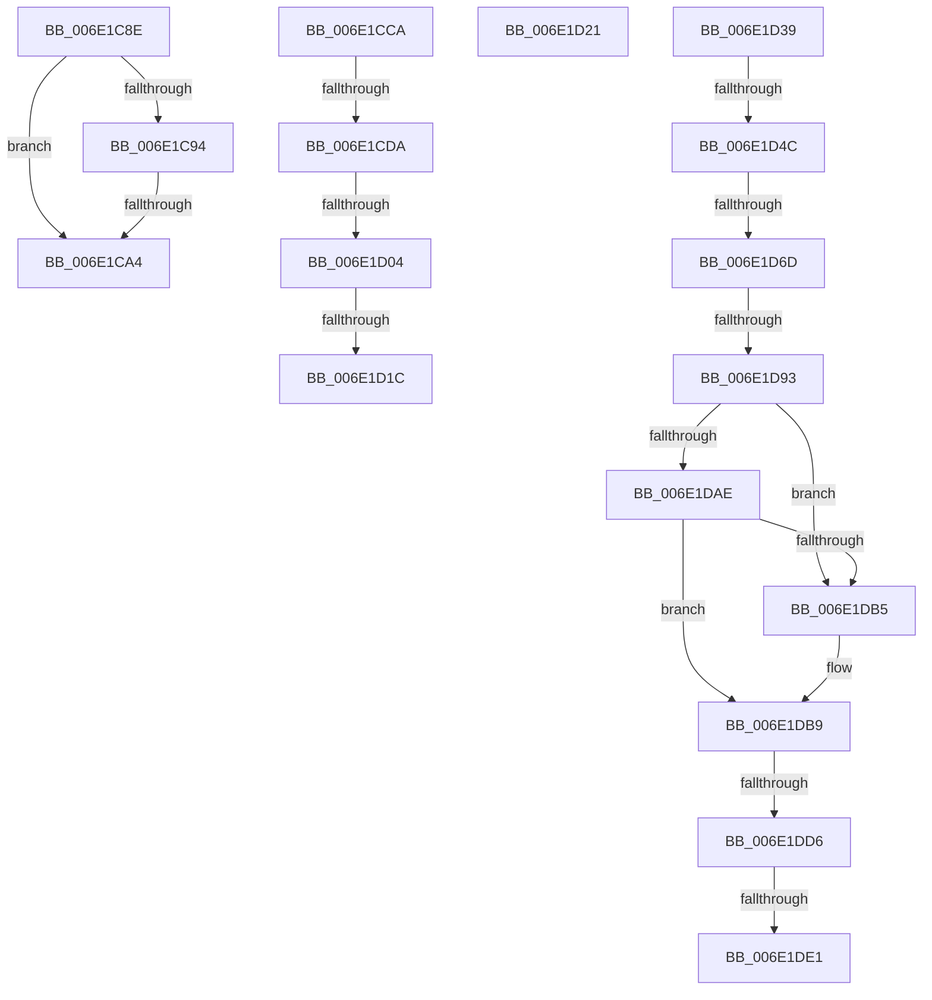

# sub_006E1C8E

- RVA: `0x006E1C8E`–`0x006E1DF5` (길이 `359` bytes)
- VA: `0x00000001406E1C8E`
- 실행 섹션: `.text`
- PDB 이름 있음: `아니요`; PDB Function 태그: `아니요`
- unwind 정보 RVA: `0x00075ED0`
- 디코드: `82`개 명령, `359/359` bytes 표시
- 미해석 바이트: `0` (있으면 어셈블리에 `.byte`로 보존)

> 이 문서는 커널 이미지의 기계어와 PDB 기호를 분석해 생성했습니다. 4번과 5번은 함수 원형과 자료형을 바이너리 사용 방식에서 추정한 C 해석이며 원본 소스 복구 결과는 아닙니다.

## 1. Dependencies

- 직접 호출 지점: **9**; 고유 호출 대상: **9**
- 직접 호출자로 확인된 함수: **0**
- RIP 상대 이미지 참조: **2**

### Outgoing calls
- `0x006E1C97` → [MiRotatedToFrameBuffer](../2C/MiRotatedToFrameBuffer_function_002C5FE4.md) (function, `0x002C5FE4`)
- `0x006E1CBF` → [MiProcessWsInSwapFault](../36/MiProcessWsInSwapFault_function_00361EFC.md) (function, `0x00361EFC`)
- `0x006E1CCD` → [KeInvalidAccessAllowed](../34/KeInvalidAccessAllowed_function_0034B3F0.md) (function, `0x0034B3F0`)
- `0x006E1CF1` → [KeBugCheckEx](../4F/KeBugCheckEx_function_004FD660.md) (function, `0x004FD660`)
- `0x006E1D0D` → [MiKernelWriteToExecutableMemory](../36/MiKernelWriteToExecutableMemory_function_00368F18.md) (function, `0x00368F18`)
- `0x006E1D27` → [MiUnlockPageTable](../21/MiUnlockPageTable_function_00216EC0.md) (function, `0x00216EC0`)
- `0x006E1D3F` → [MiCanGrantExecute](../4A/MiCanGrantExecute_function_004AD788.md) (function, `0x004AD788`)
- `0x006E1DBF` → [MiWriteValidPteNewProtection](../28/MiWriteValidPteNewProtection_function_00281810.md) (function, `0x00281810`)
- `0x006E1DEA` → [MiFlushSingleTbEntry](../28/MiFlushSingleTbEntry_function_0028E730.md) (function, `0x0028E730`)

### Direct callers
- 이 함수 시작 RVA로 연결되는 직접 call은 확인되지 않았습니다. 간접 호출은 완전히 역산할 수 없습니다.

### Static image references
- `0x006E1D60` → RVA `0x00E2DCE0` (`.data`; read)
- `0x006E1DA0` → RVA `0x00FC6A88` (`ALMOSTRO`; read)

## 2. Other-region calls and transfers

- 다른 실행 섹션으로 향하는 call: **0**
- call이 아닌 외부 분기/꼬리 이동: **13**
  - `0x006E1C9E` → [MiValidFault + 0x24A](../32/MiValidFault_function_003280B4.md) (`tail-transfer`)
  - `0x006E1CC5` → [MiValidFault + 0x24A](../32/MiValidFault_function_003280B4.md) (`tail-transfer`)
  - `0x006E1CD4` → [MiValidFault + 0xCB](../32/MiValidFault_function_003280B4.md) (`tail-transfer`)
  - `0x006E1CFE` → [MiValidFault + 0xF5](../32/MiValidFault_function_003280B4.md) (`tail-transfer`)
  - `0x006E1D16` → [MiValidFault + 0x159](../32/MiValidFault_function_003280B4.md) (`tail-transfer`)
  - `0x006E1D1C` → [MiValidFault + 0xF5](../32/MiValidFault_function_003280B4.md) (`tail-transfer`)
  - `0x006E1D34` → [MiValidFault + 0x1A3](../32/MiValidFault_function_003280B4.md) (`tail-transfer`)
  - `0x006E1D46` → [MiValidFault + 0xCB](../32/MiValidFault_function_003280B4.md) (`tail-transfer`)
  - `0x006E1D67` → [MiValidFault + 0xCB](../32/MiValidFault_function_003280B4.md) (`tail-transfer`)
  - `0x006E1D8D` → [MiValidFault + 0xCB](../32/MiValidFault_function_003280B4.md) (`tail-transfer`)
  - `0x006E1DD0` → [MiValidFault + 0x14F](../32/MiValidFault_function_003280B4.md) (`tail-transfer`)
  - `0x006E1DDB` → [MiValidFault + 0x14F](../32/MiValidFault_function_003280B4.md) (`tail-transfer`)
  - `0x006E1DF0` → [MiValidFault + 0x14F](../32/MiValidFault_function_003280B4.md) (`tail-transfer`)

## 3. Assembly (complete function range)

```asm
006E1C8E  41 83 F8 40                     cmp r8d, 0x40
006E1C92  75 10                           jne 0x1406e1ca4
006E1C94  49 8B CC                        mov rcx, r12
006E1C97  E8 48 43 BE FF                  call 0x1402c5fe4
006E1C9C  85 C0                           test eax, eax
006E1C9E  0F 85 5A 66 C4 FF               jne 0x1403282fe
006E1CA4  48 B8 00 00 00 00 00 DE FF FF   movabs rax, 0xffffde0000000000
006E1CAE  48 8B C0                        mov rax, rax
006E1CB1  49 8B 4F 38                     mov rcx, qword ptr [r15 + 0x38]
006E1CB5  48 8D 14 D8                     lea rdx, [rax + rbx*8]
006E1CB9  45 33 C9                        xor r9d, r9d
006E1CBC  4C 8B C5                        mov r8, rbp
006E1CBF  E8 38 02 C8 FF                  call 0x140361efc
006E1CC4  90                              nop
006E1CC5  E9 34 66 C4 FF                  jmp 0x1403282fe
006E1CCA  48 8B CE                        mov rcx, rsi
006E1CCD  E8 1E 97 C6 FF                  call 0x14034b3f0
006E1CD2  84 C0                           test al, al
006E1CD4  0F 85 A5 64 C4 FF               jne 0x14032817f
006E1CDA  4C 8B CE                        mov r9, rsi
006E1CDD  48 C7 44 24 20 08 00 00 00      mov qword ptr [rsp + 0x20], 8
006E1CE6  4D 8B C6                        mov r8, r14
006E1CE9  48 8B D5                        mov rdx, rbp
006E1CEC  B9 50 00 00 00                  mov ecx, 0x50
006E1CF1  E8 6A B9 E1 FF                  call 0x1404fd660
006E1CF6  CC                              int3
006E1CF7  F6 81 A9 05 00 00 20            test byte ptr [rcx + 0x5a9], 0x20
006E1CFE  0F 85 A5 64 C4 FF               jne 0x1403281a9
006E1D04  4D 8B C5                        mov r8, r13
006E1D07  48 8B D7                        mov rdx, rdi
006E1D0A  49 8B CF                        mov rcx, r15
006E1D0D  E8 06 72 C8 FF                  call 0x140368f18
006E1D12  8B D8                           mov ebx, eax
006E1D14  85 C0                           test eax, eax
006E1D16  0F 88 F1 64 C4 FF               js 0x14032820d
006E1D1C  E9 88 64 C4 FF                  jmp 0x1403281a9
006E1D21  49 8B D5                        mov rdx, r13
006E1D24  49 8B CC                        mov rcx, r12
006E1D27  E8 94 51 B3 FF                  call 0x140216ec0
006E1D2C  4C 8B A4 24 80 00 00 00         mov r12, qword ptr [rsp + 0x80]
006E1D34  E9 1E 65 C4 FF                  jmp 0x140328257
006E1D39  48 8B D5                        mov rdx, rbp
006E1D3C  49 8B CD                        mov rcx, r13
006E1D3F  E8 44 BA DC FF                  call 0x1404ad788
006E1D44  85 C0                           test eax, eax
006E1D46  0F 84 33 64 C4 FF               je 0x14032817f
006E1D4C  48 8B C7                        mov rax, rdi
006E1D4F  48 B9 FF FF FF FF FF 00 00 00   movabs rcx, 0xffffffffff
006E1D59  48 C1 E8 0C                     shr rax, 0xc
006E1D5D  48 23 C1                        and rax, rcx
006E1D60  48 3B 05 79 BF 74 00            cmp rax, qword ptr [rip + 0x74bf79]
006E1D67  0F 87 12 64 C4 FF               ja 0x14032817f
006E1D6D  48 8D 0C 40                     lea rcx, [rax + rax*2]
006E1D71  48 B8 28 00 00 00 00 DE FF FF   movabs rax, 0xffffde0000000028
006E1D7B  48 03 C9                        add rcx, rcx
006E1D7E  48 8B C0                        mov rax, rax
006E1D81  48 8B 04 C8                     mov rax, qword ptr [rax + rcx*8]
006E1D85  48 C1 E8 36                     shr rax, 0x36
006E1D89  0F BA E0 00                     bt eax, 0
006E1D8D  0F 83 EC 63 C4 FF               jae 0x14032817f
006E1D93  48 B8 FF FF FF FF FF FF FF 7F   movabs rax, 0x7fffffffffffffff
006E1D9D  48 23 F8                        and rdi, rax
006E1DA0  48 8B 05 E1 4C 8E 00            mov rax, qword ptr [rip + 0x8e4ce1]
006E1DA7  48 0F BA E0 08                  bt rax, 8
006E1DAC  72 07                           jb 0x1406e1db5
006E1DAE  48 0F BA E0 09                  bt rax, 9
006E1DB3  73 04                           jae 0x1406e1db9
006E1DB5  48 83 CF 20                     or rdi, 0x20
006E1DB9  48 8B D7                        mov rdx, rdi
006E1DBC  49 8B CC                        mov rcx, r12
006E1DBF  E8 4C FA B9 FF                  call 0x140281810
006E1DC4  48 8B 05 BD 4C 8E 00            mov rax, qword ptr [rip + 0x8e4cbd]
006E1DCB  48 0F BA E0 08                  bt rax, 8
006E1DD0  0F 82 2D 64 C4 FF               jb 0x140328203
006E1DD6  48 0F BA E0 09                  bt rax, 9
006E1DDB  0F 82 22 64 C4 FF               jb 0x140328203
006E1DE1  33 D2                           xor edx, edx
006E1DE3  48 8B CD                        mov rcx, rbp
006E1DE6  44 8D 42 20                     lea r8d, [rdx + 0x20]
006E1DEA  E8 41 C9 BA FF                  call 0x14028e730
006E1DEF  90                              nop
006E1DF0  E9 0E 64 C4 FF                  jmp 0x140328203
```

## 4. C-style interpretation (structured pseudocode)

```c
__int64 __fastcall sub_006E1C8E(__int64 a1, __int64 a2, int a3, int a4)
{
    __int64 result;
    unsigned __int64 v_stack_p20;
    unsigned __int64 v_stack_p80;

    if (a3 != 64) goto loc_006E1CA4;
    result = MiRotatedToFrameBuffer(v_r12, a2, a3, a4);
loc_006E1CA4:
    a4 = 0;
    result = MiProcessWsInSwapFault(*(unsigned __int64 *)(v_r15 + 56), result + v_rbx * 8, v_rbp, a4);
}
```

## 5. (Beta) C Style

```c
int64_t sub_006E1C8E(int64_t Arg1, int64_t Arg2, int32_t Arg3, int32_t Arg4)
{
    int64_t result;
    uint64_t v_stack_p20;
    uint64_t v_stack_p80;

    if (Arg3 != 64) goto loc_006E1CA4;
    result = MiRotatedToFrameBuffer(local_r12, Arg2, Arg3, Arg4);
loc_006E1CA4:
    Arg4 = 0;
    result = MiProcessWsInSwapFault(*(uint64_t *)(local_r15 + 0x38), result + local_rbx * 8, local_rbp, Arg4);
}
```

## 6. Execution-region graph

[열기: 2D/3D 그래프와 함수 탐색 컨트롤 패널](../../../control-panel.html?section=text&rva=0x006E1C8E&view=graph)

- 2D 그래프는 위에서 아래로 흐르고, 3D 그래프는 빈 공간을 드래그해 회전합니다. Shift+드래그는 이동, 휠은 확대·축소, 함수 노드 선택은 대상 보고서 이동입니다.

### Static fallback


