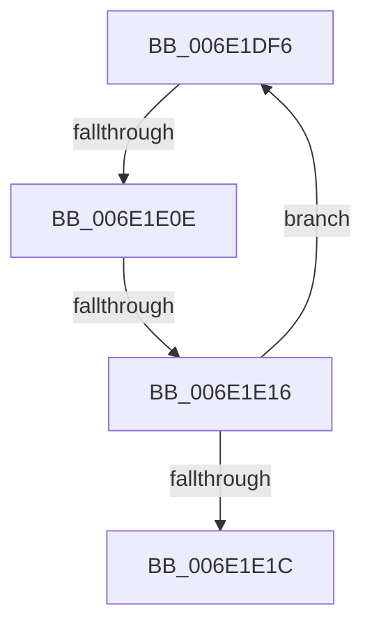

# sub_006E1DF6

- RVA: `0x006E1DF6`–`0x006E1E26` (길이 `48` bytes)
- VA: `0x00000001406E1DF6`
- 실행 섹션: `.text`
- PDB 이름 있음: `아니요`; PDB Function 태그: `아니요`
- unwind 정보 RVA: `0x00075F40`
- 디코드: `12`개 명령, `48/48` bytes 표시
- 미해석 바이트: `0` (있으면 어셈블리에 `.byte`로 보존)

> 이 문서는 커널 이미지의 기계어와 PDB 기호를 분석해 생성했습니다. 4번과 5번은 함수 원형과 자료형을 바이너리 사용 방식에서 추정한 C 해석이며 원본 소스 복구 결과는 아닙니다.

## 1. Dependencies

- 직접 호출 지점: **1**; 고유 호출 대상: **1**
- 직접 호출자로 확인된 함수: **0**
- RIP 상대 이미지 참조: **0**

### Outgoing calls
- `0x006E1E01` → [MI_READ_PTE_LOCK_FREE](../28/MI_READ_PTE_LOCK_FREE_function_002828A0.md) (function, `0x002828A0`)

### Direct callers
- 이 함수 시작 RVA로 연결되는 직접 call은 확인되지 않았습니다. 간접 호출은 완전히 역산할 수 없습니다.

### Static image references
- 디코드된 RIP-relative 메모리 참조가 없습니다.

## 2. Other-region calls and transfers

- 다른 실행 섹션으로 향하는 call: **0**
- call이 아닌 외부 분기/꼬리 이동: **3**
  - `0x006E1E08` → [MiFindActualFaultingPte + 0x1C2](../32/MiFindActualFaultingPte_function_0032899C.md) (`tail-transfer`)
  - `0x006E1E10` → [MiFindActualFaultingPte + 0x19E](../32/MiFindActualFaultingPte_function_0032899C.md) (`tail-transfer`)
  - `0x006E1E21` → [MiFindActualFaultingPte + 0xA5](../32/MiFindActualFaultingPte_function_0032899C.md) (`tail-transfer`)

## 3. Assembly (complete function range)

```asm
006E1DF6  48 8B 7C DC 28                  mov rdi, qword ptr [rsp + rbx*8 + 0x28]
006E1DFB  48 FF CB                        dec rbx
006E1DFE  48 8B CF                        mov rcx, rdi
006E1E01  E8 9A 0A BA FF                  call 0x1402828a0
006E1E06  A8 01                           test al, 1
006E1E08  0F 84 50 6D C4 FF               je 0x140328b5e
006E1E0E  84 C0                           test al, al
006E1E10  0F 88 24 6D C4 FF               js 0x140328b3a
006E1E16  48 83 FB 01                     cmp rbx, 1
006E1E1A  75 DA                           jne 0x1406e1df6
006E1E1C  48 8B 7C 24 30                  mov rdi, qword ptr [rsp + 0x30]
006E1E21  E9 1B 6C C4 FF                  jmp 0x140328a41
```

## 4. C-style interpretation (structured pseudocode)

```c
__int64 __fastcall sub_006E1DF6(__int64 a1, __int64 a2, __int64 a3, __int64 a4, __int64 a5, __int64 a6)
{
    __int64 result;
    __int64 v_rbx;

    v_rbx = (v_rbx) - 1;
    result = MI_READ_PTE_LOCK_FREE(*(unsigned __int64 *)(v_rsp + v_rbx * 8 + 40), a2, a3, a4);
    if (v_rbx != 1) goto loc_006E1DF6;
}
```

## 5. (Beta) C Style

```c
int64_t sub_006E1DF6(int64_t Arg1, int64_t Arg2, int64_t Arg3, int64_t Arg4, int64_t Arg5, int64_t Arg6)
{
    int64_t result;
    int64_t local_rbx;

    local_rbx = (local_rbx) - 1;
    result = MI_READ_PTE_LOCK_FREE(*(uint64_t *)(local_rsp + local_rbx * 8 + 0x28), Arg2, Arg3, Arg4);
    if (local_rbx != 1) goto loc_006E1DF6;
}
```

## 6. Execution-region graph

[열기: 2D/3D 그래프와 함수 탐색 컨트롤 패널](../../../control-panel.html?section=text&rva=0x006E1DF6&view=graph)

- 2D 그래프는 위에서 아래로 흐르고, 3D 그래프는 빈 공간을 드래그해 회전합니다. Shift+드래그는 이동, 휠은 확대·축소, 함수 노드 선택은 대상 보고서 이동입니다.

### Static fallback


