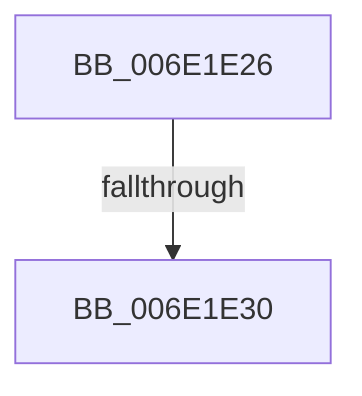

# sub_006E1E26

- RVA: `0x006E1E26`–`0x006E1E4B` (길이 `37` bytes)
- VA: `0x00000001406E1E26`
- 실행 섹션: `.text`
- PDB 이름 있음: `아니요`; PDB Function 태그: `아니요`
- unwind 정보 RVA: `0x00075F6C`
- 디코드: `9`개 명령, `37/37` bytes 표시
- 미해석 바이트: `0` (있으면 어셈블리에 `.byte`로 보존)

> 이 문서는 커널 이미지의 기계어와 PDB 기호를 분석해 생성했습니다. 4번과 5번은 함수 원형과 자료형을 바이너리 사용 방식에서 추정한 C 해석이며 원본 소스 복구 결과는 아닙니다.

## 1. Dependencies

- 직접 호출 지점: **1**; 고유 호출 대상: **1**
- 직접 호출자로 확인된 함수: **0**
- RIP 상대 이미지 참조: **0**

### Outgoing calls
- `0x006E1E45` → [KeBugCheckEx](../4F/KeBugCheckEx_function_004FD660.md) (function, `0x004FD660`)

### Direct callers
- 이 함수 시작 RVA로 연결되는 직접 call은 확인되지 않았습니다. 간접 호출은 완전히 역산할 수 없습니다.

### Static image references
- 디코드된 RIP-relative 메모리 참조가 없습니다.

## 2. Other-region calls and transfers

- 다른 실행 섹션으로 향하는 call: **0**
- call이 아닌 외부 분기/꼬리 이동: **1**
  - `0x006E1E2A` → [MiLockPoolCommitPageTable + 0x125](../32/MiLockPoolCommitPageTable_function_00328BAC.md) (`tail-transfer`)

## 3. Assembly (complete function range)

```asm
006E1E26  F6 46 64 04                     test byte ptr [rsi + 0x64], 4
006E1E2A  0F 84 A1 6E C4 FF               je 0x140328cd1
006E1E30  48 83 64 24 20 00               and qword ptr [rsp + 0x20], 0
006E1E36  45 33 C9                        xor r9d, r9d
006E1E39  4C 8B C7                        mov r8, rdi
006E1E3C  BA 03 53 00 00                  mov edx, 0x5303
006E1E41  41 8D 49 1A                     lea ecx, [r9 + 0x1a]
006E1E45  E8 16 B8 E1 FF                  call 0x1404fd660
006E1E4A  CC                              int3
```

## 4. C-style interpretation (structured pseudocode)

```c
__int64 __fastcall sub_006E1E26(__int64 a1, __int64 a2, __int64 a3, int a4)
{
    __int64 result;
    unsigned __int64 v_stack_p20;

    a4 = 0;
    result = KeBugCheckEx(a4 + 26, (unsigned int)(0x5303ULL), v_rdi, a4);
    return result;
}
```

## 5. (Beta) C Style

```c
int64_t sub_006E1E26(int64_t Arg1, int64_t Arg2, int64_t Arg3, int32_t Arg4)
{
    int64_t result;
    uint64_t v_stack_p20;

    Arg4 = 0;
    result = KeBugCheckEx(Arg4 + 26, (uint32_t)(0x5303ULL), local_rdi, Arg4);
    return result;
}
```

## 6. Execution-region graph

[열기: 2D/3D 그래프와 함수 탐색 컨트롤 패널](../../../control-panel.html?section=text&rva=0x006E1E26&view=graph)

- 2D 그래프는 위에서 아래로 흐르고, 3D 그래프는 빈 공간을 드래그해 회전합니다. Shift+드래그는 이동, 휠은 확대·축소, 함수 노드 선택은 대상 보고서 이동입니다.

### Static fallback


