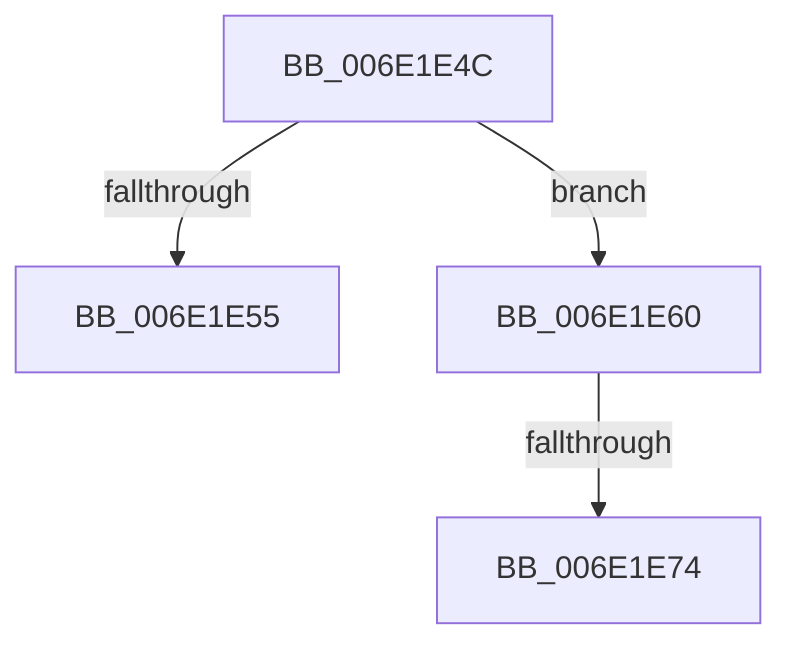

# sub_006E1E4C

- RVA: `0x006E1E4C`–`0x006E1E7F` (길이 `51` bytes)
- VA: `0x00000001406E1E4C`
- 실행 섹션: `.text`
- PDB 이름 있음: `아니요`; PDB Function 태그: `아니요`
- unwind 정보 RVA: `0x00075FF4`
- 디코드: `11`개 명령, `51/51` bytes 표시
- 미해석 바이트: `0` (있으면 어셈블리에 `.byte`로 보존)

> 이 문서는 커널 이미지의 기계어와 PDB 기호를 분석해 생성했습니다. 4번과 5번은 함수 원형과 자료형을 바이너리 사용 방식에서 추정한 C 해석이며 원본 소스 복구 결과는 아닙니다.

## 1. Dependencies

- 직접 호출 지점: **0**; 고유 호출 대상: **0**
- 직접 호출자로 확인된 함수: **0**
- RIP 상대 이미지 참조: **1**

### Outgoing calls
- 직접 디코드된 call 명령이 없습니다.

### Direct callers
- 이 함수 시작 RVA로 연결되는 직접 call은 확인되지 않았습니다. 간접 호출은 완전히 역산할 수 없습니다.

### Static image references
- `0x006E1E60` → RVA `0x00FC5000` (`ALMOSTRO`; read)

## 2. Other-region calls and transfers

- 다른 실행 섹션으로 향하는 call: **0**
- call이 아닌 외부 분기/꼬리 이동: **3**
  - `0x006E1E5B` → [sub_00328FA3 + 0x459](../32/Unknown_function_00328FA3.md) (`tail-transfer`)
  - `0x006E1E6E` → [sub_00328FA3 + 0x409](../32/Unknown_function_00328FA3.md) (`tail-transfer`)
  - `0x006E1E7A` → [sub_00328FA3 + 0x459](../32/Unknown_function_00328FA3.md) (`tail-transfer`)

## 3. Assembly (complete function range)

```asm
006E1E4C  4B 8D 04 2F                     lea rax, [r15 + r13]
006E1E50  49 3B C5                        cmp rax, r13
006E1E53  73 0B                           jae 0x1406e1e60
006E1E55  41 BE 95 00 00 C0               mov r14d, 0xc0000095
006E1E5B  E9 9C 75 C4 FF                  jmp 0x1403293fc
006E1E60  0F B7 05 99 31 8E 00            movzx eax, word ptr [rip + 0x8e3199]
006E1E67  44 8B 45 67                     mov r8d, dword ptr [rbp + 0x67]
006E1E6B  44 3B C0                        cmp r8d, eax
006E1E6E  0F 86 38 75 C4 FF               jbe 0x1403293ac
006E1E74  41 BE F1 00 00 C0               mov r14d, 0xc00000f1
006E1E7A  E9 7D 75 C4 FF                  jmp 0x1403293fc
```

## 4. C-style interpretation (structured pseudocode)

```c
__int64 __fastcall sub_006E1E4C(void)
{
    if ((v_r15 + v_r13 * 1) >= v_r13) goto loc_006E1E60;
loc_006E1E60:
}
```

## 5. (Beta) C Style

```c
void sub_006E1E4C(void)
{
    if ((local_r15 + local_r13 * 1) >= local_r13) goto loc_006E1E60;
loc_006E1E60:
}
```

## 6. Execution-region graph

[열기: 2D/3D 그래프와 함수 탐색 컨트롤 패널](../../../control-panel.html?section=text&rva=0x006E1E4C&view=graph)

- 2D 그래프는 위에서 아래로 흐르고, 3D 그래프는 빈 공간을 드래그해 회전합니다. Shift+드래그는 이동, 휠은 확대·축소, 함수 노드 선택은 대상 보고서 이동입니다.

### Static fallback


