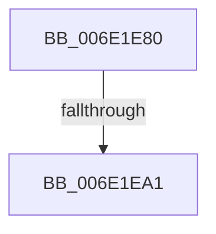

# sub_006E1E80

- RVA: `0x006E1E80`–`0x006E1EB5` (길이 `53` bytes)
- VA: `0x00000001406E1E80`
- 실행 섹션: `.text`
- PDB 이름 있음: `아니요`; PDB Function 태그: `아니요`
- unwind 정보 RVA: `0x00076044`
- 디코드: `11`개 명령, `53/53` bytes 표시
- 미해석 바이트: `0` (있으면 어셈블리에 `.byte`로 보존)

> 이 문서는 커널 이미지의 기계어와 PDB 기호를 분석해 생성했습니다. 4번과 5번은 함수 원형과 자료형을 바이너리 사용 방식에서 추정한 C 해석이며 원본 소스 복구 결과는 아닙니다.

## 1. Dependencies

- 직접 호출 지점: **0**; 고유 호출 대상: **0**
- 직접 호출자로 확인된 함수: **0**
- RIP 상대 이미지 참조: **0**

### Outgoing calls
- 직접 디코드된 call 명령이 없습니다.

### Direct callers
- 이 함수 시작 RVA로 연결되는 직접 call은 확인되지 않았습니다. 간접 호출은 완전히 역산할 수 없습니다.

### Static image references
- 디코드된 RIP-relative 메모리 참조가 없습니다.

## 2. Other-region calls and transfers

- 다른 실행 섹션으로 향하는 call: **0**
- call이 아닌 외부 분기/꼬리 이동: **2**
  - `0x006E1E9B` → [MiUserFault + 0x78F](../32/MiUserFault_function_00329840.md) (`tail-transfer`)
  - `0x006E1EB0` → [MiUserFault + 0x78F](../32/MiUserFault_function_00329840.md) (`tail-transfer`)

## 3. Assembly (complete function range)

```asm
006E1E80  41 8B C4                        mov eax, r12d
006E1E83  48 81 E2 1F FC FF FF            and rdx, 0xfffffffffffffc1f
006E1E8A  83 E0 0F                        and eax, 0xf
006E1E8D  48 C1 E0 05                     shl rax, 5
006E1E91  48 0B C2                        or rax, rdx
006E1E94  48 89 45 00                     mov qword ptr [rbp], rax
006E1E98  48 85 DB                        test rbx, rbx
006E1E9B  0F 84 2E 81 C4 FF               je 0x140329fcf
006E1EA1  48 B8 FF FF FF FF FF FF FF 7F   movabs rax, 0x7fffffffffffffff
006E1EAB  F0 48 21 43 18                  lock and qword ptr [rbx + 0x18], rax
006E1EB0  E9 1A 81 C4 FF                  jmp 0x140329fcf
```

## 4. C-style interpretation (structured pseudocode)

```c
__int64 __fastcall sub_006E1E80(__int64 a1, __int64 a2)
{
    __int64 result;

    a2 = (a2) & (-993);
    result = (unsigned int)(((unsigned int)((unsigned int)(v_r12))) & (15));
    result = (result) << (5);
    result = (result) | (a2);
    *(unsigned __int64 *)(v_rbp) = result;
}
```

## 5. (Beta) C Style

```c
int64_t sub_006E1E80(int64_t Arg1, int64_t Arg2)
{
    int64_t result;

    Arg2 = (Arg2) & (-993);
    result = (uint32_t)(((uint32_t)((uint32_t)(local_r12))) & (15));
    result = (result) << (5);
    result = (result) | (Arg2);
    *(uint64_t *)(local_rbp) = result;
}
```

## 6. Execution-region graph

[열기: 2D/3D 그래프와 함수 탐색 컨트롤 패널](../../../control-panel.html?section=text&rva=0x006E1E80&view=graph)

- 2D 그래프는 위에서 아래로 흐르고, 3D 그래프는 빈 공간을 드래그해 회전합니다. Shift+드래그는 이동, 휠은 확대·축소, 함수 노드 선택은 대상 보고서 이동입니다.

### Static fallback


