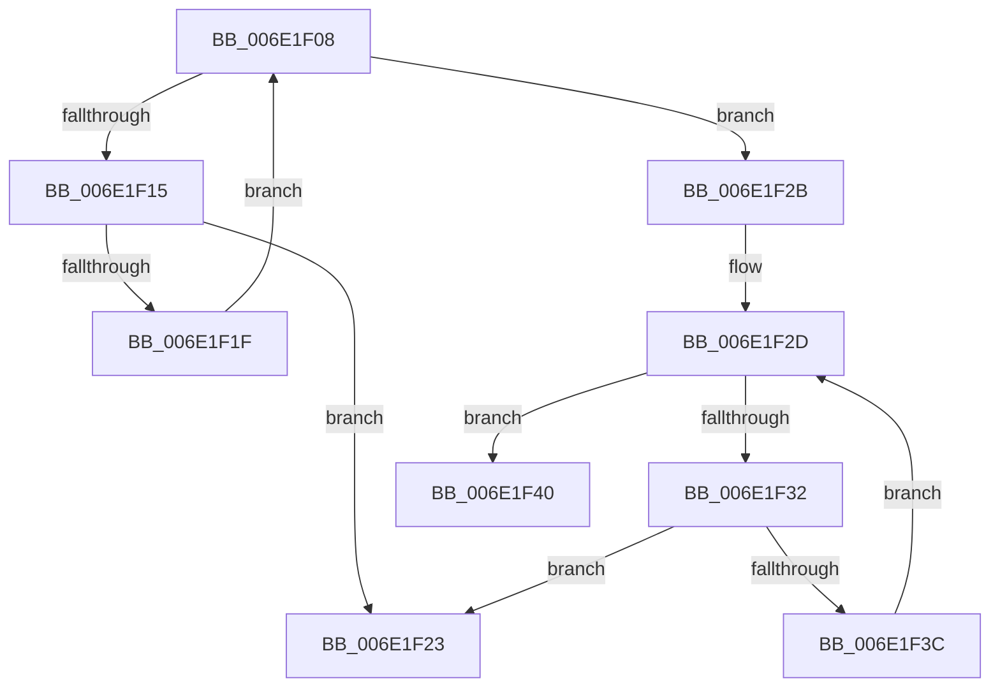

# sub_006E1F08

- RVA: `0x006E1F08`–`0x006E1F48` (길이 `64` bytes)
- VA: `0x00000001406E1F08`
- 실행 섹션: `.text`
- PDB 이름 있음: `아니요`; PDB Function 태그: `아니요`
- unwind 정보 RVA: `0x00076510`
- 디코드: `20`개 명령, `64/64` bytes 표시
- 미해석 바이트: `0` (있으면 어셈블리에 `.byte`로 보존)

> 이 문서는 커널 이미지의 기계어와 PDB 기호를 분석해 생성했습니다. 4번과 5번은 함수 원형과 자료형을 바이너리 사용 방식에서 추정한 C 해석이며 원본 소스 복구 결과는 아닙니다.

## 1. Dependencies

- 직접 호출 지점: **0**; 고유 호출 대상: **0**
- 직접 호출자로 확인된 함수: **0**
- RIP 상대 이미지 참조: **1**

### Outgoing calls
- 직접 디코드된 call 명령이 없습니다.

### Direct callers
- 이 함수 시작 RVA로 연결되는 직접 call은 확인되지 않았습니다. 간접 호출은 완전히 역산할 수 없습니다.

### Static image references
- `0x006E1F08` → RVA `0x00FC5002` (`ALMOSTRO`; read)

## 2. Other-region calls and transfers

- 다른 실행 섹션으로 향하는 call: **0**
- call이 아닌 외부 분기/꼬리 이동: **2**
  - `0x006E1F26` → [sub_0032FBA9 + 0x1B6](../32/Unknown_function_0032FBA9.md) (`tail-transfer`)
  - `0x006E1F43` → [sub_0032FBA9 + 0x1B4](../32/Unknown_function_0032FBA9.md) (`tail-transfer`)

## 3. Assembly (complete function range)

```asm
006E1F08  44 0F B6 15 F2 30 8E 00         movzx r10d, byte ptr [rip + 0x8e30f2]
006E1F10  41 3A D2                        cmp dl, r10b
006E1F13  73 16                           jae 0x1406e1f2b
006E1F15  0F B6 CA                        movzx ecx, dl
006E1F18  42 80 3C 19 01                  cmp byte ptr [rcx + r11], 1
006E1F1D  74 04                           je 0x1406e1f23
006E1F1F  FE C2                           inc dl
006E1F21  EB E5                           jmp 0x1406e1f08
006E1F23  45 33 D2                        xor r10d, r10d
006E1F26  E9 34 DE C4 FF                  jmp 0x14032fd5f
006E1F2B  32 D2                           xor dl, dl
006E1F2D  41 3A D2                        cmp dl, r10b
006E1F30  73 0E                           jae 0x1406e1f40
006E1F32  0F B6 CA                        movzx ecx, dl
006E1F35  42 80 3C 19 02                  cmp byte ptr [rcx + r11], 2
006E1F3A  74 E7                           je 0x1406e1f23
006E1F3C  FE C2                           inc dl
006E1F3E  EB ED                           jmp 0x1406e1f2d
006E1F40  45 33 D2                        xor r10d, r10d
006E1F43  E9 15 DE C4 FF                  jmp 0x14032fd5d
```

## 4. C-style interpretation (structured pseudocode)

```c
void __fastcall sub_006E1F08(__int64 a1, unsigned __int8 a2)
{
    __int64 v_r10;

    if (a2 >= ((unsigned __int8)(*(unsigned __int8 *)(v_rip + 9318642)))) goto loc_006E1F2B;
    if ((*(unsigned __int8 *)(a2 + v_r11 * 1)) == 1) goto loc_006E1F23;
    a2 = (unsigned __int8)((a2) + 1);
    goto loc_006E1F08;
loc_006E1F23:
    v_r10 = 0;
loc_006E1F2B:
    a2 = 0;
loc_006E1F2D:
    if (0 >= 0) goto loc_006E1F40;
    if ((*(unsigned __int8 *)(0 + v_r11 * 1)) == 2) goto loc_006E1F23;
    a2 = (unsigned __int8)((a2) + 1);
    goto loc_006E1F2D;
loc_006E1F40:
    v_r10 = 0;
}
```

## 5. (Beta) C Style

```c
void sub_006E1F08(int64_t Arg1, uint8_t Arg2)
{
    int64_t local_r10;

    if (Arg2 >= ((uint8_t)(*(uint8_t *)(v_rip + 0x8E30F2)))) goto loc_006E1F2B;
    if ((*(uint8_t *)(Arg2 + local_r11 * 1)) == 1) goto loc_006E1F23;
    Arg2 = (uint8_t)((Arg2) + 1);
    goto loc_006E1F08;
loc_006E1F23:
    local_r10 = 0;
loc_006E1F2B:
    Arg2 = 0;
loc_006E1F2D:
    if (0 >= 0) goto loc_006E1F40;
    if ((*(uint8_t *)(0 + local_r11 * 1)) == 2) goto loc_006E1F23;
    Arg2 = (uint8_t)((Arg2) + 1);
    goto loc_006E1F2D;
loc_006E1F40:
    local_r10 = 0;
}
```

## 6. Execution-region graph

[열기: 2D/3D 그래프와 함수 탐색 컨트롤 패널](../../../control-panel.html?section=text&rva=0x006E1F08&view=graph)

- 2D 그래프는 위에서 아래로 흐르고, 3D 그래프는 빈 공간을 드래그해 회전합니다. Shift+드래그는 이동, 휠은 확대·축소, 함수 노드 선택은 대상 보고서 이동입니다.

### Static fallback


