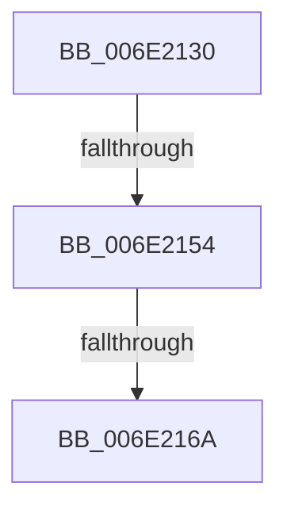

# sub_006E2130

- RVA: `0x006E2130`–`0x006E2189` (길이 `89` bytes)
- VA: `0x00000001406E2130`
- 실행 섹션: `.text`
- PDB 이름 있음: `아니요`; PDB Function 태그: `아니요`
- unwind 정보 RVA: `0x00078518`
- 디코드: `19`개 명령, `89/89` bytes 표시
- 미해석 바이트: `0` (있으면 어셈블리에 `.byte`로 보존)

> 이 문서는 커널 이미지의 기계어와 PDB 기호를 분석해 생성했습니다. 4번과 5번은 함수 원형과 자료형을 바이너리 사용 방식에서 추정한 C 해석이며 원본 소스 복구 결과는 아닙니다.

## 1. Dependencies

- 직접 호출 지점: **2**; 고유 호출 대상: **2**
- 직접 호출자로 확인된 함수: **0**
- RIP 상대 이미지 참조: **0**

### Outgoing calls
- `0x006E2136` → [MiCheckSystemNxFault](../4A/MiCheckSystemNxFault_function_004A44C0.md) (function, `0x004A44C0`)
- `0x006E2183` → [KeBugCheckEx](../4F/KeBugCheckEx_function_004FD660.md) (function, `0x004FD660`)

### Direct callers
- 이 함수 시작 RVA로 연결되는 직접 call은 확인되지 않았습니다. 간접 호출은 완전히 역산할 수 없습니다.

### Static image references
- 디코드된 RIP-relative 메모리 참조가 없습니다.

## 2. Other-region calls and transfers

- 다른 실행 섹션으로 향하는 call: **0**
- call이 아닌 외부 분기/꼬리 이동: **2**
  - `0x006E214E` → [MiRaisedIrqlFault + 0x29F](../34/MiRaisedIrqlFault_function_0034A6C8.md) (`tail-transfer`)
  - `0x006E2164` → [MiRaisedIrqlFault + 0x29F](../34/MiRaisedIrqlFault_function_0034A6C8.md) (`tail-transfer`)

## 3. Assembly (complete function range)

```asm
006E2130  44 8B C3                        mov r8d, ebx
006E2133  48 8B CF                        mov rcx, rdi
006E2136  E8 85 23 DC FF                  call 0x1404a44c0
006E213B  48 8B 0F                        mov rcx, qword ptr [rdi]
006E213E  48 BA 00 00 00 00 80 F6 FF FF   movabs rdx, 0xfffff68000000000
006E2148  48 8B C2                        mov rax, rdx
006E214B  48 3B C8                        cmp rcx, rax
006E214E  0F 82 13 88 C6 FF               jb 0x14034a967
006E2154  48 B8 FF FF FF FF FF F6 FF FF   movabs rax, 0xfffff6ffffffffff
006E215E  48 8B C0                        mov rax, rax
006E2161  48 3B C8                        cmp rcx, rax
006E2164  0F 87 FD 87 C6 FF               ja 0x14034a967
006E216A  4C 8B 4F 10                     mov r9, qword ptr [rdi + 0x10]
006E216E  48 8B D1                        mov rdx, rcx
006E2171  4C 8B 47 08                     mov r8, qword ptr [rdi + 8]
006E2175  B9 50 00 00 00                  mov ecx, 0x50
006E217A  48 C7 44 24 20 08 00 00 00      mov qword ptr [rsp + 0x20], 8
006E2183  E8 D8 B4 E1 FF                  call 0x1404fd660
006E2188  CC                              int3
```

## 4. C-style interpretation (structured pseudocode)

```c
__int64 __fastcall sub_006E2130(void)
{
    __int64 result;
    unsigned __int64 v_stack_p20;

    result = MiCheckSystemNxFault(v_rdi, a2, (unsigned int)((unsigned int)(v_rbx)), a4);
    v_stack_p20 = 8;
    result = KeBugCheckEx(80, *(unsigned __int64 *)(v_rdi), *(unsigned __int64 *)(v_rdi + 8), *(unsigned __int64 *)(v_rdi + 16));
    return result;
}
```

## 5. (Beta) C Style

```c
void sub_006E2130(void)
{
    int64_t result;
    uint64_t v_stack_p20;

    result = MiCheckSystemNxFault(local_rdi, a2, (uint32_t)((uint32_t)(local_rbx)), a4);
    v_stack_p20 = 8;
    result = KeBugCheckEx(80, *(uint64_t *)(local_rdi), *(uint64_t *)(local_rdi + 0x8), *(uint64_t *)(local_rdi + 0x10));
    return result;
}
```

## 6. Execution-region graph

[열기: 2D/3D 그래프와 함수 탐색 컨트롤 패널](../../../control-panel.html?section=text&rva=0x006E2130&view=graph)

- 2D 그래프는 위에서 아래로 흐르고, 3D 그래프는 빈 공간을 드래그해 회전합니다. Shift+드래그는 이동, 휠은 확대·축소, 함수 노드 선택은 대상 보고서 이동입니다.

### Static fallback


