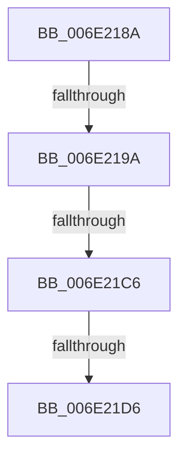

# sub_006E218A

- RVA: `0x006E218A`–`0x006E21F4` (길이 `106` bytes)
- VA: `0x00000001406E218A`
- 실행 섹션: `.text`
- PDB 이름 있음: `아니요`; PDB Function 태그: `아니요`
- unwind 정보 RVA: `0x00078554`
- 디코드: `26`개 명령, `106/106` bytes 표시
- 미해석 바이트: `0` (있으면 어셈블리에 `.byte`로 보존)

> 이 문서는 커널 이미지의 기계어와 PDB 기호를 분석해 생성했습니다. 4번과 5번은 함수 원형과 자료형을 바이너리 사용 방식에서 추정한 C 해석이며 원본 소스 복구 결과는 아닙니다.

## 1. Dependencies

- 직접 호출 지점: **5**; 고유 호출 대상: **3**
- 직접 호출자로 확인된 함수: **0**
- RIP 상대 이미지 참조: **0**

### Outgoing calls
- `0x006E218D` → [MiGenerateAccessViolation](../34/MiGenerateAccessViolation_function_0034B50C.md) (function, `0x0034B50C`)
- `0x006E21B1` → [KeBugCheckEx](../4F/KeBugCheckEx_function_004FD660.md) (function, `0x004FD660`)
- `0x006E21B9` → [KeInvalidAccessAllowed](../34/KeInvalidAccessAllowed_function_0034B3F0.md) (function, `0x0034B3F0`)
- `0x006E21C9` → [MiGenerateAccessViolation](../34/MiGenerateAccessViolation_function_0034B50C.md) (function, `0x0034B50C`)
- `0x006E21EE` → [KeBugCheckEx](../4F/KeBugCheckEx_function_004FD660.md) (function, `0x004FD660`)

### Direct callers
- 이 함수 시작 RVA로 연결되는 직접 call은 확인되지 않았습니다. 간접 호출은 완전히 역산할 수 없습니다.

### Static image references
- 디코드된 RIP-relative 메모리 참조가 없습니다.

## 2. Other-region calls and transfers

- 다른 실행 섹션으로 향하는 call: **0**
- call이 아닌 외부 분기/꼬리 이동: **3**
  - `0x006E2194` → [MiSystemFault + 0x597](../34/MiSystemFault_function_0034AA64.md) (`tail-transfer`)
  - `0x006E21C0` → [MiSystemFault + 0x221](../34/MiSystemFault_function_0034AA64.md) (`tail-transfer`)
  - `0x006E21D0` → [MiSystemFault + 0x221](../34/MiSystemFault_function_0034AA64.md) (`tail-transfer`)

## 3. Assembly (complete function range)

```asm
006E218A  48 8B CF                        mov rcx, rdi
006E218D  E8 7A 93 C6 FF                  call 0x14034b50c
006E2192  85 C0                           test eax, eax
006E2194  0F 85 61 8E C6 FF               jne 0x14034affb
006E219A  4C 8B 4F 10                     mov r9, qword ptr [rdi + 0x10]
006E219E  8D 48 50                        lea ecx, [rax + 0x50]
006E21A1  4C 8B 47 08                     mov r8, qword ptr [rdi + 8]
006E21A5  48 8B 17                        mov rdx, qword ptr [rdi]
006E21A8  48 C7 44 24 20 01 00 00 00      mov qword ptr [rsp + 0x20], 1
006E21B1  E8 AA B4 E1 FF                  call 0x1404fd660
006E21B6  CC                              int3
006E21B7  33 D2                           xor edx, edx
006E21B9  E8 32 92 C6 FF                  call 0x14034b3f0
006E21BE  84 C0                           test al, al
006E21C0  0F 85 BF 8A C6 FF               jne 0x14034ac85
006E21C6  48 8B CF                        mov rcx, rdi
006E21C9  E8 3E 93 C6 FF                  call 0x14034b50c
006E21CE  85 C0                           test eax, eax
006E21D0  0F 85 AF 8A C6 FF               jne 0x14034ac85
006E21D6  4C 8B 4F 10                     mov r9, qword ptr [rdi + 0x10]
006E21DA  4C 8B C3                        mov r8, rbx
006E21DD  48 8B 17                        mov rdx, qword ptr [rdi]
006E21E0  B9 BE 00 00 00                  mov ecx, 0xbe
006E21E5  48 C7 44 24 20 0E 00 00 00      mov qword ptr [rsp + 0x20], 0xe
006E21EE  E8 6D B4 E1 FF                  call 0x1404fd660
006E21F3  CC                              int3
```

## 4. C-style interpretation (structured pseudocode)

```c
__int64 __fastcall sub_006E218A(void)
{
    __int64 result;
    unsigned __int64 v_stack_p20;

    result = MiGenerateAccessViolation(v_rdi, a2, a3, a4);
    v_stack_p20 = 1;
    result = KeBugCheckEx(result + 80, *(unsigned __int64 *)(v_rdi), *(unsigned __int64 *)(v_rdi + 8), *(unsigned __int64 *)(v_rdi + 16));
    a2 = 0;
    result = KeInvalidAccessAllowed(result + 80, a2, *(unsigned __int64 *)(v_rdi + 8), *(unsigned __int64 *)(v_rdi + 16));
    result = MiGenerateAccessViolation(v_rdi, a2, *(unsigned __int64 *)(v_rdi + 8), *(unsigned __int64 *)(v_rdi + 16));
    v_stack_p20 = 14;
    result = KeBugCheckEx(190, *(unsigned __int64 *)(v_rdi), v_rbx, *(unsigned __int64 *)(v_rdi + 16));
    return result;
}
```

## 5. (Beta) C Style

```c
void sub_006E218A(void)
{
    int64_t result;
    uint64_t v_stack_p20;

    result = MiGenerateAccessViolation(local_rdi, a2, a3, a4);
    v_stack_p20 = 1;
    result = KeBugCheckEx(result + 80, *(uint64_t *)(local_rdi), *(uint64_t *)(local_rdi + 0x8), *(uint64_t *)(local_rdi + 0x10));
    a2 = 0;
    result = KeInvalidAccessAllowed(result + 80, a2, *(uint64_t *)(local_rdi + 0x8), *(uint64_t *)(local_rdi + 0x10));
    result = MiGenerateAccessViolation(local_rdi, a2, *(uint64_t *)(local_rdi + 0x8), *(uint64_t *)(local_rdi + 0x10));
    v_stack_p20 = 14;
    result = KeBugCheckEx(190, *(uint64_t *)(local_rdi), local_rbx, *(uint64_t *)(local_rdi + 0x10));
    return result;
}
```

## 6. Execution-region graph

[열기: 2D/3D 그래프와 함수 탐색 컨트롤 패널](../../../control-panel.html?section=text&rva=0x006E218A&view=graph)

- 2D 그래프는 위에서 아래로 흐르고, 3D 그래프는 빈 공간을 드래그해 회전합니다. Shift+드래그는 이동, 휠은 확대·축소, 함수 노드 선택은 대상 보고서 이동입니다.

### Static fallback


