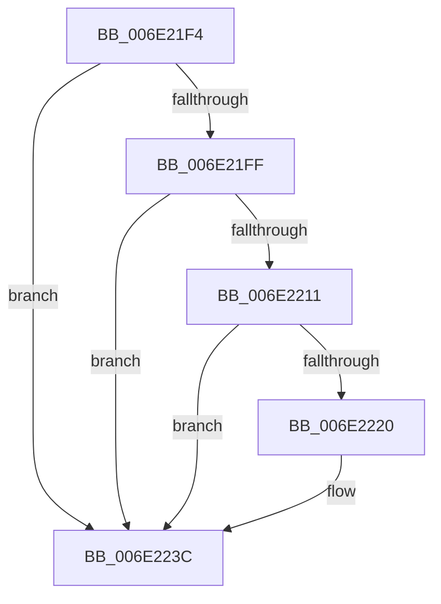

# sub_006E21F4

- RVA: `0x006E21F4`–`0x006E2246` (길이 `82` bytes)
- VA: `0x00000001406E21F4`
- 실행 섹션: `.text`
- PDB 이름 있음: `아니요`; PDB Function 태그: `아니요`
- unwind 정보 RVA: `0x00078588`
- 디코드: `19`개 명령, `82/82` bytes 표시
- 미해석 바이트: `0` (있으면 어셈블리에 `.byte`로 보존)

> 이 문서는 커널 이미지의 기계어와 PDB 기호를 분석해 생성했습니다. 4번과 5번은 함수 원형과 자료형을 바이너리 사용 방식에서 추정한 C 해석이며 원본 소스 복구 결과는 아닙니다.

## 1. Dependencies

- 직접 호출 지점: **2**; 고유 호출 대상: **2**
- 직접 호출자로 확인된 함수: **0**
- RIP 상대 이미지 참조: **0**

### Outgoing calls
- `0x006E21F6` → [KeInvalidAccessAllowed](../34/KeInvalidAccessAllowed_function_0034B3F0.md) (function, `0x0034B3F0`)
- `0x006E2236` → [KeBugCheckEx](../4F/KeBugCheckEx_function_004FD660.md) (function, `0x004FD660`)

### Direct callers
- 이 함수 시작 RVA로 연결되는 직접 call은 확인되지 않았습니다. 간접 호출은 완전히 역산할 수 없습니다.

### Static image references
- 디코드된 RIP-relative 메모리 참조가 없습니다.

## 2. Other-region calls and transfers

- 다른 실행 섹션으로 향하는 call: **0**
- call이 아닌 외부 분기/꼬리 이동: **1**
  - `0x006E2241` → [sub_0034B2F9 + 0x4A](../34/Unknown_function_0034B2F9.md) (`tail-transfer`)

## 3. Assembly (complete function range)

```asm
006E21F4  33 D2                           xor edx, edx
006E21F6  E8 F5 91 C6 FF                  call 0x14034b3f0
006E21FB  84 C0                           test al, al
006E21FD  75 3D                           jne 0x1406e223c
006E21FF  48 8B 17                        mov rdx, qword ptr [rdi]
006E2202  48 B8 00 00 00 00 80 F6 FF FF   movabs rax, 0xfffff68000000000
006E220C  48 3B D0                        cmp rdx, rax
006E220F  72 2B                           jb 0x1406e223c
006E2211  48 B8 FF FF FF FF FF F6 FF FF   movabs rax, 0xfffff6ffffffffff
006E221B  48 3B D0                        cmp rdx, rax
006E221E  77 1C                           ja 0x1406e223c
006E2220  4C 8B 4F 10                     mov r9, qword ptr [rdi + 0x10]
006E2224  B9 50 00 00 00                  mov ecx, 0x50
006E2229  4C 8B 47 08                     mov r8, qword ptr [rdi + 8]
006E222D  48 C7 44 24 20 08 00 00 00      mov qword ptr [rsp + 0x20], 8
006E2236  E8 25 B4 E1 FF                  call 0x1404fd660
006E223B  CC                              int3
006E223C  B8 01 00 00 00                  mov eax, 1
006E2241  E9 FD 90 C6 FF                  jmp 0x14034b343
```

## 4. C-style interpretation (structured pseudocode)

```c
__int64 __fastcall sub_006E21F4(__int64 a1, int a2)
{
    __int64 result;
    unsigned __int64 v_stack_p20;

    a2 = 0;
    result = KeInvalidAccessAllowed(a1, a2, a3, a4);
    if ((unsigned __int8)(result) != 0) goto loc_006E223C;
    if ((*(unsigned __int64 *)(v_rdi)) < result) goto loc_006E223C;
    if ((*(unsigned __int64 *)(v_rdi)) <= result) {
        a4 = *(unsigned __int64 *)(v_rdi + 16);
        a1 = 80;
        a3 = *(unsigned __int64 *)(v_rdi + 8);
        v_stack_p20 = 8;
        result = KeBugCheckEx(a1, *(unsigned __int64 *)(v_rdi), a3, a4);
    }
}
```

## 5. (Beta) C Style

```c
int64_t sub_006E21F4(int64_t Arg1, int32_t Arg2)
{
    int64_t result;
    uint64_t v_stack_p20;

    Arg2 = 0;
    result = KeInvalidAccessAllowed(Arg1, Arg2, a3, a4);
    if ((uint8_t)(result) != 0) goto loc_006E223C;
    if ((*(uint64_t *)(local_rdi)) < result) goto loc_006E223C;
    if ((*(uint64_t *)(local_rdi)) <= result) {
        a4 = *(uint64_t *)(local_rdi + 0x10);
        Arg1 = 80;
        a3 = *(uint64_t *)(local_rdi + 0x8);
        v_stack_p20 = 8;
        result = KeBugCheckEx(Arg1, *(uint64_t *)(local_rdi), a3, a4);
    }
}
```

## 6. Execution-region graph

[열기: 2D/3D 그래프와 함수 탐색 컨트롤 패널](../../../control-panel.html?section=text&rva=0x006E21F4&view=graph)

- 2D 그래프는 위에서 아래로 흐르고, 3D 그래프는 빈 공간을 드래그해 회전합니다. Shift+드래그는 이동, 휠은 확대·축소, 함수 노드 선택은 대상 보고서 이동입니다.

### Static fallback


