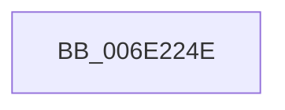

# sub_006E224E

- RVA: `0x006E224E`–`0x006E2285` (길이 `55` bytes)
- VA: `0x00000001406E224E`
- 실행 섹션: `.text`
- PDB 이름 있음: `아니요`; PDB Function 태그: `아니요`
- unwind 정보 RVA: `0x00078830`
- 디코드: `15`개 명령, `55/55` bytes 표시
- 미해석 바이트: `0` (있으면 어셈블리에 `.byte`로 보존)

> 이 문서는 커널 이미지의 기계어와 PDB 기호를 분석해 생성했습니다. 4번과 5번은 함수 원형과 자료형을 바이너리 사용 방식에서 추정한 C 해석이며 원본 소스 복구 결과는 아닙니다.

## 1. Dependencies

- 직접 호출 지점: **1**; 고유 호출 대상: **1**
- 직접 호출자로 확인된 함수: **0**
- RIP 상대 이미지 참조: **0**

### Outgoing calls
- `0x006E226E` → [ST_STORE<SM_TRAITS>::StDmPageError](../60/ST_STORE_SM_TRAITS_StDmPageError_function_0060DDDC.md) (function, `0x0060DDDC`)

### Direct callers
- 이 함수 시작 RVA로 연결되는 직접 call은 확인되지 않았습니다. 간접 호출은 완전히 역산할 수 없습니다.

### Static image references
- 디코드된 RIP-relative 메모리 참조가 없습니다.

## 2. Other-region calls and transfers

- 다른 실행 섹션으로 향하는 call: **0**
- call이 아닌 외부 분기/꼬리 이동: **1**
  - `0x006E2280` → [sub_0034CB1A + 0x72](../34/Unknown_function_0034CB1A.md) (`tail-transfer`)

## 3. Assembly (complete function range)

```asm
006E224E  83 F8 08                        cmp eax, 8
006E2251  B9 E2 04 00 C0                  mov ecx, 0xc00004e2
006E2256  0F 44 E9                        cmove ebp, ecx
006E2259  89 6C 24 28                     mov dword ptr [rsp + 0x28], ebp
006E225D  4D 8B CE                        mov r9, r14
006E2260  4D 8B C7                        mov r8, r15
006E2263  4C 89 6C 24 20                  mov qword ptr [rsp + 0x20], r13
006E2268  49 8B D4                        mov rdx, r12
006E226B  48 8B CE                        mov rcx, rsi
006E226E  E8 69 BB F2 FF                  call 0x14060dddc
006E2273  8B E8                           mov ebp, eax
006E2275  49 8D 7E 14                     lea rdi, [r14 + 0x14]
006E2279  45 33 C0                        xor r8d, r8d
006E227C  49 8D 5E 08                     lea rbx, [r14 + 8]
006E2280  E9 07 A9 C6 FF                  jmp 0x14034cb8c
```

## 4. C-style interpretation (structured pseudocode)

```c
__int64 __fastcall sub_006E224E(void)
{
    __int64 result;
    __int64 v_rbp;
    unsigned __int64 v_stack_p20;
    unsigned int v_stack_p28;

    if (((unsigned int)(result)) == 8) { v_rbp = (unsigned int)((unsigned int)(0xC00004E2ULL)); }
    v_stack_p28 = (unsigned int)(v_rbp);
    v_stack_p20 = v_r13;
    result = ST_STORE_SM_TRAITS___StDmPageError(v_rsi, v_r12, v_r15, v_r14);
    a3 = 0;
}
```

## 5. (Beta) C Style

```c
void sub_006E224E(void)
{
    int64_t result;
    int64_t local_rbp;
    uint64_t v_stack_p20;
    uint32_t v_stack_p28;

    if (((uint32_t)(result)) == 8) { local_rbp = (uint32_t)((uint32_t)(0xC00004E2ULL)); }
    v_stack_p28 = (uint32_t)(local_rbp);
    v_stack_p20 = local_r13;
    result = ST_STORE_SM_TRAITS___StDmPageError(local_rsi, local_r12, local_r15, local_r14);
    a3 = 0;
}
```

## 6. Execution-region graph

[열기: 2D/3D 그래프와 함수 탐색 컨트롤 패널](../../../control-panel.html?section=text&rva=0x006E224E&view=graph)

- 2D 그래프는 위에서 아래로 흐르고, 3D 그래프는 빈 공간을 드래그해 회전합니다. Shift+드래그는 이동, 휠은 확대·축소, 함수 노드 선택은 대상 보고서 이동입니다.

### Static fallback


