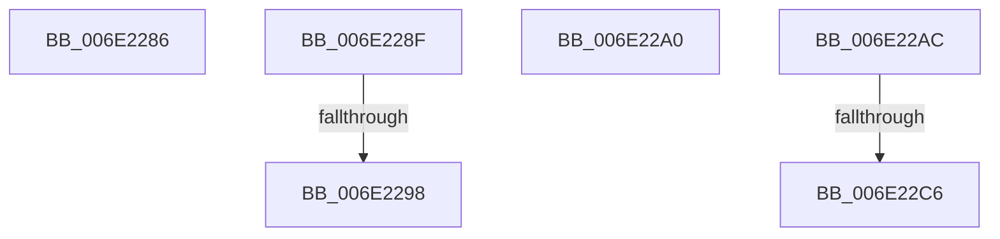

# sub_006E2286

- RVA: `0x006E2286`–`0x006E22D2` (길이 `76` bytes)
- VA: `0x00000001406E2286`
- 실행 섹션: `.text`
- PDB 이름 있음: `아니요`; PDB Function 태그: `아니요`
- unwind 정보 RVA: `0x00078B84`
- 디코드: `15`개 명령, `76/76` bytes 표시
- 미해석 바이트: `0` (있으면 어셈블리에 `.byte`로 보존)

> 이 문서는 커널 이미지의 기계어와 PDB 기호를 분석해 생성했습니다. 4번과 5번은 함수 원형과 자료형을 바이너리 사용 방식에서 추정한 C 해석이며 원본 소스 복구 결과는 아닙니다.

## 1. Dependencies

- 직접 호출 지점: **0**; 고유 호출 대상: **0**
- 직접 호출자로 확인된 함수: **0**
- RIP 상대 이미지 참조: **0**

### Outgoing calls
- 직접 디코드된 call 명령이 없습니다.

### Direct callers
- 이 함수 시작 RVA로 연결되는 직접 call은 확인되지 않았습니다. 간접 호출은 완전히 역산할 수 없습니다.

### Static image references
- 디코드된 RIP-relative 메모리 참조가 없습니다.

## 2. Other-region calls and transfers

- 다른 실행 섹션으로 향하는 call: **0**
- call이 아닌 외부 분기/꼬리 이동: **6**
  - `0x006E228A` → [MiComputeSystemTrimCriteria + 0x149](../34/MiComputeSystemTrimCriteria_function_0034E184.md) (`tail-transfer`)
  - `0x006E2292` → [MiComputeSystemTrimCriteria + 0x15B](../34/MiComputeSystemTrimCriteria_function_0034E184.md) (`tail-transfer`)
  - `0x006E229B` → [MiComputeSystemTrimCriteria + 0x167](../34/MiComputeSystemTrimCriteria_function_0034E184.md) (`tail-transfer`)
  - `0x006E22A7` → [MiComputeSystemTrimCriteria + 0x196](../34/MiComputeSystemTrimCriteria_function_0034E184.md) (`tail-transfer`)
  - `0x006E22C0` → [MiComputeSystemTrimCriteria + 0x2E3](../34/MiComputeSystemTrimCriteria_function_0034E184.md) (`tail-transfer`)
  - `0x006E22CD` → [MiComputeSystemTrimCriteria + 0x2E3](../34/MiComputeSystemTrimCriteria_function_0034E184.md) (`tail-transfer`)

## 3. Assembly (complete function range)

```asm
006E2286  44 89 63 30                     mov dword ptr [rbx + 0x30], r12d
006E228A  E9 3E C0 C6 FF                  jmp 0x14034e2cd
006E228F  48 3B F9                        cmp rdi, rcx
006E2292  0F 83 47 C0 C6 FF               jae 0x14034e2df
006E2298  48 8B F9                        mov rdi, rcx
006E229B  E9 4B C0 C6 FF                  jmp 0x14034e2eb
006E22A0  48 89 8B 48 01 00 00            mov qword ptr [rbx + 0x148], rcx
006E22A7  E9 6E C0 C6 FF                  jmp 0x14034e31a
006E22AC  48 8B 54 24 78                  mov rdx, qword ptr [rsp + 0x78]
006E22B1  B8 FA 00 00 00                  mov eax, 0xfa
006E22B6  40 8A CF                        mov cl, dil
006E22B9  66 39 83 12 01 00 00            cmp word ptr [rbx + 0x112], ax
006E22C0  0F 83 A1 C1 C6 FF               jae 0x14034e467
006E22C6  66 89 83 12 01 00 00            mov word ptr [rbx + 0x112], ax
006E22CD  E9 95 C1 C6 FF                  jmp 0x14034e467
```

## 4. C-style interpretation (structured pseudocode)

```c
__int64 __fastcall sub_006E2286(__int64 a1)
{
    unsigned __int64 v_stack_p78;

    *(unsigned int *)(v_rbx + 48) = (unsigned int)(v_r12);
}
```

## 5. (Beta) C Style

```c
int64_t sub_006E2286(int64_t Arg1)
{
    uint64_t v_stack_p78;

    *(uint32_t *)(local_rbx + 0x30) = (uint32_t)(local_r12);
}
```

## 6. Execution-region graph

[열기: 2D/3D 그래프와 함수 탐색 컨트롤 패널](../../../control-panel.html?section=text&rva=0x006E2286&view=graph)

- 2D 그래프는 위에서 아래로 흐르고, 3D 그래프는 빈 공간을 드래그해 회전합니다. Shift+드래그는 이동, 휠은 확대·축소, 함수 노드 선택은 대상 보고서 이동입니다.

### Static fallback


