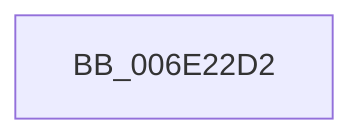

# sub_006E22D2

- RVA: `0x006E22D2`–`0x006E2433` (길이 `353` bytes)
- VA: `0x00000001406E22D2`
- 실행 섹션: `.text`
- PDB 이름 있음: `아니요`; PDB Function 태그: `아니요`
- unwind 정보 RVA: `0x00078C0C`
- 디코드: `72`개 명령, `353/353` bytes 표시
- 미해석 바이트: `0` (있으면 어셈블리에 `.byte`로 보존)

> 이 문서는 커널 이미지의 기계어와 PDB 기호를 분석해 생성했습니다. 4번과 5번은 함수 원형과 자료형을 바이너리 사용 방식에서 추정한 C 해석이며 원본 소스 복구 결과는 아닙니다.

## 1. Dependencies

- 직접 호출 지점: **1**; 고유 호출 대상: **1**
- 직접 호출자로 확인된 함수: **0**
- RIP 상대 이미지 참조: **1**

### Outgoing calls
- `0x006E2428` → [tlgWriteEx_EtwWriteEx](../4A/tlgWriteEx_EtwWriteEx_function_004AA348.md) (function, `0x004AA348`)

### Direct callers
- 이 함수 시작 RVA로 연결되는 직접 call은 확인되지 않았습니다. 간접 호출은 완전히 역산할 수 없습니다.

### Static image references
- `0x006E23B0` → RVA `0x00058348` (`.rdata`; read)

## 2. Other-region calls and transfers

- 다른 실행 섹션으로 향하는 call: **0**
- call이 아닌 외부 분기/꼬리 이동: **1**
  - `0x006E242E` → [MiLogPartitionState + 0xD8](../34/MiLogPartitionState_function_0034F330.md) (`tail-transfer`)

## 3. Assembly (complete function range)

```asm
006E22D2  41 0F B7 00                     movzx eax, word ptr [r8]
006E22D6  49 8B CA                        mov rcx, r10
006E22D9  66 89 44 24 44                  mov word ptr [rsp + 0x44], ax
006E22DE  48 8D 44 24 44                  lea rax, [rsp + 0x44]
006E22E3  48 89 45 C0                     mov qword ptr [rbp - 0x40], rax
006E22E7  49 8B 80 50 48 00 00            mov rax, qword ptr [r8 + 0x4850]
006E22EE  48 89 44 24 48                  mov qword ptr [rsp + 0x48], rax
006E22F3  48 8D 44 24 48                  lea rax, [rsp + 0x48]
006E22F8  48 89 45 D0                     mov qword ptr [rbp - 0x30], rax
006E22FC  49 8B 80 00 49 00 00            mov rax, qword ptr [r8 + 0x4900]
006E2303  48 89 44 24 50                  mov qword ptr [rsp + 0x50], rax
006E2308  48 8D 44 24 50                  lea rax, [rsp + 0x50]
006E230D  48 89 45 E0                     mov qword ptr [rbp - 0x20], rax
006E2311  48 8D 44 24 58                  lea rax, [rsp + 0x58]
006E2316  48 89 45 F0                     mov qword ptr [rbp - 0x10], rax
006E231A  48 8D 44 24 60                  lea rax, [rsp + 0x60]
006E231F  48 89 45 00                     mov qword ptr [rbp], rax
006E2323  48 8D 44 24 68                  lea rax, [rsp + 0x68]
006E2328  48 89 45 10                     mov qword ptr [rbp + 0x10], rax
006E232C  48 8D 44 24 70                  lea rax, [rsp + 0x70]
006E2331  48 89 45 20                     mov qword ptr [rbp + 0x20], rax
006E2335  48 8D 44 24 78                  lea rax, [rsp + 0x78]
006E233A  48 89 45 30                     mov qword ptr [rbp + 0x30], rax
006E233E  48 8D 45 80                     lea rax, [rbp - 0x80]
006E2342  48 89 45 40                     mov qword ptr [rbp + 0x40], rax
006E2346  49 8B 80 40 49 00 00            mov rax, qword ptr [r8 + 0x4940]
006E234D  48 89 45 88                     mov qword ptr [rbp - 0x78], rax
006E2351  48 8D 45 88                     lea rax, [rbp - 0x78]
006E2355  48 89 45 50                     mov qword ptr [rbp + 0x50], rax
006E2359  49 8B 80 40 4B 00 00            mov rax, qword ptr [r8 + 0x4b40]
006E2360  48 89 45 90                     mov qword ptr [rbp - 0x70], rax
006E2364  48 8D 45 90                     lea rax, [rbp - 0x70]
006E2368  48 89 45 60                     mov qword ptr [rbp + 0x60], rax
006E236C  49 8B 80 B8 4C 00 00            mov rax, qword ptr [r8 + 0x4cb8]
006E2373  48 89 45 98                     mov qword ptr [rbp - 0x68], rax
006E2377  48 8D 45 98                     lea rax, [rbp - 0x68]
006E237B  48 89 45 70                     mov qword ptr [rbp + 0x70], rax
006E237F  48 8D 44 24 40                  lea rax, [rsp + 0x40]
006E2384  48 89 85 80 00 00 00            mov qword ptr [rbp + 0x80], rax
006E238B  48 8D 85 A0 00 00 00            lea rax, [rbp + 0xa0]
006E2392  48 89 85 90 00 00 00            mov qword ptr [rbp + 0x90], rax
006E2399  0F B7 44 24 40                  movzx eax, word ptr [rsp + 0x40]
006E239E  C1 E0 05                        shl eax, 5
006E23A1  89 85 98 00 00 00               mov dword ptr [rbp + 0x98], eax
006E23A7  48 8D 45 A0                     lea rax, [rbp - 0x60]
006E23AB  48 89 54 24 58                  mov qword ptr [rsp + 0x58], rdx
006E23B0  48 8D 15 91 5F 97 FF            lea rdx, [rip - 0x68a06f]
006E23B7  4C 89 4C 24 60                  mov qword ptr [rsp + 0x60], r9
006E23BC  41 B9 01 00 00 00               mov r9d, 1
006E23C2  48 89 44 24 38                  mov qword ptr [rsp + 0x38], rax
006E23C7  C7 44 24 30 10 00 00 00         mov dword ptr [rsp + 0x30], 0x10
006E23CF  48 C7 45 C8 02 00 00 00         mov qword ptr [rbp - 0x38], 2
006E23D7  4C 89 7D D8                     mov qword ptr [rbp - 0x28], r15
006E23DB  4C 89 7D E8                     mov qword ptr [rbp - 0x18], r15
006E23DF  4C 89 7D F8                     mov qword ptr [rbp - 8], r15
006E23E3  4C 89 7D 08                     mov qword ptr [rbp + 8], r15
006E23E7  48 89 7C 24 68                  mov qword ptr [rsp + 0x68], rdi
006E23EC  4C 89 7D 18                     mov qword ptr [rbp + 0x18], r15
006E23F0  48 89 74 24 70                  mov qword ptr [rsp + 0x70], rsi
006E23F5  4C 89 7D 28                     mov qword ptr [rbp + 0x28], r15
006E23F9  4C 89 5C 24 78                  mov qword ptr [rsp + 0x78], r11
006E23FE  4C 89 7D 38                     mov qword ptr [rbp + 0x38], r15
006E2402  48 89 5D 80                     mov qword ptr [rbp - 0x80], rbx
006E2406  4C 89 7D 48                     mov qword ptr [rbp + 0x48], r15
006E240A  4C 89 7D 58                     mov qword ptr [rbp + 0x58], r15
006E240E  4C 89 7D 68                     mov qword ptr [rbp + 0x68], r15
006E2412  4C 89 7D 78                     mov qword ptr [rbp + 0x78], r15
006E2416  48 C7 85 88 00 00 00 02 00 00 00  mov qword ptr [rbp + 0x88], 2
006E2421  44 89 B5 9C 00 00 00            mov dword ptr [rbp + 0x9c], r14d
006E2428  E8 1B 7F DC FF                  call 0x1404aa348
006E242D  90                              nop
006E242E  E9 D5 CF C6 FF                  jmp 0x14034f408
```

## 4. C-style interpretation (structured pseudocode)

```c
__int64 __fastcall sub_006E22D2(__int64 a1, __int64 a2, __int64 a3, __int64 a4, __int64 a5, __int64 a6, __int64 a7, unsigned __int16 a8, __int64 a9, __int64 a10, __int64 a11, __int64 a12, __int64 a13, __int64 a14, __int64 a15)
{
    __int64 result;
    unsigned int v_stack_p30;
    unsigned __int64 v_stack_p38;
    unsigned __int16 v_stack_p44;
    unsigned __int64 v_stack_p48;
    unsigned __int64 v_stack_p50;
    unsigned __int64 v_stack_p58;
    unsigned __int64 v_stack_p60;
    unsigned __int64 v_stack_p68;
    unsigned __int64 v_stack_p70;
    unsigned __int64 v_stack_p78;

    v_stack_p44 = (unsigned __int16)(*(unsigned __int16 *)(a3));
    *(unsigned __int64 *)(v_rbp - 64) = v_stack_p44;
    v_stack_p48 = *(unsigned __int64 *)(a3 + 18512);
    *(unsigned __int64 *)(v_rbp - 48) = a9;
    v_stack_p50 = *(unsigned __int64 *)(a3 + 18688);
    *(unsigned __int64 *)(v_rbp - 32) = a10;
    *(unsigned __int64 *)(v_rbp - 16) = a11;
    *(unsigned __int64 *)(v_rbp) = a12;
    *(unsigned __int64 *)(v_rbp + 16) = a13;
    *(unsigned __int64 *)(v_rbp + 32) = a14;
    *(unsigned __int64 *)(v_rbp + 48) = a15;
    *(unsigned __int64 *)(v_rbp + 64) = v_rbp - 128;
    *(unsigned __int64 *)(v_rbp - 120) = *(unsigned __int64 *)(a3 + 18752);
    *(unsigned __int64 *)(v_rbp + 80) = v_rbp - 120;
    *(unsigned __int64 *)(v_rbp - 112) = *(unsigned __int64 *)(a3 + 19264);
    *(unsigned __int64 *)(v_rbp + 96) = v_rbp - 112;
    *(unsigned __int64 *)(v_rbp - 104) = *(unsigned __int64 *)(a3 + 19640);
    *(unsigned __int64 *)(v_rbp + 112) = v_rbp - 104;
    *(unsigned __int64 *)(v_rbp + 128) = a8;
    *(unsigned __int64 *)(v_rbp + 144) = v_rbp + 160;
    result = (unsigned int)((a8) << (5));
    *(unsigned int *)(v_rbp + 152) = (unsigned int)(result);
    v_stack_p58 = a2;
    v_stack_p60 = a4;
    v_stack_p38 = v_rbp - 96;
    v_stack_p30 = 16;
    *(unsigned __int64 *)(v_rbp - 56) = 2;
    *(unsigned __int64 *)(v_rbp - 40) = v_r15;
    *(unsigned __int64 *)(v_rbp - 24) = v_r15;
    *(unsigned __int64 *)(v_rbp - 8) = v_r15;
    *(unsigned __int64 *)(v_rbp + 8) = v_r15;
    v_stack_p68 = v_rdi;
    *(unsigned __int64 *)(v_rbp + 24) = v_r15;
    v_stack_p70 = v_rsi;
    *(unsigned __int64 *)(v_rbp + 40) = v_r15;
    v_stack_p78 = v_r11;
    *(unsigned __int64 *)(v_rbp + 56) = v_r15;
    *(unsigned __int64 *)(v_rbp - 128) = v_rbx;
    *(unsigned __int64 *)(v_rbp + 72) = v_r15;
    *(unsigned __int64 *)(v_rbp + 88) = v_r15;
    *(unsigned __int64 *)(v_rbp + 104) = v_r15;
    *(unsigned __int64 *)(v_rbp + 120) = v_r15;
    *(unsigned __int64 *)(v_rbp + 136) = 2;
    *(unsigned int *)(v_rbp + 156) = (unsigned int)(v_r14);
    result = tlgWriteEx_EtwWriteEx(v_r10, v_rip - 6856815, a3, 1);
}
```

## 5. (Beta) C Style

```c
int64_t sub_006E22D2(int64_t Arg1, int64_t Arg2, void *Arg3, int64_t Arg4, uint64_t Arg5, uint64_t Arg6, uint64_t Arg7, uint16_t Arg8, int64_t Arg9, int64_t Arg10, int64_t Arg11, int64_t Arg12, int64_t Arg13, int64_t Arg14, int64_t Arg15)
{
    uint8_t *arg3 = (uint8_t *)Arg3;

    int64_t result;
    uint32_t v_stack_p30;
    uint64_t v_stack_p38;
    uint16_t v_stack_p44;
    uint64_t v_stack_p48;
    uint64_t v_stack_p50;
    uint64_t v_stack_p58;
    uint64_t v_stack_p60;
    uint64_t v_stack_p68;
    uint64_t v_stack_p70;
    uint64_t v_stack_p78;

    v_stack_p44 = (uint16_t)(*(uint16_t *)(arg3));
    *(uint64_t *)(local_rbp - 0x40) = v_stack_p44;
    v_stack_p48 = *(uint64_t *)(arg3 + 0x4850);
    *(uint64_t *)(local_rbp - 0x30) = Arg9;
    v_stack_p50 = *(uint64_t *)(arg3 + 0x4900);
    *(uint64_t *)(local_rbp - 0x20) = Arg10;
    *(uint64_t *)(local_rbp - 0x10) = Arg11;
    *(uint64_t *)(local_rbp) = Arg12;
    *(uint64_t *)(local_rbp + 0x10) = Arg13;
    *(uint64_t *)(local_rbp + 0x20) = Arg14;
    *(uint64_t *)(local_rbp + 0x30) = Arg15;
    *(uint64_t *)(local_rbp + 0x40) = local_rbp - 128;
    *(uint64_t *)(local_rbp - 0x78) = *(uint64_t *)(arg3 + 0x4940);
    *(uint64_t *)(local_rbp + 0x50) = local_rbp - 120;
    *(uint64_t *)(local_rbp - 0x70) = *(uint64_t *)(arg3 + 0x4B40);
    *(uint64_t *)(local_rbp + 0x60) = local_rbp - 112;
    *(uint64_t *)(local_rbp - 0x68) = *(uint64_t *)(arg3 + 0x4CB8);
    *(uint64_t *)(local_rbp + 0x70) = local_rbp - 104;
    *(uint64_t *)(local_rbp + 0x80) = Arg8;
    *(uint64_t *)(local_rbp + 0x90) = local_rbp + 160;
    result = (uint32_t)((Arg8) << (5));
    *(uint32_t *)(local_rbp + 0x98) = (uint32_t)(result);
    v_stack_p58 = Arg2;
    v_stack_p60 = Arg4;
    v_stack_p38 = local_rbp - 96;
    v_stack_p30 = 16;
    *(uint64_t *)(local_rbp - 0x38) = 2;
    *(uint64_t *)(local_rbp - 0x28) = local_r15;
    *(uint64_t *)(local_rbp - 0x18) = local_r15;
    *(uint64_t *)(local_rbp - 0x8) = local_r15;
    *(uint64_t *)(local_rbp + 0x8) = local_r15;
    v_stack_p68 = local_rdi;
    *(uint64_t *)(local_rbp + 0x18) = local_r15;
    v_stack_p70 = local_rsi;
    *(uint64_t *)(local_rbp + 0x28) = local_r15;
    v_stack_p78 = local_r11;
    *(uint64_t *)(local_rbp + 0x38) = local_r15;
    *(uint64_t *)(local_rbp - 0x80) = local_rbx;
    *(uint64_t *)(local_rbp + 0x48) = local_r15;
    *(uint64_t *)(local_rbp + 0x58) = local_r15;
    *(uint64_t *)(local_rbp + 0x68) = local_r15;
    *(uint64_t *)(local_rbp + 0x78) = local_r15;
    *(uint64_t *)(local_rbp + 0x88) = 2;
    *(uint32_t *)(local_rbp + 0x9C) = (uint32_t)(local_r14);
    result = tlgWriteEx_EtwWriteEx(local_r10, v_rip - 6856815, Arg3, 1);
}
```

### 관측된 메모리 오프셋

구조체 형식이 확인되지 않은 접근은 인자 기준의 오프셋으로만 기록했습니다.

| 기준 인자 | 오프셋 표현 | 폭 (bit) | 접근 |
|---|---:|---:|---|
| `Arg3` | `+ 0x0` | `16` | `R` |
| `Arg3` | `+ 0x4850` | `64` | `R` |
| `Arg3` | `+ 0x4900` | `64` | `R` |
| `Arg3` | `+ 0x4940` | `64` | `R` |
| `Arg3` | `+ 0x4B40` | `64` | `R` |
| `Arg3` | `+ 0x4CB8` | `64` | `R` |

## 6. Execution-region graph

[열기: 2D/3D 그래프와 함수 탐색 컨트롤 패널](../../../control-panel.html?section=text&rva=0x006E22D2&view=graph)

- 2D 그래프는 위에서 아래로 흐르고, 3D 그래프는 빈 공간을 드래그해 회전합니다. Shift+드래그는 이동, 휠은 확대·축소, 함수 노드 선택은 대상 보고서 이동입니다.

### Static fallback


