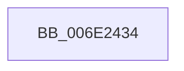

# sub_006E2434

- RVA: `0x006E2434`–`0x006E2561` (길이 `301` bytes)
- VA: `0x00000001406E2434`
- 실행 섹션: `.text`
- PDB 이름 있음: `아니요`; PDB Function 태그: `아니요`
- unwind 정보 RVA: `0x00078C3C`
- 디코드: `68`개 명령, `301/301` bytes 표시
- 미해석 바이트: `0` (있으면 어셈블리에 `.byte`로 보존)

> 이 문서는 커널 이미지의 기계어와 PDB 기호를 분석해 생성했습니다. 4번과 5번은 함수 원형과 자료형을 바이너리 사용 방식에서 추정한 C 해석이며 원본 소스 복구 결과는 아닙니다.

## 1. Dependencies

- 직접 호출 지점: **1**; 고유 호출 대상: **1**
- 직접 호출자로 확인된 함수: **0**
- RIP 상대 이미지 참조: **1**

### Outgoing calls
- `0x006E2556` → [tlgWriteEx_EtwWriteEx](../4A/tlgWriteEx_EtwWriteEx_function_004AA348.md) (function, `0x004AA348`)

### Direct callers
- 이 함수 시작 RVA로 연결되는 직접 call은 확인되지 않았습니다. 간접 호출은 완전히 역산할 수 없습니다.

### Static image references
- `0x006E24C8` → RVA `0x000584B0` (`.rdata`; read)

## 2. Other-region calls and transfers

- 다른 실행 섹션으로 향하는 call: **0**
- call이 아닌 외부 분기/꼬리 이동: **1**
  - `0x006E255C` → [MiLogProcessWorkingSetsStart + 0x65](../34/MiLogProcessWorkingSetsStart_function_0034F468.md) (`tail-transfer`)

## 3. Assembly (complete function range)

```asm
006E2434  41 0F B7 01                     movzx eax, word ptr [r9]
006E2438  B9 04 00 00 00                  mov ecx, 4
006E243D  83 65 AC 00                     and dword ptr [rbp - 0x54], 0
006E2441  83 65 BC 00                     and dword ptr [rbp - 0x44], 0
006E2445  83 65 CC 00                     and dword ptr [rbp - 0x34], 0
006E2449  83 65 DC 00                     and dword ptr [rbp - 0x24], 0
006E244D  83 65 EC 00                     and dword ptr [rbp - 0x14], 0
006E2451  83 65 FC 00                     and dword ptr [rbp - 4], 0
006E2455  83 65 0C 00                     and dword ptr [rbp + 0xc], 0
006E2459  83 65 1C 00                     and dword ptr [rbp + 0x1c], 0
006E245D  83 65 2C 00                     and dword ptr [rbp + 0x2c], 0
006E2461  83 65 3C 00                     and dword ptr [rbp + 0x3c], 0
006E2465  89 44 24 48                     mov dword ptr [rsp + 0x48], eax
006E2469  48 8D 44 24 48                  lea rax, [rsp + 0x48]
006E246E  48 89 45 A0                     mov qword ptr [rbp - 0x60], rax
006E2472  8A 42 02                        mov al, byte ptr [rdx + 2]
006E2475  88 44 24 40                     mov byte ptr [rsp + 0x40], al
006E2479  48 8D 44 24 40                  lea rax, [rsp + 0x40]
006E247E  48 89 45 B0                     mov qword ptr [rbp - 0x50], rax
006E2482  41 0F B7 83 12 01 00 00         movzx eax, word ptr [r11 + 0x112]
006E248A  66 89 44 24 44                  mov word ptr [rsp + 0x44], ax
006E248F  48 8D 44 24 44                  lea rax, [rsp + 0x44]
006E2494  48 89 45 C0                     mov qword ptr [rbp - 0x40], rax
006E2498  48 8D 44 24 4C                  lea rax, [rsp + 0x4c]
006E249D  48 89 45 D0                     mov qword ptr [rbp - 0x30], rax
006E24A1  0F B6 42 04                     movzx eax, byte ptr [rdx + 4]
006E24A5  89 44 24 50                     mov dword ptr [rsp + 0x50], eax
006E24A9  48 8D 44 24 50                  lea rax, [rsp + 0x50]
006E24AE  48 89 45 E0                     mov qword ptr [rbp - 0x20], rax
006E24B2  48 8B 42 50                     mov rax, qword ptr [rdx + 0x50]
006E24B6  48 89 44 24 58                  mov qword ptr [rsp + 0x58], rax
006E24BB  48 8D 44 24 58                  lea rax, [rsp + 0x58]
006E24C0  48 89 45 F0                     mov qword ptr [rbp - 0x10], rax
006E24C4  48 8B 42 48                     mov rax, qword ptr [rdx + 0x48]
006E24C8  48 8D 15 E1 5F 97 FF            lea rdx, [rip - 0x68a01f]
006E24CF  48 89 44 24 60                  mov qword ptr [rsp + 0x60], rax
006E24D4  48 8D 44 24 60                  lea rax, [rsp + 0x60]
006E24D9  48 89 45 00                     mov qword ptr [rbp], rax
006E24DD  49 8B 81 00 49 00 00            mov rax, qword ptr [r9 + 0x4900]
006E24E4  48 89 44 24 68                  mov qword ptr [rsp + 0x68], rax
006E24E9  48 8D 44 24 68                  lea rax, [rsp + 0x68]
006E24EE  48 89 45 10                     mov qword ptr [rbp + 0x10], rax
006E24F2  48 8D 44 24 70                  lea rax, [rsp + 0x70]
006E24F7  89 4D A8                        mov dword ptr [rbp - 0x58], ecx
006E24FA  89 4D D8                        mov dword ptr [rbp - 0x28], ecx
006E24FD  89 4D E8                        mov dword ptr [rbp - 0x18], ecx
006E2500  B9 08 00 00 00                  mov ecx, 8
006E2505  48 89 45 20                     mov qword ptr [rbp + 0x20], rax
006E2509  48 8D 44 24 78                  lea rax, [rsp + 0x78]
006E250E  48 89 45 30                     mov qword ptr [rbp + 0x30], rax
006E2512  48 8D 45 80                     lea rax, [rbp - 0x80]
006E2516  89 4D F8                        mov dword ptr [rbp - 8], ecx
006E2519  89 4D 08                        mov dword ptr [rbp + 8], ecx
006E251C  44 8D 49 F9                     lea r9d, [rcx - 7]
006E2520  89 4D 18                        mov dword ptr [rbp + 0x18], ecx
006E2523  89 4D 28                        mov dword ptr [rbp + 0x28], ecx
006E2526  89 4D 38                        mov dword ptr [rbp + 0x38], ecx
006E2529  49 8B CA                        mov rcx, r10
006E252C  48 89 44 24 38                  mov qword ptr [rsp + 0x38], rax
006E2531  C7 44 24 30 0C 00 00 00         mov dword ptr [rsp + 0x30], 0xc
006E2539  C7 45 B8 01 00 00 00            mov dword ptr [rbp - 0x48], 1
006E2540  C7 45 C8 02 00 00 00            mov dword ptr [rbp - 0x38], 2
006E2547  44 89 44 24 4C                  mov dword ptr [rsp + 0x4c], r8d
006E254C  48 89 5C 24 70                  mov qword ptr [rsp + 0x70], rbx
006E2551  48 89 7C 24 78                  mov qword ptr [rsp + 0x78], rdi
006E2556  E8 ED 7D DC FF                  call 0x1404aa348
006E255B  90                              nop
006E255C  E9 6C CF C6 FF                  jmp 0x14034f4cd
```

## 4. C-style interpretation (structured pseudocode)

```c
__int64 __fastcall sub_006E2434(__int64 a1, __int64 a2, int a3, __int64 a4, __int64 a5, __int64 a6, __int64 a7, __int64 a8, __int64 a9, __int64 a10, __int64 a11, __int64 a12, __int64 a13, __int64 a14, __int64 a15)
{
    __int64 result;
    unsigned int v_stack_p30;
    unsigned __int64 v_stack_p38;
    unsigned __int8 v_stack_p40;
    unsigned __int16 v_stack_p44;
    unsigned int v_stack_p48;
    unsigned __int64 v_stack_p4C;
    unsigned int v_stack_p50;
    unsigned __int64 v_stack_p58;
    unsigned __int64 v_stack_p60;
    unsigned __int64 v_stack_p68;
    unsigned __int64 v_stack_p70;
    unsigned __int64 v_stack_p78;

    v_stack_p48 = (unsigned int)(*(unsigned __int16 *)(a4));
    *(unsigned __int64 *)(v_rbp - 96) = a9;
    v_stack_p40 = (unsigned __int8)(*(unsigned __int8 *)(a2 + 2));
    *(unsigned __int64 *)(v_rbp - 80) = a8;
    v_stack_p44 = (unsigned __int16)(*(unsigned __int16 *)(v_r11 + 274));
    *(unsigned __int64 *)(v_rbp - 64) = v_stack_p44;
    *(unsigned __int64 *)(v_rbp - 48) = v_stack_p4C;
    v_stack_p50 = (unsigned int)(*(unsigned __int8 *)(a2 + 4));
    *(unsigned __int64 *)(v_rbp - 32) = a10;
    v_stack_p58 = *(unsigned __int64 *)(a2 + 80);
    *(unsigned __int64 *)(v_rbp - 16) = a11;
    v_stack_p60 = *(unsigned __int64 *)(a2 + 72);
    *(unsigned __int64 *)(v_rbp) = a12;
    v_stack_p68 = *(unsigned __int64 *)(a4 + 18688);
    *(unsigned __int64 *)(v_rbp + 16) = a13;
    *(unsigned int *)(v_rbp - 88) = 4;
    *(unsigned int *)(v_rbp - 40) = 4;
    *(unsigned int *)(v_rbp - 24) = 4;
    *(unsigned __int64 *)(v_rbp + 32) = a14;
    *(unsigned __int64 *)(v_rbp + 48) = a15;
    *(unsigned int *)(v_rbp - 8) = 8;
    *(unsigned int *)(v_rbp + 8) = 8;
    *(unsigned int *)(v_rbp + 24) = 8;
    *(unsigned int *)(v_rbp + 40) = 8;
    *(unsigned int *)(v_rbp + 56) = 8;
    v_stack_p38 = v_rbp - 128;
    v_stack_p30 = 12;
    *(unsigned int *)(v_rbp - 72) = 1;
    *(unsigned int *)(v_rbp - 56) = 2;
    v_stack_p4C = a3;
    v_stack_p70 = v_rbx;
    v_stack_p78 = v_rdi;
    result = tlgWriteEx_EtwWriteEx(v_r10, v_rip - 6856735, a3, 8 - 7);
}
```

## 5. (Beta) C Style

```c
int64_t sub_006E2434(int64_t Arg1, void *Arg2, int32_t Arg3, void *Arg4, uint64_t Arg5, uint64_t Arg6, uint64_t Arg7, int64_t Arg8, int64_t Arg9, int64_t Arg10, int64_t Arg11, int64_t Arg12, int64_t Arg13, int64_t Arg14, int64_t Arg15)
{
    uint8_t *arg2 = (uint8_t *)Arg2;
    uint8_t *arg4 = (uint8_t *)Arg4;

    int64_t result;
    uint32_t v_stack_p30;
    uint64_t v_stack_p38;
    uint8_t v_stack_p40;
    uint16_t v_stack_p44;
    uint32_t v_stack_p48;
    uint64_t v_stack_p4C;
    uint32_t v_stack_p50;
    uint64_t v_stack_p58;
    uint64_t v_stack_p60;
    uint64_t v_stack_p68;
    uint64_t v_stack_p70;
    uint64_t v_stack_p78;

    v_stack_p48 = (uint32_t)(*(uint16_t *)(arg4));
    *(uint64_t *)(local_rbp - 0x60) = Arg9;
    v_stack_p40 = (uint8_t)(*(uint8_t *)(arg2 + 0x2));
    *(uint64_t *)(local_rbp - 0x50) = Arg8;
    v_stack_p44 = (uint16_t)(*(uint16_t *)(local_r11 + 0x112));
    *(uint64_t *)(local_rbp - 0x40) = v_stack_p44;
    *(uint64_t *)(local_rbp - 0x30) = v_stack_p4C;
    v_stack_p50 = (uint32_t)(*(uint8_t *)(arg2 + 0x4));
    *(uint64_t *)(local_rbp - 0x20) = Arg10;
    v_stack_p58 = *(uint64_t *)(arg2 + 0x50);
    *(uint64_t *)(local_rbp - 0x10) = Arg11;
    v_stack_p60 = *(uint64_t *)(arg2 + 0x48);
    *(uint64_t *)(local_rbp) = Arg12;
    v_stack_p68 = *(uint64_t *)(arg4 + 0x4900);
    *(uint64_t *)(local_rbp + 0x10) = Arg13;
    *(uint32_t *)(local_rbp - 0x58) = 4;
    *(uint32_t *)(local_rbp - 0x28) = 4;
    *(uint32_t *)(local_rbp - 0x18) = 4;
    *(uint64_t *)(local_rbp + 0x20) = Arg14;
    *(uint64_t *)(local_rbp + 0x30) = Arg15;
    *(uint32_t *)(local_rbp - 0x8) = 8;
    *(uint32_t *)(local_rbp + 0x8) = 8;
    *(uint32_t *)(local_rbp + 0x18) = 8;
    *(uint32_t *)(local_rbp + 0x28) = 8;
    *(uint32_t *)(local_rbp + 0x38) = 8;
    v_stack_p38 = local_rbp - 128;
    v_stack_p30 = 12;
    *(uint32_t *)(local_rbp - 0x48) = 1;
    *(uint32_t *)(local_rbp - 0x38) = 2;
    v_stack_p4C = Arg3;
    v_stack_p70 = local_rbx;
    v_stack_p78 = local_rdi;
    result = tlgWriteEx_EtwWriteEx(local_r10, v_rip - 6856735, Arg3, 8 - 7);
}
```

### 관측된 메모리 오프셋

구조체 형식이 확인되지 않은 접근은 인자 기준의 오프셋으로만 기록했습니다.

| 기준 인자 | 오프셋 표현 | 폭 (bit) | 접근 |
|---|---:|---:|---|
| `Arg2` | `+ 0x2` | `8` | `R` |
| `Arg2` | `+ 0x4` | `8` | `R` |
| `Arg2` | `+ 0x48` | `64` | `R` |
| `Arg2` | `+ 0x50` | `64` | `R` |
| `Arg4` | `+ 0x0` | `16` | `R` |
| `Arg4` | `+ 0x4900` | `64` | `R` |

## 6. Execution-region graph

[열기: 2D/3D 그래프와 함수 탐색 컨트롤 패널](../../../control-panel.html?section=text&rva=0x006E2434&view=graph)

- 2D 그래프는 위에서 아래로 흐르고, 3D 그래프는 빈 공간을 드래그해 회전합니다. Shift+드래그는 이동, 휠은 확대·축소, 함수 노드 선택은 대상 보고서 이동입니다.

### Static fallback


