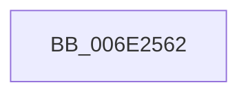

# sub_006E2562

- RVA: `0x006E2562`–`0x006E25E7` (길이 `133` bytes)
- VA: `0x00000001406E2562`
- 실행 섹션: `.text`
- PDB 이름 있음: `아니요`; PDB Function 태그: `아니요`
- unwind 정보 RVA: `0x00078C64`
- 디코드: `27`개 명령, `133/133` bytes 표시
- 미해석 바이트: `0` (있으면 어셈블리에 `.byte`로 보존)

> 이 문서는 커널 이미지의 기계어와 PDB 기호를 분석해 생성했습니다. 4번과 5번은 함수 원형과 자료형을 바이너리 사용 방식에서 추정한 C 해석이며 원본 소스 복구 결과는 아닙니다.

## 1. Dependencies

- 직접 호출 지점: **1**; 고유 호출 대상: **1**
- 직접 호출자로 확인된 함수: **0**
- RIP 상대 이미지 참조: **1**

### Outgoing calls
- `0x006E25DC` → [tlgWriteEx_EtwWriteEx](../4A/tlgWriteEx_EtwWriteEx_function_004AA348.md) (function, `0x004AA348`)

### Direct callers
- 이 함수 시작 RVA로 연결되는 직접 call은 확인되지 않았습니다. 간접 호출은 완전히 역산할 수 없습니다.

### Static image references
- `0x006E257A` → RVA `0x000582E2` (`.rdata`; read)

## 2. Other-region calls and transfers

- 다른 실행 섹션으로 향하는 call: **0**
- call이 아닌 외부 분기/꼬리 이동: **1**
  - `0x006E25E2` → [MiLogProcessWorkingSetsStop + 0x58](../34/MiLogProcessWorkingSetsStop_function_0034F60C.md) (`tail-transfer`)

## 3. Assembly (complete function range)

```asm
006E2562  0F B7 02                        movzx eax, word ptr [rdx]
006E2565  49 8B C8                        mov rcx, r8
006E2568  89 45 C7                        mov dword ptr [rbp - 0x39], eax
006E256B  48 8D 45 C7                     lea rax, [rbp - 0x39]
006E256F  48 89 45 07                     mov qword ptr [rbp + 7], rax
006E2573  48 8B 82 00 49 00 00            mov rax, qword ptr [rdx + 0x4900]
006E257A  48 8D 15 61 5D 97 FF            lea rdx, [rip - 0x68a29f]
006E2581  48 89 45 CF                     mov qword ptr [rbp - 0x31], rax
006E2585  48 8D 45 CF                     lea rax, [rbp - 0x31]
006E2589  48 89 45 17                     mov qword ptr [rbp + 0x17], rax
006E258D  48 8D 45 D7                     lea rax, [rbp - 0x29]
006E2591  48 89 45 27                     mov qword ptr [rbp + 0x27], rax
006E2595  48 8D 45 DF                     lea rax, [rbp - 0x21]
006E2599  48 89 45 37                     mov qword ptr [rbp + 0x37], rax
006E259D  48 8D 45 E7                     lea rax, [rbp - 0x19]
006E25A1  4C 89 4D D7                     mov qword ptr [rbp - 0x29], r9
006E25A5  41 B9 01 00 00 00               mov r9d, 1
006E25AB  48 89 44 24 38                  mov qword ptr [rsp + 0x38], rax
006E25B0  C7 44 24 30 06 00 00 00         mov dword ptr [rsp + 0x30], 6
006E25B8  48 C7 45 0F 04 00 00 00         mov qword ptr [rbp + 0xf], 4
006E25C0  48 C7 45 1F 08 00 00 00         mov qword ptr [rbp + 0x1f], 8
006E25C8  48 C7 45 2F 08 00 00 00         mov qword ptr [rbp + 0x2f], 8
006E25D0  4C 89 55 DF                     mov qword ptr [rbp - 0x21], r10
006E25D4  48 C7 45 3F 08 00 00 00         mov qword ptr [rbp + 0x3f], 8
006E25DC  E8 67 7D DC FF                  call 0x1404aa348
006E25E1  90                              nop
006E25E2  E9 7D D0 C6 FF                  jmp 0x14034f664
```

## 4. C-style interpretation (structured pseudocode)

```c
__int64 __fastcall sub_006E2562(__int64 a1, __int64 a2, __int64 a3, __int64 a4)
{
    __int64 result;
    unsigned int v_stack_p30;
    unsigned __int64 v_stack_p38;

    *(unsigned int *)(v_rbp - 57) = (unsigned int)(*(unsigned __int16 *)(a2));
    *(unsigned __int64 *)(v_rbp + 7) = v_rbp - 57;
    *(unsigned __int64 *)(v_rbp - 49) = *(unsigned __int64 *)(a2 + 18688);
    *(unsigned __int64 *)(v_rbp + 23) = v_rbp - 49;
    *(unsigned __int64 *)(v_rbp + 39) = v_rbp - 41;
    *(unsigned __int64 *)(v_rbp + 55) = v_rbp - 33;
    *(unsigned __int64 *)(v_rbp - 41) = a4;
    v_stack_p38 = v_rbp - 25;
    v_stack_p30 = 6;
    *(unsigned __int64 *)(v_rbp + 15) = 4;
    *(unsigned __int64 *)(v_rbp + 31) = 8;
    *(unsigned __int64 *)(v_rbp + 47) = 8;
    *(unsigned __int64 *)(v_rbp - 33) = v_r10;
    *(unsigned __int64 *)(v_rbp + 63) = 8;
    result = tlgWriteEx_EtwWriteEx(a3, v_rip - 6857375, a3, 1);
}
```

## 5. (Beta) C Style

```c
int64_t sub_006E2562(int64_t Arg1, void *Arg2, int64_t Arg3, int64_t Arg4)
{
    uint8_t *arg2 = (uint8_t *)Arg2;

    int64_t result;
    uint32_t v_stack_p30;
    uint64_t v_stack_p38;

    *(uint32_t *)(local_rbp - 0x39) = (uint32_t)(*(uint16_t *)(arg2));
    *(uint64_t *)(local_rbp + 0x7) = local_rbp - 57;
    *(uint64_t *)(local_rbp - 0x31) = *(uint64_t *)(arg2 + 0x4900);
    *(uint64_t *)(local_rbp + 0x17) = local_rbp - 49;
    *(uint64_t *)(local_rbp + 0x27) = local_rbp - 41;
    *(uint64_t *)(local_rbp + 0x37) = local_rbp - 33;
    *(uint64_t *)(local_rbp - 0x29) = Arg4;
    v_stack_p38 = local_rbp - 25;
    v_stack_p30 = 6;
    *(uint64_t *)(local_rbp + 0xF) = 4;
    *(uint64_t *)(local_rbp + 0x1F) = 8;
    *(uint64_t *)(local_rbp + 0x2F) = 8;
    *(uint64_t *)(local_rbp - 0x21) = local_r10;
    *(uint64_t *)(local_rbp + 0x3F) = 8;
    result = tlgWriteEx_EtwWriteEx(Arg3, v_rip - 6857375, Arg3, 1);
}
```

### 관측된 메모리 오프셋

구조체 형식이 확인되지 않은 접근은 인자 기준의 오프셋으로만 기록했습니다.

| 기준 인자 | 오프셋 표현 | 폭 (bit) | 접근 |
|---|---:|---:|---|
| `Arg2` | `+ 0x0` | `16` | `R` |
| `Arg2` | `+ 0x4900` | `64` | `R` |

## 6. Execution-region graph

[열기: 2D/3D 그래프와 함수 탐색 컨트롤 패널](../../../control-panel.html?section=text&rva=0x006E2562&view=graph)

- 2D 그래프는 위에서 아래로 흐르고, 3D 그래프는 빈 공간을 드래그해 회전합니다. Shift+드래그는 이동, 휠은 확대·축소, 함수 노드 선택은 대상 보고서 이동입니다.

### Static fallback


