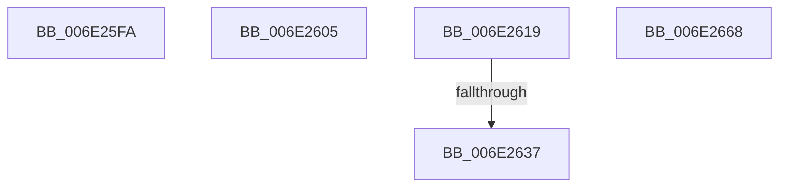

# sub_006E25FA

- RVA: `0x006E25FA`–`0x006E2698` (길이 `158` bytes)
- VA: `0x00000001406E25FA`
- 실행 섹션: `.text`
- PDB 이름 있음: `아니요`; PDB Function 태그: `아니요`
- unwind 정보 RVA: `0x00078E18`
- 디코드: `36`개 명령, `158/158` bytes 표시
- 미해석 바이트: `0` (있으면 어셈블리에 `.byte`로 보존)

> 이 문서는 커널 이미지의 기계어와 PDB 기호를 분석해 생성했습니다. 4번과 5번은 함수 원형과 자료형을 바이너리 사용 방식에서 추정한 C 해석이며 원본 소스 복구 결과는 아닙니다.

## 1. Dependencies

- 직접 호출 지점: **5**; 고유 호출 대상: **5**
- 직접 호출자로 확인된 함수: **0**
- RIP 상대 이미지 참조: **0**

### Outgoing calls
- `0x006E260D` → [ObfDereferenceObjectWithTag](../2F/ObfDereferenceObjectWithTag_function_002F78E0.md) (function, `0x002F78E0`)
- `0x006E2627` → [KiValidateCpuSetMasks](../30/KiValidateCpuSetMasks_function_00304238.md) (function, `0x00304238`)
- `0x006E2643` → [memset](../6C/memset_function_006C6C40.md) (function, `0x006C6C40`)
- `0x006E2654` → [memcpy](../6C/memcpy_function_006C6840.md) (function, `0x006C6840`)
- `0x006E266B` → [ExpRemoveCurrentThreadFromThreadHistory](../48/ExpRemoveCurrentThreadFromThreadHistory_function_00483154.md) (function, `0x00483154`)

### Direct callers
- 이 함수 시작 RVA로 연결되는 직접 call은 확인되지 않았습니다. 간접 호출은 완전히 역산할 수 없습니다.

### Static image references
- 디코드된 RIP-relative 메모리 참조가 없습니다.

## 2. Other-region calls and transfers

- 다른 실행 섹션으로 향하는 call: **0**
- call이 아닌 외부 분기/꼬리 이동: **5**
  - `0x006E2600` → [NtSetInformationWorkerFactory + 0x7D](../35/NtSetInformationWorkerFactory_function_00350A30.md) (`tail-transfer`)
  - `0x006E2614` → [NtSetInformationWorkerFactory + 0x30A](../35/NtSetInformationWorkerFactory_function_00350A30.md) (`tail-transfer`)
  - `0x006E2631` → [NtSetInformationWorkerFactory + 0x2DE](../35/NtSetInformationWorkerFactory_function_00350A30.md) (`tail-transfer`)
  - `0x006E2663` → [NtSetInformationWorkerFactory + 0x2DE](../35/NtSetInformationWorkerFactory_function_00350A30.md) (`tail-transfer`)
  - `0x006E2693` → [NtSetInformationWorkerFactory + 0x2DE](../35/NtSetInformationWorkerFactory_function_00350A30.md) (`tail-transfer`)

## 3. Assembly (complete function range)

```asm
006E25FA  41 B8 00 01 00 00               mov r8d, 0x100
006E2600  E9 A8 E4 C6 FF                  jmp 0x140350aad
006E2605  89 42 2C                        mov dword ptr [rdx + 0x2c], eax
006E2608  BA 44 66 6C 74                  mov edx, 0x746c6644
006E260D  E8 CE 52 C1 FF                  call 0x1402f78e0
006E2612  33 C0                           xor eax, eax
006E2614  E9 21 E7 C6 FF                  jmp 0x140350d3a
006E2619  8B 74 24 3C                     mov esi, dword ptr [rsp + 0x3c]
006E261D  8B D6                           mov edx, esi
006E261F  C1 EA 03                        shr edx, 3
006E2622  48 8D 4C 24 70                  lea rcx, [rsp + 0x70]
006E2627  E8 0C 1C C2 FF                  call 0x140304238
006E262C  44 8B F0                        mov r14d, eax
006E262F  85 C0                           test eax, eax
006E2631  0F 88 D7 E6 C6 FF               js 0x140350d0e
006E2637  33 D2                           xor edx, edx
006E2639  41 B8 00 01 00 00               mov r8d, 0x100
006E263F  48 8D 4F 78                     lea rcx, [rdi + 0x78]
006E2643  E8 F8 45 FE FF                  call 0x1406c6c40
006E2648  44 8B C6                        mov r8d, esi
006E264B  48 8D 54 24 70                  lea rdx, [rsp + 0x70]
006E2650  48 8D 4F 78                     lea rcx, [rdi + 0x78]
006E2654  E8 E7 41 FE FF                  call 0x1406c6840
006E2659  81 8F 98 01 00 00 00 40 00 00   or dword ptr [rdi + 0x198], 0x4000
006E2663  E9 A6 E6 C6 FF                  jmp 0x140350d0e
006E2668  48 8B CF                        mov rcx, rdi
006E266B  E8 E4 0A DA FF                  call 0x140483154
006E2670  8B 8F 80 01 00 00               mov ecx, dword ptr [rdi + 0x180]
006E2676  FF C9                           dec ecx
006E2678  89 8F 80 01 00 00               mov dword ptr [rdi + 0x180], ecx
006E267E  FF 8F 84 01 00 00               dec dword ptr [rdi + 0x184]
006E2684  45 0F B6 E4                     movzx r12d, r12b
006E2688  BA 01 00 00 00                  mov edx, 1
006E268D  85 C9                           test ecx, ecx
006E268F  44 0F 44 E2                     cmove r12d, edx
006E2693  E9 76 E6 C6 FF                  jmp 0x140350d0e
```

## 4. C-style interpretation (structured pseudocode)

```c
__int64 __fastcall sub_006E25FA(__int64 a1, __int64 a2)
{
    unsigned int v_stack_p3C;
    unsigned __int64 v_stack_p70;
}
```

## 5. (Beta) C Style

```c
int64_t sub_006E25FA(int64_t Arg1, int64_t Arg2)
{
    uint32_t v_stack_p3C;
    uint64_t v_stack_p70;
}
```

## 6. Execution-region graph

[열기: 2D/3D 그래프와 함수 탐색 컨트롤 패널](../../../control-panel.html?section=text&rva=0x006E25FA&view=graph)

- 2D 그래프는 위에서 아래로 흐르고, 3D 그래프는 빈 공간을 드래그해 회전합니다. Shift+드래그는 이동, 휠은 확대·축소, 함수 노드 선택은 대상 보고서 이동입니다.

### Static fallback


