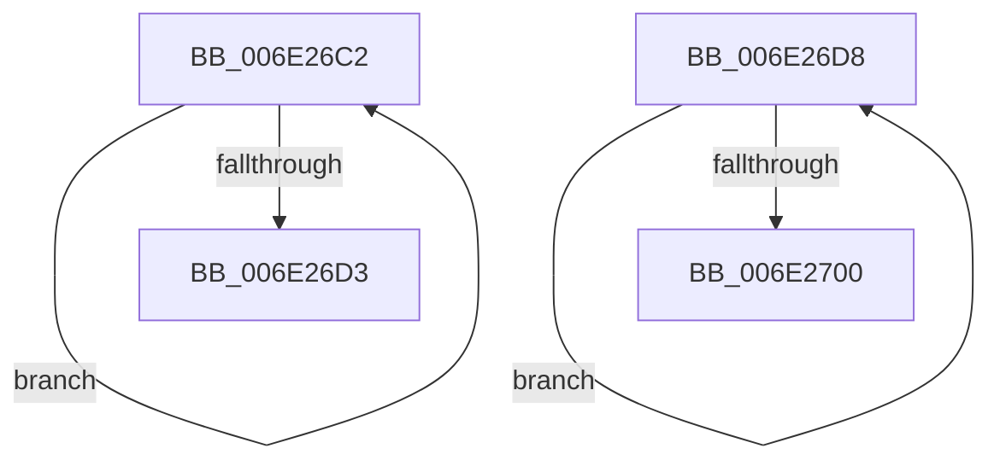

# sub_006E26C2

- RVA: `0x006E26C2`–`0x006E2712` (길이 `80` bytes)
- VA: `0x00000001406E26C2`
- 실행 섹션: `.text`
- PDB 이름 있음: `아니요`; PDB Function 태그: `아니요`
- unwind 정보 RVA: `0x000790D4`
- 디코드: `22`개 명령, `80/80` bytes 표시
- 미해석 바이트: `0` (있으면 어셈블리에 `.byte`로 보존)

> 이 문서는 커널 이미지의 기계어와 PDB 기호를 분석해 생성했습니다. 4번과 5번은 함수 원형과 자료형을 바이너리 사용 방식에서 추정한 C 해석이며 원본 소스 복구 결과는 아닙니다.

## 1. Dependencies

- 직접 호출 지점: **3**; 고유 호출 대상: **3**
- 직접 호출자로 확인된 함수: **0**
- RIP 상대 이미지 참조: **0**

### Outgoing calls
- `0x006E26C6` → [KeYieldProcessorEx](../3F/KeYieldProcessorEx_function_003FBD00.md) (function, `0x003FBD00`)
- `0x006E26F2` → [KiCompleteRescheduleContextEntry](../35/KiCompleteRescheduleContextEntry_function_00356330.md) (function, `0x00356330`)
- `0x006E2707` → [KiFlushSoftwareInterruptBatch](../25/KiFlushSoftwareInterruptBatch_function_00252200.md) (function, `0x00252200`)

### Direct callers
- 이 함수 시작 RVA로 연결되는 직접 call은 확인되지 않았습니다. 간접 호출은 완전히 역산할 수 없습니다.

### Static image references
- 디코드된 RIP-relative 메모리 참조가 없습니다.

## 2. Other-region calls and transfers

- 다른 실행 섹션으로 향하는 call: **0**
- call이 아닌 외부 분기/꼬리 이동: **2**
  - `0x006E26D3` → [KiParkCurrentProcessor + 0x2FA](../35/KiParkCurrentProcessor_function_003533A4.md) (`tail-transfer`)
  - `0x006E270D` → [KiParkCurrentProcessor + 0x137](../35/KiParkCurrentProcessor_function_003533A4.md) (`tail-transfer`)

## 3. Assembly (complete function range)

```asm
006E26C2  48 8D 4D 38                     lea rcx, [rbp + 0x38]
006E26C6  E8 35 96 D1 FF                  call 0x1403fbd00
006E26CB  48 8B 07                        mov rax, qword ptr [rdi]
006E26CE  48 85 C0                        test rax, rax
006E26D1  75 EF                           jne 0x1406e26c2
006E26D3  E9 C6 0F C7 FF                  jmp 0x14035369e
006E26D8  8B C7                           mov eax, edi
006E26DA  45 33 C9                        xor r9d, r9d
006E26DD  45 33 C0                        xor r8d, r8d
006E26E0  48 8B D3                        mov rdx, rbx
006E26E3  48 8D 0C 85 02 00 00 00         lea rcx, [rax*4 + 2]
006E26EB  48 03 C8                        add rcx, rax
006E26EE  48 8D 0C CE                     lea rcx, [rsi + rcx*8]
006E26F2  E8 39 3C C7 FF                  call 0x140356330
006E26F7  0F B6 06                        movzx eax, byte ptr [rsi]
006E26FA  FF C7                           inc edi
006E26FC  3B F8                           cmp edi, eax
006E26FE  72 D8                           jb 0x1406e26d8
006E2700  48 8D 8B D8 35 00 00            lea rcx, [rbx + 0x35d8]
006E2707  E8 F4 FA B6 FF                  call 0x140252200
006E270C  90                              nop
006E270D  E9 C9 0D C7 FF                  jmp 0x1403534db
```

## 4. C-style interpretation (structured pseudocode)

```c
__int64 __fastcall sub_006E26C2(__int64 a1, __int64 a2, int a3, int a4)
{
    __int64 result;

    result = KeYieldProcessorEx(v_rbp + 56, a2, a3, a4);
    if (*(unsigned __int64 *)(v_rdi) != 0) goto loc_006E26C2;
}
```

## 5. (Beta) C Style

```c
int64_t sub_006E26C2(int64_t Arg1, int64_t Arg2, int32_t Arg3, int32_t Arg4)
{
    int64_t result;

    result = KeYieldProcessorEx(local_rbp + 56, Arg2, Arg3, Arg4);
    if (*(uint64_t *)(local_rdi) != 0) goto loc_006E26C2;
}
```

## 6. Execution-region graph

[열기: 2D/3D 그래프와 함수 탐색 컨트롤 패널](../../../control-panel.html?section=text&rva=0x006E26C2&view=graph)

- 2D 그래프는 위에서 아래로 흐르고, 3D 그래프는 빈 공간을 드래그해 회전합니다. Shift+드래그는 이동, 휠은 확대·축소, 함수 노드 선택은 대상 보고서 이동입니다.

### Static fallback


