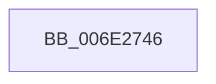

# sub_006E2746

- RVA: `0x006E2746`–`0x006E27A3` (길이 `93` bytes)
- VA: `0x00000001406E2746`
- 실행 섹션: `.text`
- PDB 이름 있음: `아니요`; PDB Function 태그: `아니요`
- unwind 정보 RVA: `0x0007921C`
- 디코드: `18`개 명령, `93/93` bytes 표시
- 미해석 바이트: `0` (있으면 어셈블리에 `.byte`로 보존)

> 이 문서는 커널 이미지의 기계어와 PDB 기호를 분석해 생성했습니다. 4번과 5번은 함수 원형과 자료형을 바이너리 사용 방식에서 추정한 C 해석이며 원본 소스 복구 결과는 아닙니다.

## 1. Dependencies

- 직접 호출 지점: **1**; 고유 호출 대상: **1**
- 직접 호출자로 확인된 함수: **0**
- RIP 상대 이미지 참조: **1**

### Outgoing calls
- `0x006E2796` → [DbgPrintEx](../35/DbgPrintEx_function_00359290.md) (function, `0x00359290`)

### Direct callers
- 이 함수 시작 RVA로 연결되는 직접 call은 확인되지 않았습니다. 간접 호출은 완전히 역산할 수 없습니다.

### Static image references
- `0x006E274F` → RVA `0x006C9090` (` ?? ::FNODOBFM::`string'`; read)

## 2. Other-region calls and transfers

- 다른 실행 섹션으로 향하는 call: **0**
- call이 아닌 외부 분기/꼬리 이동: **1**
  - `0x006E279E` → [CcWriteBehindAsync + 0x14D](../35/CcWriteBehindAsync_function_003549E8.md) (`tail-transfer`)

## 3. Assembly (complete function range)

```asm
006E2746  65 4C 8B 14 25 88 01 00 00      mov r10, qword ptr gs:[0x188]
006E274F  4C 8D 05 3A 69 FE FF            lea r8, [rip - 0x196c6]
006E2756  48 8B 8F 90 00 00 00            mov rcx, qword ptr [rdi + 0x90]
006E275D  8B D0                           mov edx, eax
006E275F  65 4C 8B 0C 25 88 01 00 00      mov r9, qword ptr gs:[0x188]
006E2768  8B 41 18                        mov eax, dword ptr [rcx + 0x18]
006E276B  45 8B 89 08 05 00 00            mov r9d, dword ptr [r9 + 0x508]
006E2772  89 44 24 40                     mov dword ptr [rsp + 0x40], eax
006E2776  41 8B 82 10 05 00 00            mov eax, dword ptr [r10 + 0x510]
006E277D  48 89 4C 24 38                  mov qword ptr [rsp + 0x38], rcx
006E2782  89 54 24 30                     mov dword ptr [rsp + 0x30], edx
006E2786  BA 03 00 00 00                  mov edx, 3
006E278B  89 5C 24 28                     mov dword ptr [rsp + 0x28], ebx
006E278F  89 44 24 20                     mov dword ptr [rsp + 0x20], eax
006E2793  8D 4A 7C                        lea ecx, [rdx + 0x7c]
006E2796  E8 F5 6A C7 FF                  call 0x140359290
006E279B  8A 45 D9                        mov al, byte ptr [rbp - 0x27]
006E279E  E9 92 23 C7 FF                  jmp 0x140354b35
```

## 4. C-style interpretation (structured pseudocode)

```c
__int64 __fastcall sub_006E2746(void)
{
    __int64 result;
    unsigned int v_stack_p20;
    unsigned int v_stack_p28;
    unsigned int v_stack_p30;
    unsigned __int64 v_stack_p38;
    unsigned int v_stack_p40;

    v_stack_p40 = (unsigned int)((unsigned int)(*(unsigned int *)(*(unsigned __int64 *)(v_rdi + 144) + 24)));
    v_stack_p38 = *(unsigned __int64 *)(v_rdi + 144);
    v_stack_p30 = (unsigned int)((unsigned int)((unsigned int)(result)));
    v_stack_p28 = (unsigned int)(v_rbx);
    v_stack_p20 = (unsigned int)((unsigned int)(*(unsigned int *)(*(unsigned __int64 *)(gs_base + (0 + 392)) + 1296)));
    result = DbgPrintEx(3 + 124, 3, v_rip - 104134, (unsigned int)(*(unsigned int *)(*(unsigned __int64 *)(gs_base + (0 + 392)) + 1288)));
}
```

## 5. (Beta) C Style

```c
void sub_006E2746(void)
{
    int64_t result;
    uint32_t v_stack_p20;
    uint32_t v_stack_p28;
    uint32_t v_stack_p30;
    uint64_t v_stack_p38;
    uint32_t v_stack_p40;

    v_stack_p40 = (uint32_t)((uint32_t)(*(uint32_t *)(*(uint64_t *)(local_rdi + 0x90) + 0x18)));
    v_stack_p38 = *(uint64_t *)(local_rdi + 0x90);
    v_stack_p30 = (uint32_t)((uint32_t)((uint32_t)(result)));
    v_stack_p28 = (uint32_t)(local_rbx);
    v_stack_p20 = (uint32_t)((uint32_t)(*(uint32_t *)(*(uint64_t *)(gs_base + (0 + 0x188)) + 0x510)));
    result = DbgPrintEx(3 + 124, 3, v_rip - 104134, (uint32_t)(*(uint32_t *)(*(uint64_t *)(gs_base + (0 + 0x188)) + 0x508)));
}
```

## 6. Execution-region graph

[열기: 2D/3D 그래프와 함수 탐색 컨트롤 패널](../../../control-panel.html?section=text&rva=0x006E2746&view=graph)

- 2D 그래프는 위에서 아래로 흐르고, 3D 그래프는 빈 공간을 드래그해 회전합니다. Shift+드래그는 이동, 휠은 확대·축소, 함수 노드 선택은 대상 보고서 이동입니다.

### Static fallback


