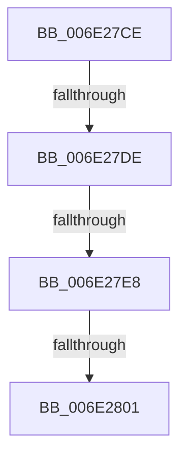

# sub_006E27CE

- RVA: `0x006E27CE`–`0x006E2870` (길이 `162` bytes)
- VA: `0x00000001406E27CE`
- 실행 섹션: `.text`
- PDB 이름 있음: `아니요`; PDB Function 태그: `아니요`
- unwind 정보 RVA: `0x00079290`
- 디코드: `34`개 명령, `162/162` bytes 표시
- 미해석 바이트: `0` (있으면 어셈블리에 `.byte`로 보존)

> 이 문서는 커널 이미지의 기계어와 PDB 기호를 분석해 생성했습니다. 4번과 5번은 함수 원형과 자료형을 바이너리 사용 방식에서 추정한 C 해석이며 원본 소스 복구 결과는 아닙니다.

## 1. Dependencies

- 직접 호출 지점: **3**; 고유 호출 대상: **3**
- 직접 호출자로 확인된 함수: **0**
- RIP 상대 이미지 참조: **2**

### Outgoing calls
- `0x006E27F4` → [tlgKeywordOn](../42/tlgKeywordOn_function_0042EAA0.md) (function, `0x0042EAA0`)
- `0x006E280C` → [tlgCreate1Sz_char](../42/tlgCreate1Sz_char_function_00427304.md) (function, `0x00427304`)
- `0x006E2865` → [tlgWriteEx_EtwWriteEx](../4A/tlgWriteEx_EtwWriteEx_function_004AA348.md) (function, `0x004AA348`)

### Direct callers
- 이 함수 시작 RVA로 연결되는 직접 call은 확인되지 않았습니다. 간접 호출은 완전히 역산할 수 없습니다.

### Static image references
- `0x006E27CE` → RVA `0x00E37618` (`.data`; read)
- `0x006E2828` → RVA `0x00057A75` (`.rdata`; read)

## 2. Other-region calls and transfers

- 다른 실행 섹션으로 향하는 call: **0**
- call이 아닌 외부 분기/꼬리 이동: **4**
  - `0x006E27D8` → [MmNotifyProcessInSwapTrigger + 0x32](../35/MmNotifyProcessInSwapTrigger_function_00354FAC.md) (`tail-transfer`)
  - `0x006E27E2` → [MmNotifyProcessInSwapTrigger + 0x32](../35/MmNotifyProcessInSwapTrigger_function_00354FAC.md) (`tail-transfer`)
  - `0x006E27FB` → [MmNotifyProcessInSwapTrigger + 0x32](../35/MmNotifyProcessInSwapTrigger_function_00354FAC.md) (`tail-transfer`)
  - `0x006E286B` → [MmNotifyProcessInSwapTrigger + 0x32](../35/MmNotifyProcessInSwapTrigger_function_00354FAC.md) (`tail-transfer`)

## 3. Assembly (complete function range)

```asm
006E27CE  4C 8B 05 43 4E 75 00            mov r8, qword ptr [rip + 0x754e43]
006E27D5  4D 85 C0                        test r8, r8
006E27D8  0F 84 00 28 C7 FF               je 0x140354fde
006E27DE  41 83 38 05                     cmp dword ptr [r8], 5
006E27E2  0F 86 F6 27 C7 FF               jbe 0x140354fde
006E27E8  41 BA 08 00 00 00               mov r10d, 8
006E27EE  49 8B C8                        mov rcx, r8
006E27F1  41 8B D2                        mov edx, r10d
006E27F4  E8 A7 C2 D4 FF                  call 0x14042eaa0
006E27F9  84 C0                           test al, al
006E27FB  0F 84 DD 27 C7 FF               je 0x140354fde
006E2801  49 8D 91 38 03 00 00            lea rdx, [r9 + 0x338]
006E2808  48 8D 4D 17                     lea rcx, [rbp + 0x17]
006E280C  E8 F3 4A D4 FF                  call 0x140427304
006E2811  41 8B 89 D0 01 00 00            mov ecx, dword ptr [r9 + 0x1d0]
006E2818  48 8D 45 E7                     lea rax, [rbp - 0x19]
006E281C  83 65 33 00                     and dword ptr [rbp + 0x33], 0
006E2820  45 8D 4A F9                     lea r9d, [r10 - 7]
006E2824  83 65 43 00                     and dword ptr [rbp + 0x43], 0
006E2828  48 8D 15 46 52 97 FF            lea rdx, [rip - 0x68adba]
006E282F  48 89 45 27                     mov qword ptr [rbp + 0x27], rax
006E2833  48 8D 45 EF                     lea rax, [rbp - 0x11]
006E2837  48 89 45 37                     mov qword ptr [rbp + 0x37], rax
006E283B  48 8D 45 F7                     lea rax, [rbp - 9]
006E283F  89 4D E7                        mov dword ptr [rbp - 0x19], ecx
006E2842  49 8B C8                        mov rcx, r8
006E2845  48 89 44 24 38                  mov qword ptr [rsp + 0x38], rax
006E284A  C7 44 24 30 05 00 00 00         mov dword ptr [rsp + 0x30], 5
006E2852  C7 45 2F 04 00 00 00            mov dword ptr [rbp + 0x2f], 4
006E2859  48 C7 45 EF 00 00 00 01         mov qword ptr [rbp - 0x11], 0x1000000
006E2861  44 89 55 3F                     mov dword ptr [rbp + 0x3f], r10d
006E2865  E8 DE 7A DC FF                  call 0x1404aa348
006E286A  90                              nop
006E286B  E9 6E 27 C7 FF                  jmp 0x140354fde
```

## 4. C-style interpretation (structured pseudocode)

```c
__int64 __fastcall sub_006E27CE(__int64 a1, __int64 a2, __int64 a3, __int64 a4)
{
    __int64 result;
    unsigned int v_stack_p30;
    unsigned __int64 v_stack_p38;

    result = tlgKeywordOn(*(unsigned __int64 *)(v_rip + 7687747), 8, *(unsigned __int64 *)(v_rip + 7687747), a4);
    result = tlgCreate1Sz_char(v_rbp + 23, a4 + 824, *(unsigned __int64 *)(v_rip + 7687747), a4);
    *(unsigned __int64 *)(v_rbp + 39) = v_rbp - 25;
    *(unsigned __int64 *)(v_rbp + 55) = v_rbp - 17;
    *(unsigned int *)(v_rbp - 25) = (unsigned int)((unsigned int)(*(unsigned int *)(a4 + 464)));
    v_stack_p38 = v_rbp - 9;
    v_stack_p30 = 5;
    *(unsigned int *)(v_rbp + 47) = 4;
    *(unsigned __int64 *)(v_rbp - 17) = 0x1000000ULL;
    *(unsigned int *)(v_rbp + 63) = 8;
    result = tlgWriteEx_EtwWriteEx(*(unsigned __int64 *)(v_rip + 7687747), v_rip - 6860218, *(unsigned __int64 *)(v_rip + 7687747), 8 - 7);
}
```

## 5. (Beta) C Style

```c
int64_t sub_006E27CE(int64_t Arg1, int64_t Arg2, int64_t Arg3, int64_t Arg4)
{
    int64_t result;
    uint32_t v_stack_p30;
    uint64_t v_stack_p38;

    result = tlgKeywordOn(*(uint64_t *)(v_rip + 0x754E43), 8, *(uint64_t *)(v_rip + 0x754E43), Arg4);
    result = tlgCreate1Sz_char(local_rbp + 23, Arg4 + 824, *(uint64_t *)(v_rip + 0x754E43), Arg4);
    *(uint64_t *)(local_rbp + 0x27) = local_rbp - 25;
    *(uint64_t *)(local_rbp + 0x37) = local_rbp - 17;
    *(uint32_t *)(local_rbp - 0x19) = (uint32_t)((uint32_t)(*(uint32_t *)(Arg4 + 0x1D0)));
    v_stack_p38 = local_rbp - 9;
    v_stack_p30 = 5;
    *(uint32_t *)(local_rbp + 0x2F) = 4;
    *(uint64_t *)(local_rbp - 0x11) = 0x1000000ULL;
    *(uint32_t *)(local_rbp + 0x3F) = 8;
    result = tlgWriteEx_EtwWriteEx(*(uint64_t *)(v_rip + 0x754E43), v_rip - 6860218, *(uint64_t *)(v_rip + 0x754E43), 8 - 7);
}
```

## 6. Execution-region graph

[열기: 2D/3D 그래프와 함수 탐색 컨트롤 패널](../../../control-panel.html?section=text&rva=0x006E27CE&view=graph)

- 2D 그래프는 위에서 아래로 흐르고, 3D 그래프는 빈 공간을 드래그해 회전합니다. Shift+드래그는 이동, 휠은 확대·축소, 함수 노드 선택은 대상 보고서 이동입니다.

### Static fallback


